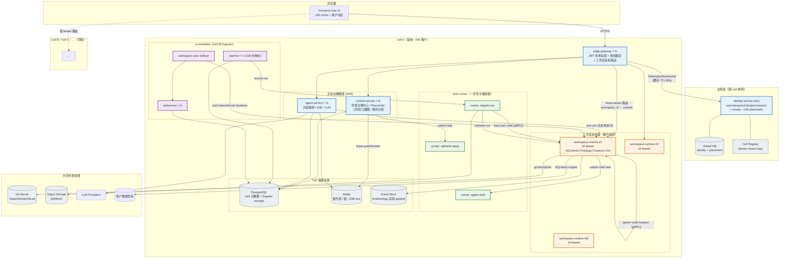

# 02 · 目标架构（DataCode 2.0）

---

## 1. 切分准则

重构的唯一准则：**服务边界 = 状态性质边界 = 伸缩维度边界 = 隔离边界**。

三者不重合就会出现当前的病症（声明无状态却持有内存态、三服务共享可变目录）。

### 1.1 四象限分类

```
                     状态在哪里？
             ┌──────────────────────┬──────────────────────┐
             │  外部（DB/Redis）     │  本地（内存/磁盘）     │
    ┌────────┼──────────────────────┼──────────────────────┤
    │ 长生命 │  ① 无状态服务         │  ② 亲和服务           │
    │  周期  │  任意副本服务任意请求  │  绑定一个工作区       │
    │        │  → 纯 HPA            │  → 租约 + 一致性路由   │
    │        │                      │                      │
    │        │  edge-gateway        │  workspace-runtime    │
    │        │  identity-service    │                      │
    │        │  control-service     │                      │
    │        │  agent-service       │                      │
    ├────────┼──────────────────────┼──────────────────────┤
    │  短生命│  ④ （不适用）         │  ③ 一次性执行体       │
    │  周期  │                      │  生命周期 = 一次任务   │
    │        │                      │  → 按需拉起，跑完销毁  │
    │        │                      │                      │
    │        │                      │  task-runner          │
    └────────┴──────────────────────┴──────────────────────┘

    ⑤ 单例控制面（外部框架硬约束）：orchestrator（Dagster daemon/webserver）
```

### 1.2 三条硬规则

| # | 规则 | 违反的后果（当前实例） |
|---|------|---------------------|
| **R1** | **一个工作副本（working copy）在任一时刻只被一个进程挂载并写入。** | 当前 3 个服务共享 PV → 无法沙箱化、需要分布式锁、git 在 NFS 上塌陷 |
| **R2** | **一个服务只有一个伸缩维度。** | 当前 sqlmesh-service 同时按 DB QPS、Context 内存、Git IO 三个维度受限 |
| **R3** | **用户代码永远不在平台进程空间内执行。** | 当前 `shell.py` 与 dagster code location 都在平台进程里跑用户代码 |

---

## 2. 目标服务清单

### 2.1 服务矩阵

| 服务 | 语言 | 类别 | 伸缩维度 | 副本策略 | 承接现有代码 |
|------|------|------|---------|---------|------------|
| **edge-gateway** | Go | ① 无状态 | HTTP QPS | HPA 3-30 | `gateway/` 的 router/proxy/middleware |
| **identity-service** | Go | ① 无状态 | 认证 QPS | HPA 2-10 | `gateway/internal/{auth,rbac}` 拆出 |
| **control-service** | Python | ① 无状态 | DB QPS | HPA 3-20 | `sqlmesh-service/src/{environments,workspace/{models,repository,manager}}` |
| **agent-service** | Python | ① 无状态 | 并发对话 / LLM 配额 | HPA 3-30 | `agent-service/` 保留（去掉本地 shell 执行） |
| **workspace-runtime** | Python | ② 亲和 | 活跃工作副本数 | 按租约扩，每实例 N 个租约 | `sqlmesh-service/src/{core,workspace/{git_ops,file_ops},logs}` + `ontology-service/` 全部 + `dagster-service/src/core/code_location_manager` |
| **orchestrator** | Dagster OSS | ⑤ 单例控制面 | 每 Cell 一套 | daemon×1 + webserver×N per Cell | `dagster-control-plane/` 成为其 sidecar |
| **task-runner** | Python | ③ 一次性 | 任务数 | 按需 Job/Pod | 新增（承接 plan/apply/run/shell 的实际执行） |

**服务实体数：6 → 4 个长驻业务服务 + 1 个控制面 + 1 类一次性执行体。**

### 2.2 各服务职责

#### edge-gateway（Go，无状态）

**唯一职责：边缘。** 不含任何业务逻辑、不含任何表。

| 能力 | 说明 |
|------|------|
| TLS 终止、CORS、请求日志、trace_id 生成 | 继承现状 |
| JWT 验签 | **本地验签**（公钥/共享密钥），不调 identity-service（热路径不能有网络跳） |
| 身份头注入与清洗 | 继承 `middleware/sanitize_identity.go`：覆写客户端传入的身份字段 |
| **授权决策** | 调 identity-service 拉取 `(user, tenant) → permissions` 后**本地缓存**（继承 `rbac/cache.go`），路由→权限映射表继承 `rbac/routemap.go` |
| **工作区亲和路由** ⭐ | **新增**：对带 `workspace_path` / `workspace_id` 的请求，查询工作区租约表（Redis），路由到持有租约的 workspace-runtime 实例；无租约则触发租约申请 |
| 登录限流 | 继承 `auth/ratelimit_redis.go` |
| SSE / WebSocket 透传 | 继承 |

去掉的：所有 `CREATE TABLE`、所有身份/RBAC 持久化、`workspace.go` / `sqlmesh.go` / `agent.go` 里的身份注入特例（改为统一 header 注入）。

#### identity-service（Go，无状态）

**唯一职责：身份与授权的真源。**

| 能力 | 端点 |
|------|------|
| 注册/登录/选租户/刷新/登出/改密 | `/auth/*` |
| 租户与成员 | `/tenants/*`、`/tenants/{id}/members` |
| 工作区成员绑定 | `/workspaces/{id}/members` |
| 权限目录与角色 | `/rbac/permissions`、`/rbac/roles` |
| **授权查询（内部）** | `/internal/authz/resolve?user&tenant` → 权限集合 + Cell 归属 |
| **租户 → Cell 映射（内部）** | `/internal/tenants/{id}/placement` |

拥有的表：`users` `tenants` `tenant_members` `refresh_tokens` `permissions` `roles` `role_permissions` `workspace_members` `rbac_audit_log`（全部从 gateway 迁出，改为**受管迁移**而非 `CREATE TABLE IF NOT EXISTS`）。

**为什么拆出而不是留在 gateway**：① 身份表是全局的（跨 Cell），而 gateway 是每 Cell 部署的边缘；② Python 侧服务需要权威地做**非 HTTP 入口**的授权（schedule 触发、reconciler），必须有一个可调用的授权 API；③ gateway 要能被替换成任意 Ingress/Envoy 而不丢身份能力。

#### control-service（Python，无状态）

**唯一职责：平台元数据与生命周期编排。只碰 DB，绝不碰工作区文件系统。**

| 能力 | 承接自 |
|------|--------|
| 工作区注册表 CRUD | `workspace/{models,repository}.py` |
| **环境注册中心 + 状态机** | `environments/{registry,repository,models}.py` |
| **Reconciler 四方对账** | `environments/reconciler.py` |
| 环境准入控制 | `environments/guard.py` |
| 沙箱 TTL 回收 | `environments/reaper.py` |
| Git 凭证管理（加密存储） | `workspace/git_credentials.py` |
| Plan/Apply 历史 | `workspace/models.py` 的 `plan_apply_history` |
| 知识库文档元数据 | `knowledge_documents` |
| **命名代数** | `environments/naming.py`（成为 shared 库，多服务共用） |
| **工作区租约管理** ⭐ | 新增：分配/续期/回收 `workspace → runtime 实例` 租约 |
| **任务提交** ⭐ | 新增：把 plan/apply/run 等重活提交给 task-runner，返回 task_id |

**关键变化**：control-service **不再执行** SQLMesh 操作、不再跑 git 命令、不再读写工作区文件。它只写 DB + 下发指令。因此它是真正的无状态服务，可以纯 HPA。

原 `environments/{git_binder,sqlmesh_binder,deployment_binder}.py` 三个 binder 从"直接操作"变为"向 workspace-runtime 下发指令"——保留其状态机语义与幂等约定，只换执行通道。

#### agent-service（Python，无状态）

**职责不变，但剥离本地执行。**

保留：Agent 编排、ACP 协议、triage/handoff、SSE 流、记忆、goal loop、审批分级、tool registry。

**剥离**：所有直接碰文件系统与执行子进程的工具（`shell.py`、`read_file.py`、`create_file.py`、`apply_patch.py`、`list_dir.py`、`search_code.py`）改为**通过 workspace-runtime 的工具 API 执行**。

理由（R3）：agent-service 必须能纯 HPA。一旦它在自己进程里跑用户 shell，它就成了亲和服务且无法沙箱化。工具调用变成一次 HTTP：

```
agent-service ──POST /rt/v1/tools/shell {workspace_path, cmd}──▶ workspace-runtime
                                                                    │
                                                          在沙箱内执行（§04）
```

审批分级（`command_approval.py` L1-L6）仍在 agent-service（它是对话语义的一部分），沙箱执行策略在 runtime（它是隔离的一部分）——**双层防御，职责不重叠**。

#### workspace-runtime（Python，工作区亲和）⭐ 核心新服务

**唯一职责：一个工作副本内的一切。** 它是 R1 的执行者：**工作副本的唯一所有者**。

| 能力域 | 承接自 | 说明 |
|--------|--------|------|
| **Git 工作副本** | `workspace/git_ops.py`（2164 行）、`git_merge.py` | worktree 物化/status/diff/commit/push/pull/merge |
| **文件 IO** | `workspace/file_ops.py`、`layout.py` | 读写/列目录/重命名 |
| **SQLMesh Context** | `core/context_pool.py` 及全部 `core/*_service.py` | plan/apply/render/lineage/models/schema/query/format |
| **语义层** | `ontology-service/` 全部（2,733 行） | 读 `{ws}/ontology/*.yaml` + 交叉引用校验（**变成本地函数调用，HTTP 环路消失**） |
| **Dagster code location** | `dagster-service/src/core/code_location_manager.py` + `deployment_manager.py` | 按需拉起 gRPC 子进程加载 `asset-dag/` |
| **知识库文件** | `api/rest/knowledge.py` 的文件侧 | 元数据在 control，文件在 runtime |
| **工作区日志** | `logs/reader.py`、`WorkspaceLogSink` | tail + SSE |
| **Agent 工具执行** ⭐ | 新增，承接 agent-service 剥离的工具 | shell/read/write/patch/search，全部在沙箱内 |
| **错误归档** | `utils/error_archive.py` | 写 `{ws}/errors/` |

**为什么把这四个东西（SQLMesh / Ontology / Dagster code location / Git）合并**：

它们**共享同一份不可分割的状态**——一个工作副本的文件树 + 从它派生的内存索引：

```
一次 "plan dev_alice" 的真实数据依赖：
  sql-warehouse/models/*.sql    → SQLMesh Context（内存 AST）
  sql-warehouse/config.yaml     → gateway 连接配置
  ontology/*.yaml               → 语义层引用校验（要查 SQLMesh 模型列是否存在）
  asset-dag/definitions.py      → Dagster asset 依赖 SQLMesh 模型
  .git                          → 当前 checkout 的 revision 决定以上全部
```

把它们放在三个进程里，就必须：共享可变 PV（R1 违反）+ 3 条 HTTP 环路 + 跨进程缓存一致性（当前 `dirty` 标志的失效问题）。放在一个进程里，全部退化为**本地函数调用 + 进程内锁**。

**内存与生命周期**：一个 runtime 实例持有 N 个工作副本租约（N 可配，如 16）。每个租约对应：1 个 worktree（`materialize.root` 下）+ 1 个 SQLMesh Context（内存）+ 0-1 个 code location 子进程（按需）+ 1 个 ontology registry（内存）。租约空闲超时后整体回收（Context 释放、子进程 kill、worktree 可保留或删除）。

#### orchestrator（Dagster OSS，每 Cell 一套）

保持官方形态，**每 Cell 一套**（这是解决 daemon 单点的唯一途径）：

- `dagster-webserver` × N（无状态 + LB）
- `dagster-daemon` × 1 **per Cell**（官方硬约束，Cell 内单点，Cell 间独立）
- `QueuedRunCoordinator` + `tag_concurrency_limits`（按 `datacode/tenant_id` 限流）
- `workspace-sync` sidecar：继承 `dagster-control-plane/`，从本 Cell 的 workspace-runtime 实例拉取 code location 并渲染 workspace.yaml

`dagster-control-plane` 不再是独立代码库，而是 orchestrator 部署单元里的一个 sidecar 组件（689 行的它本来就不该是独立 repo）。

#### task-runner（Python，一次性）⭐ 新增

**唯一职责：执行一个有界任务，然后消失。**

承接所有「可能跑很久、可能吃很多资源、可能执行用户代码」的工作：

| 任务类型 | 触发方 | 沙箱级别 |
|---------|--------|---------|
| `sqlmesh.plan` / `sqlmesh.apply` | control-service | L2（用户 SQL，无任意代码） |
| `dagster.run`（asset materialization） | orchestrator RunLauncher | **L3**（import 用户 Python） |
| `agent.shell` | workspace-runtime 转发 | **L3**（任意命令） |
| `git.clone` / `git.push`（大仓库） | workspace-runtime | L2 |

**为什么不让 workspace-runtime 直接跑**：runtime 持有 N 个租约的内存态，一个 OOM 会带走 N 个用户的会话。task-runner 是每任务一容器，故障域 = 一个任务。

**与 workspace-runtime 的关系**：task-runner 挂载 runtime 的 worktree 目录（同 Pod 内 emptyDir 共享 / 或 runtime 通过 API 提供文件视图）。详见 §04.3。

---

## 3. 架构总览



---

## 4. 服务间调用关系（环路已消除）

### 4.1 依赖方向

```
edge-gateway ──▶ identity-service      （授权解析，带缓存）
edge-gateway ──▶ control-service       （元数据 CRUD）
edge-gateway ──▶ agent-service         （对话 / SSE）
edge-gateway ──▶ workspace-runtime     （工作区操作，lease-aware 路由）

agent-service ──▶ workspace-runtime    （工具执行）
agent-service ──▶ control-service      （读环境列表 / 提交 plan）

control-service ──▶ workspace-runtime  （下发 binder 指令：git/sqlmesh/deployment）
control-service ──▶ task-runner        （提交长任务）

workspace-runtime ──▶ task-runner      （提交 shell / 重任务）
workspace-runtime ◀── orchestrator     （sync 拉 code location；runner 加载用户代码）
```

**关键：这是一个 DAG，无环。**

对比现状消除的环路：

| 现状环路 | 2.0 如何消除 |
|---------|-------------|
| `sqlmesh-service ⇄ dagster-service` | 两者的工作区侧代码合并进 workspace-runtime → 变成**进程内调用** |
| `ontology-service → sqlmesh-service` | ontology 全部并入 workspace-runtime → 变成**函数调用** |
| `agent-service → sqlmesh-service`（工具） | 变成 `agent → workspace-runtime` 单向 |

### 4.2 谁拥有什么

| 关注点 | 拥有者 | 其他服务如何访问 |
|--------|--------|----------------|
| 用户 / 租户 / 角色 / 权限 | identity-service | `/internal/authz/*`（gateway 缓存） |
| 工作区注册表 / 环境注册表 | control-service | REST |
| 工作副本文件系统 | **workspace-runtime（独占）** | 只能经 runtime API |
| SQLMesh Context | **workspace-runtime（独占）** | 只能经 runtime API |
| Dagster run / event / schedule | orchestrator（Dagster storage） | GraphQL |
| 会话 / 消息 / 记忆 | agent-service | REST |
| 租户 → Cell 映射 | identity-service（全局） | placement API |
| 工作区 → runtime 租约 | control-service（写）+ Redis（读） | gateway 直读 Redis 做路由 |

---

## 5. 前后对照

### 5.1 服务映射

| 2.0 服务 | 来源 | 迁移动作 |
|---------|------|---------|
| edge-gateway | `gateway/` 减去 auth/rbac 存储 | **瘦身** + 新增 lease-aware 路由 |
| identity-service | `gateway/internal/{auth,rbac}` | **拆出**为独立 Go 服务 + 受管迁移 |
| control-service | `sqlmesh-service/src/environments/*` + `workspace/{models,repository,manager,git_credentials}.py` | **提取**（约 8k 行） |
| workspace-runtime | `sqlmesh-service/src/{core,workspace/{git_ops,git_merge,file_ops,layout,config_ops},logs}` + `ontology-service/src/*` + `dagster-service/src/{core/code_location_manager,deployment_manager,bridge}` | **合并**（约 14k + 2.7k + 3k ≈ 20k 行） |
| agent-service | `agent-service/` | **剥离**本地执行工具（约 -2k 行，改为 HTTP 调用） |
| orchestrator | Dagster OSS + `dagster-control-plane/` | **降级**为部署单元的 sidecar |
| task-runner | 新增 | 承接 `tools/shell.py` 的执行部分 + Dagster run worker |

### 5.2 关键指标对照

| 维度 | 现状 | 2.0 |
|------|------|-----|
| 长驻业务服务数 | 5（gateway/agent/sqlmesh/ontology/dagster） | 4（gateway/identity/control/agent）+ 1 亲和（runtime） |
| 独立代码库数 | 6 | 5（control-plane 并入 orchestrator 部署） |
| 服务间 HTTP 环路 | **2 条**（sqlmesh⇄dagster，ontology→sqlmesh） | **0** |
| 共享可变 PV | 必需 | **不需要**（工作副本在实例私有目录；介质由 `materialize.mount_kind` 声明，共享介质在启动期被拒绝） |
| 用户代码执行位置 | 平台服务进程的子进程 | **独立沙箱容器** |
| 最大单服务行数 | 22,365（sqlmesh-service，41%） | ~20,000（workspace-runtime，但内部是单一状态域） |
| 跨副本分布式锁 | env_lock 必需（Redis） | **退化为进程内锁**（租约保证单写者），Redis 只管租约 |
| 工作区路由 | 随机 LB（Context 内存放大 N 倍） | **租约一致性路由**（每工作区一份 Context） |
| Dagster daemon | 全局 1 副本（架构单点） | 每 Cell 1 副本（Cell 间隔离） |
| 授权覆盖 | 仅 HTTP 入口 | 全入口（identity-service 可被任何服务调用） |

### 5.3 为什么 workspace-runtime 有 20k 行不算"大泥球"

判据不是行数，是**状态域数量**。

- 现状 `sqlmesh-service` 22k 行里有 **3 个状态域**（无状态 DB / 内存 Context / 本地磁盘），所以它必须假装无状态、必须共享 PV、必须分布式锁。
- 2.0 `workspace-runtime` 20k 行里只有 **1 个状态域**：「一个工作副本的文件树及其派生内存态」。所有代码都在这个状态域内操作，租约保证单写者，因此内部可以自由用进程内锁与直接函数调用。

它的内部分层是清晰的：

```
workspace-runtime/src/
├── lease/          租约客户端：申请/续期/释放；决定本实例服务哪些工作副本
├── materialize/    工作副本物化：从 Git 拉到 materialize.root（唯一路径，不感知介质）、worktree 生命周期
├── git/            Git 操作（承接 git_ops.py）
├── files/          文件 IO（承接 file_ops.py + layout.py）
├── sqlmesh/        Context 池 + plan/apply/lineage/model/query/schema/format
├── ontology/       语义层加载 + 交叉引用校验（内部调 sqlmesh 模块，非 HTTP）
├── codeloc/        Dagster code location 子进程管理 + 端口分配
├── tasks/          向 task-runner 提交任务 + 结果回收
├── tools/          Agent 工具执行入口（转 task-runner 或本地只读）
├── logs/           工作区日志读写
└── api/            REST + SSE + /internal
```

---

## 6. 不做的整合（及理由）

| 候选 | 为什么不做 |
|------|-----------|
| **agent-service 并入 control-service** | 伸缩维度不同：agent 按并发对话（长连接 + LLM 配额，单会话可占用 10 分钟），control 按 QPS（毫秒级 DB）。合并后 control 的扩容被长连接绑架，且 LLM 抖动会影响元数据 API 的 SLA |
| **identity-service 留在 gateway** | 身份是**全局**真源而 gateway 是**每 Cell** 的边缘；且非 HTTP 入口（schedule/reconciler/CLI）需要可调用的授权 API |
| **control-service 并入 workspace-runtime** | 违反 R2：control 是无状态可自由扩的，runtime 是租约绑定的。合并后环境注册表的读写要跟着租约走，reconciler 无法全局对账 |
| **workspace-runtime 再拆分（如 SQLMesh / Dagster 分开）** | 违反 R1：两者共享同一个工作副本文件树，拆开就回到共享可变 PV 的老路 |
| **orchestrator 自研替代 Dagster** | Dagster 的 asset/schedule/sensor/backfill 模型是核心价值，自研成本远超收益。做法是**接受其单例约束并用 Cell 化绕过** |
| **task-runner 常驻池化** | 常驻就丧失"每任务一故障域"和"每任务一沙箱"。冷启动开销用预热镜像 + 预留 warm pool 解决（§04.4） |
