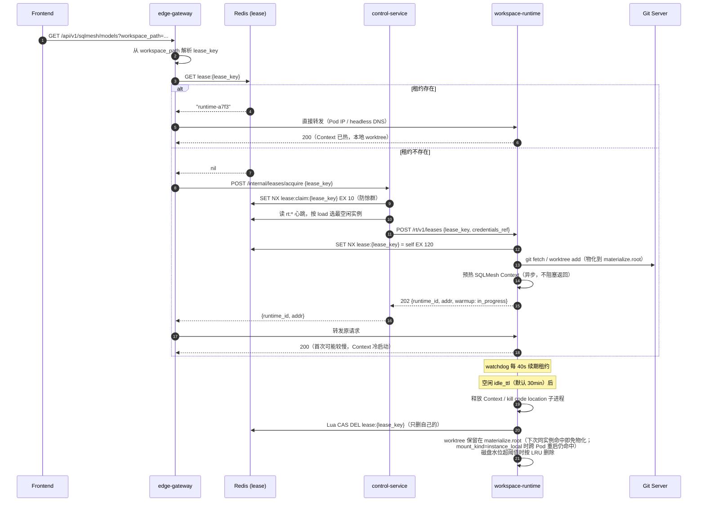

# 03 · 多租户与横向扩展

> 目标规模：**1,000 租户 × 1,000 子用户 = 10^6 用户**，日活 5%（50,000），峰值并发在线 5,000，活跃工作副本 ~20,000。

---

## 1. 扩展策略总纲

三层扩展，各自解决一类瓶颈：

| 层 | 机制 | 解决的瓶颈 |
|----|------|-----------|
| **S1 · Cell 单元化** | 租户按 shard 映射到独立 Cell，每 Cell 一套完整数据面+控制面+DB | Dagster daemon 全局单点、单一 Postgres、爆炸半径 |
| **S2 · 工作区租约** | 工作副本显式绑定到一个 workspace-runtime 实例，网关按租约路由 | SQLMesh Context 内存放大、共享 PV、跨副本锁 |
| **S3 · 无状态 HPA** | gateway/identity/control/agent 纯副本扩容 | HTTP QPS、DB QPS、LLM 并发 |

> **命名说明**：本文用 `S1/S2/S3`（Scaling）表示**扩展层级**，与 [§04](04-workspace-sandbox-isolation.md) 的 `L1/L2/L3`（Isolation Level，**隔离级别**）是两套独立概念，不要混淆。

```
                    ┌─────────────────────────────┐
                    │  S1: Cell（租户维度分片）     │
                    │  解决：单点 / DB / 爆炸半径   │
                    │  ┌───────────────────────┐  │
                    │  │ S2: 租约（工作区维度） │  │
                    │  │ 解决：内存 / 存储 / 锁  │  │
                    │  │  ┌─────────────────┐  │  │
                    │  │  │ S3: HPA（QPS）  │  │  │
                    │  │  └─────────────────┘  │  │
                    │  └───────────────────────┘  │
                    └─────────────────────────────┘
```

---

## 2. S1 · Cell 单元化

### 2.1 什么是 Cell

一个 **Cell** 是一个完整、自足、可独立部署与升级的平台实例，服务一批租户：

```
Cell = {
    edge-gateway × N,
    control-service × N,
    agent-service × N,
    workspace-runtime × M,
    orchestrator (webserver × N + daemon × 1 + workspace-sync),
    PostgreSQL (Cell 元数据 + Dagster storage),
    Redis (Cell 协调),
    Event Store (timeline / logs)
}
```

**Cell 之外只有两样东西是全局的**：
1. `identity-service` + Global DB（用户/租户/角色/权限 + 租户→Cell 映射）
2. 全局边缘路由（按 JWT 里的 `tenant_id` 决定打到哪个 Cell）

### 2.2 为什么必须 Cell 化

不是为了"更好扩展"，而是因为有**三个东西在架构上无法水平扩展**：

| 不可扩展项 | 原因 | Cell 化后 |
|-----------|------|----------|
| **Dagster daemon** | 官方硬约束：多副本会重复触发 schedule。且单进程要串行遍历所有 code location 做 tick | 每 Cell 一个 daemon，只管本 Cell 的 code location（~4,000 个而非 20,000） |
| **Dagster storage** | run/event_log 表在单库上；20,000 环境的 event log 单库扫不动 | 每 Cell 一套，行数除以 Cell 数 |
| **Reconciler 全局对账** | 要遍历所有环境做四方对账 | 每 Cell 独立对账，本 Cell 的环境是完整闭环 |

**Cell 化不是可选优化，是这三项的唯一解。**

### 2.3 Cell 容量与规格

单 Cell 目标容量（保守设计，留 50% 余量）：

| 指标 | 单 Cell 容量 | 依据 |
|------|------------|------|
| 租户数 | **200** | 1000 / 5 Cell |
| 用户数 | 200,000 | |
| 日活用户 | 10,000 | 5% |
| 峰值并发在线 | 1,000 | |
| 工作区数 | 1,000 | 200 租户 × 5 |
| 活跃工作副本 | **4,000** | 1,000 × 4 环境 |
| 峰值并发编辑会话 | 400 | 并发在线 40% |
| 活跃 code location | **≤ 800** | 只有被调度/被访问的环境才拉起（§3.6） |
| Dagster daemon tick 负载 | 800 location | 官方 daemon 可承受量级 |
| Postgres | `timeline_events` 2×10^6/天 | 单实例可承受，30 天保留 = 6×10^7 |

**初始部署 5 个 Cell** 覆盖 1000 租户。留一个 `cell-0` 作为新租户默认落点与迁移中转。

### 2.4 租户 → Cell 映射

**不用哈希，用显式映射表。**

```sql
-- Global DB (identity-service 拥有)
CREATE TABLE tenant_placement (
    tenant_id       VARCHAR(64) PRIMARY KEY,
    cell_id         VARCHAR(32) NOT NULL,
    -- 迁移中：新 Cell 已就绪但流量未切
    target_cell_id  VARCHAR(32),
    migration_state VARCHAR(24) NOT NULL DEFAULT 'stable',
      -- stable | draining | migrating | verifying
    -- UTC，全平台统一
    created_at      TIMESTAMP NOT NULL,
    updated_at      TIMESTAMP NOT NULL,
    INDEX idx_cell (cell_id)
);

CREATE TABLE cells (
    cell_id        VARCHAR(32) PRIMARY KEY,
    region         VARCHAR(32) NOT NULL,
    endpoint       VARCHAR(255) NOT NULL,   -- Cell 的 gateway 入口
    status         VARCHAR(24) NOT NULL,    -- active | draining | maintenance
    capacity_tenants   INT NOT NULL,        -- 规格上限
    assigned_tenants   INT NOT NULL,        -- 当前分配
    created_at     TIMESTAMP NOT NULL
);
```

**为什么显式映射而非一致性哈希**：
- 租户规模差异巨大（一个大租户可能 = 100 个小租户），哈希无法均衡
- 大租户需要**独占 Cell**（安全/合规/性能隔离），这在哈希下无法表达
- 迁移需要可控（一次迁一个租户），哈希改变会导致大量重映射

**放置策略**：
1. 新租户 → 选 `assigned_tenants / capacity_tenants` 最低的 `active` Cell
2. 标记为 `dedicated` 的租户 → 独占 Cell（企业版）
3. Cell 容量达 80% → 停止接收新租户，触发扩容告警

### 2.5 全局路由

JWT 里携带 `cell_id`（登录时由 identity-service 写入）：

```
                  ┌──────────────────────────────┐
   Browser ──────▶│  Global Edge (Envoy/Ingress) │
                  │  读 JWT.cell_id → 选后端集群  │
                  └───┬──────────┬───────────┬───┘
                      ▼          ▼           ▼
                  Cell A     Cell B      Cell C
```

**关键设计**：`cell_id` 在 JWT 里，全局边缘只做 header 路由，**不查库**（热路径零依赖）。

登录流程需要一次全局查询（`/auth/login` 打到 identity-service，它返回带 `cell_id` 的 token）：

```
1. POST /auth/login          → Global Edge → identity-service
2. identity-service 验证凭据，查 tenant_placement，签发 JWT{user_id, tenant_id, cell_id, perms_version}
3. 后续所有请求             → Global Edge 读 JWT.cell_id → 路由到对应 Cell
```

**Cell 迁移期间的路由**：`migration_state = migrating` 时，identity-service 拒绝签发新 token（返回 503 + Retry-After），已签发 token 在 `draining` 期内仍走旧 Cell。TTL 到期后自然全切。

### 2.6 Cell 内故障隔离

| 故障 | 影响范围 | 恢复 |
|------|---------|------|
| 一个 workspace-runtime 崩溃 | 该实例持有的 ≤16 个工作副本会话中断 | 租约 TTL 过期后其他实例接管；worktree 从 Git 重新物化 |
| Cell 的 daemon 崩溃 | 该 Cell 的 schedule 停摆（~200 租户） | K8s 重启（单副本 Deployment + `maxUnavailable: 0` 不可用，用 Recreate 策略） |
| Cell 的 Postgres 不可用 | 该 Cell 完全不可用（~200 租户） | 主备切换；其他 4 个 Cell 不受影响 |
| identity-service 不可用 | **全平台无法登录**，但已登录用户可继续（JWT 本地验签 + 授权缓存） | 多副本 + Global DB HA；这是设计上唯一的全局单点，故降级路径必须是"已登录可用" |

**爆炸半径**：单 Cell 故障影响 20% 租户（5 Cell）。这是 Cell 化最直接的收益——当前架构下任何单点故障影响 100%。

---

## 3. S2 · 工作区租约（Workspace Lease）

### 3.1 问题重述

工作副本是**有状态且不可共享**的：

```
{base}/{tenant}/{ws}/{user}/envs/{env}/    ← 一个工作副本
    + SQLMesh Context（内存 AST，数百 MB）
    + Ontology registry（内存）
    + Dagster code location 子进程
    + Git worktree（实例私有目录，index/HEAD/未提交改动）
```

必须满足（R1）：**任一时刻只有一个进程挂载并写入它。**

现状违反方式：网关随机 LB → N 个副本各自 load 一份 → 内存放大 + `dirty` 标志失效 + 需要分布式锁。

### 3.2 租约模型

**租约 = (工作副本, runtime 实例, 有效期) 的排他绑定。**

```
lease_key = "{tenant_id}/{workspace_id}/{user_id}/{environment}"
          （即工作副本的规范路径，去掉 base_path）
```

Redis 数据结构（`platform.yaml redis.key_prefix` 命名空间下）：

```
# 租约主键：值 = runtime 实例 ID，TTL = 租约有效期
{prefix}:lease:{lease_key}              → "runtime-a7f3"    EX 120

# 反向索引：一个 runtime 持有的所有租约（用于容量统计与优雅下线）
{prefix}:lease:byrt:{runtime_id}        → SET of lease_key

# runtime 实例注册与容量心跳
{prefix}:rt:{runtime_id}                → HASH {addr, leases, capacity, load, ts}  EX 30

# 租约申请队列（避免惊群：同一 lease_key 的并发申请只有一个成功）
{prefix}:lease:claim:{lease_key}        → SET NX EX 10（申请中锁）
```

**TTL 语义**（沿用平台既有哲学）：TTL **不是**操作超时，而是 **crash 恢复界**。runtime 存活期间由后台 watchdog 每 `TTL/3` 续期；实例崩溃后 TTL 到期，租约自动可被他人接管。

### 3.3 租约生命周期



### 3.4 工作副本存储：物化唯一，介质可插拔

**核心变化：工作副本从共享 NFS 移到实例私有目录。**

这里有两个必须分开看的维度——把它们混为一谈是设计上的常见错误：

| 维度 | 内容 | 是否可配置 |
|------|------|----------|
| **物化逻辑** | `git clone --bare` → `.repo` → `git worktree add` | ❌ **唯一路径，永不分支** |
| **存储介质** | `emptyDir` / per-replica PVC / `hostPath` | ✅ `materialize.mount_kind`（§05.7） |

物化逻辑不关心底下是 NVMe 还是网络盘，它只需要**一个可写目录**。所以 runtime 代码里只有一条路径：租约到手 → 检查是否已物化 → 未物化则从 Git 物化 → 已物化则直接用。介质只影响**命中率**，不影响正确性。

| 层 | 介质 | 内容 | 生命周期 |
|----|------|------|---------|
| **L0 热层** | 实例私有目录：`emptyDir`（`ephemeral`）或 **per-replica RWO PVC**（`instance_local`，生产默认） | 活跃工作副本 worktree + `.repo` 裸库 | `ephemeral`：Pod 生命周期；`instance_local`：跨 Pod 重启存活 + LRU 缓存（磁盘水位驱动） |
| **L1 冷层（可选）** | 对象存储 | `.repo` 的打包快照（加速大仓库首次物化） | 定期刷新 |
| **L2 真源** | **Git Server** | 全部代码 | 永久 |

⚠️ **`mount_kind: shared` 在启动期被硬拒绝**：可被多副本写的介质与「`env_lock` 退化为进程内锁」不能共存——租约是让进程内锁成立的前提，共享挂载会绕过租约放进第二个写者。这不是防御性编程，是防止一个看起来无害的运维配置造成静默数据损坏。同理，`instance_local` 必须是 StatefulSet 的 `volumeClaimTemplates`（每副本一个 RWO PVC），**不是**一个挂给所有副本的 RWX PVC——后者是"换了名字的共享 NFS"。

**依据**：工作副本的**唯一真源是 Git**（`paths.py` 文档已明确写了 *"Local directories are disposable, so they are never persisted in the database - they are always derived from (base_path, tenant_id, workspace_id, user_id, environment) at runtime"*）。既然是 derived state，就不需要**共享**持久卷；per-replica PVC 只是缓存，丢了也只是变慢。

**收益**：

| 指标 | 共享 EFS（现状） | 实例私有目录（2.0） |
|------|-----------------|---------------------|
| `git status`（500 文件） | 0.5-4.5 s | **< 30 ms** |
| 元数据操作延迟 | 1-3 ms/op（网络） | ~0.05 ms/op |
| 并发写风险 | 需约定 + 分布式锁 | **不存在**（租约保证单挂载 + `mount_kind` 启动期拦截共享介质） |
| 存储成本 | EFS 按量（10^7 文件的元数据成本高） | 节点本地盘 / per-replica 块存储 |
| 容量上限 | 理论无限但性能塌陷 | 每实例 ~100-500 GB → 需 LRU 回收 |

**代价与缓解**：

| 代价 | 缓解 |
|------|------|
| 未提交改动在实例目录消失后丢失 | ① 前端自动保存草稿到 control-service（DB）；② 周期 `git stash` + push `refs/datacode-wip/{user}/{env}`，物化时恢复；③ drain 时强制快照（优雅下线零丢失）；④ **`mount_kind: instance_local` 让部署/OOMKill 不再触碰这个窗口**（§05.5.3） |
| 首次物化耗时（大仓库 clone） | ① `.repo` 冷层快照；② `instance_local` 下 `.repo` 跨重启存活；③ 同实例多 env 共享 `.repo`；④ shallow clone + 按需 fetch |
| 磁盘水位管理 | LRU 回收无租约的 worktree；`.repo` 优先保留（可服务多个 env） |

### 3.5 容量模型（可计算）

单 runtime 实例规格与容量：

| 项 | 值 | 说明 |
|----|---|------|
| 每租约 SQLMesh Context 内存 | 200 MB（中等仓库） | 实测基线，需按项目校准 |
| 每租约 Ontology registry | 5 MB | YAML 解析后的 Pydantic 对象 |
| 每租约 worktree 磁盘 | 100 MB | 含 `.repo` 共享部分摊 |
| **每租约总开销** | **~210 MB 内存 + 100 MB 盘** | |
| runtime 实例内存 limit | **8 GB** | |
| 平台基线开销 | 1.5 GB | Python + FastAPI + sqlmesh 库 |
| 可用于租约 | 6.5 GB | |
| **每实例租约数** | **≤ 16**（留 34% 余量：16×210MB = 3.4GB，另留 3GB 给瞬时峰值） | 配置项 `lease.max_per_instance`，**可配置（Q3）** |
| 每实例磁盘 | 100 GB（16 × 100MB 活跃 + LRU 缓存） | |

**Cell 级容量推导**（以下用 `max_per_instance = 16` 的默认值举例；该值可配置，见下方说明）：

```
单 Cell 峰值并发编辑会话     = 400
每会话占用租约               = 1
需要租约总数                 = 400
每 runtime 实例租约数        = 16      ← 可配置（lease.max_per_instance）
需要 runtime 实例数          = 400 / 16 = 25
留 30% 余量                  = 33 实例

单 Cell runtime 资源 = 33 × (8 GB, 2 vCPU) = 264 GB, 66 vCPU
```

**全平台（5 Cell）**：165 个 runtime 实例，1.3 TB 内存，330 vCPU。

对比现状（若强行扩展）：8 副本 × `max_size=20` 且随机路由 → 有效 Context 命中率极低，需要 2,000 × 200 MB = **400 GB 常驻且无法命中**。租约模型把它降到 400 × 210 MB = **84 GB 且 100% 命中**。

#### 容量参数为什么必须可配置（Q3 决策）

`16` 不是一个可以写死的常量，因为**每租约的真实开销与用户仓库规模强相关**：一个 50 模型的仓库与一个 2000 模型的仓库，其 SQLMesh Context 内存差一个数量级。固定值在租户间必然错配 —— 大仓库租户 OOM，小仓库租户浪费资源。

因此实现为**三层机制**（契约见 ADR-002 的 Q3 修订、配置见 §05.7）：

| 层 | 机制 | 作用 |
|----|------|------|
| **① 配置** | `max_per_instance`（硬上限）+ `memory_budget_bytes`（真正的驱动项）+ `estimated_lease_bytes` | 改 Pod 规格（4/8/16 GiB）即改容量，无需改码 |
| **② 启动期自校验** | 读自身 cgroup 内存 limit，校验 `max × estimated + baseline ≤ limit`；不成立则**按预算下调有效上限 + 告警** | 拒绝一个注定 OOM 的配置，而不是接受它 |
| **③ 运行期自适应** | 租约释放时记录实际 RSS 增量，EWMA 更新估计值；持续偏离 >20% 则下调有效上限并上报 `lease_estimate_drift`。另有 `admission_rss_high_watermark`（0.80）按**真实 RSS** 兜底拒绝新租约 | 容量模型自我纠正，不依赖 P0 那一次实测的准确性 |

**因此上面的 "33 实例" 应理解为「按默认参数的规划基线」，而非硬性容量。** 实际实例数由 `LeaseController` 依租约利用率动态调整（§4.2）。

### 3.6 Code Location 从常驻改为按需

现状：每个活跃 deployment 常驻一个 gRPC 子进程（20,000 个 = 3-6 TB 内存，端口上限 3,200）。

2.0 模型：

| 状态 | 何时进入 | 资源 |
|------|---------|------|
| **cold** | 默认 | 0 |
| **warm** | 有 schedule/sensor 需要 tick，或用户正在查看 asset DAG | 1 个 gRPC 子进程（~200 MB） |
| **hot** | 正在执行 run | warm + task-runner 容器 |

**驱动规则**：
1. 有**启用的 schedule/sensor** 的 deployment 必须 warm（daemon 要 tick）。非 prod 环境默认 `SCHEDULES_ENABLED=false`（继承现有设计），所以**绝大多数分支环境是 cold**。
2. 用户打开 Asset DAG 页面 → 按需 warm，5 分钟无访问后回 cold。
3. run 触发时由 task-runner 自己加载用户代码（不依赖常驻 location）。

**容量重算**（单 Cell）：

| 项 | 数量 |
|----|------|
| 本 Cell 活跃工作副本 | 4,000 |
| 其中 prod 环境（schedule 开启） | 1,000（每工作区 1 个 prod） |
| 其中分支环境（schedule 默认关闭） | 3,000 → **cold** |
| 用户按需 warm 的分支环境（峰值） | ~100 |
| **需要 warm 的 code location** | **~1,100** |
| 端口需求 | 1,100（当前上限 3,200，**够用**） |
| 内存 | 1,100 × 200 MB = 220 GB，分布在 33 个 runtime 实例上 = 6.7 GB/实例 |

⚠️ 6.7 GB/实例 超过了 §3.5 留的 3 GB 余量。**修正**：把 code location 从 runtime 进程中**移到独立的 sidecar Pod 或独立 Deployment**，按 deployment 粒度调度：

```
方案：code location 独立部署单元
  - 每个 warm 的 deployment = 一个 K8s Pod（label: deployment={ws}__{env}）
  - Pod 挂载 runtime 提供的 worktree（同节点 hostPath / CSI ephemeral，或从 Git 自行物化）
  - workspace-sync 直接发现这些 Pod（Endpoints 而非轮询 runtime）
  - 由 control-service 的 deployment 控制器创建/删除（K8s Deployment/Job 语义）
```

这样 code location 的伸缩与 runtime 解耦：1,100 个轻量 Pod（200 MB / 0.2 vCPU）= 220 GB / 220 vCPU per Cell，且可用**低优先级节点池 + Spot**。

**修正后 runtime 每实例内存**：16 租约 × 210 MB + 1.5 GB 基线 = 4.9 GB，limit 8 GB 有充足余量。

### 3.7 网关的租约感知路由

`edge-gateway` 新增中间件（Go）：

```
LeaseRouter 中间件逻辑：
1. 从请求提取 lease_key：
   - query param workspace_path  → parse（复用现有 5 段布局解析）
   - 或 body/path 的 workspace_id + environment + 身份头 user_id/tenant_id
   - 无 lease_key（如 /auth、/rbac、/sessions）→ 跳过，走普通 LB
2. GET redis lease:{lease_key}
   - hit  → 设置上游为该 runtime 的地址，转发
   - miss → 调 control-service /internal/leases/acquire（带 5s 超时）
            → 拿到 runtime addr 后转发
            → acquire 失败（无容量）→ 503 + Retry-After
3. 转发失败（runtime 已死但 TTL 未过期）
   - 一次重试：DEL 该租约（Lua CAS 校验值）→ 重新 acquire
   - 二次失败 → 502
4. 本地缓存 lease_key → addr（TTL 10s），削减 Redis QPS
```

**Redis QPS 估算**：峰值 1,000 并发在线 × 2 req/s = 2,000 req/s，本地缓存命中率 >95% → Redis ~100 GET/s。可忽略。

**降级**：Redis 不可用时，退化为**稳定哈希路由**（`hash(lease_key) % runtime_replicas`）。此时正确性依赖副本数不变；副本数变化会导致同一工作副本被两个实例挂载 → **runtime 侧必须有第二道防线**：物化 worktree 前用文件锁（`flock` on `.repo/.datacode-lease`）确认独占，失败则返回 409 让网关重试。

---

## 4. S3 · 无状态服务 HPA

### 4.1 各服务 HPA 配置

| 服务 | min | max | 主指标 | 辅助指标 |
|------|-----|-----|--------|---------|
| edge-gateway | 3 | 30 | CPU 70% | `http_requests_per_second` > 500/pod |
| identity-service | 2 | 10 | CPU 70% | `auth_requests_per_second` > 200/pod |
| control-service | 3 | 20 | CPU 70% | `db_pool_utilization` > 80% |
| agent-service | 3 | 30 | **`active_conversations` > 20/pod** | CPU 70%（辅） |
| workspace-runtime | — | — | **不用 HPA**（见 §4.2） | |

**agent-service 用并发对话数而非 CPU**：一个 goal loop 大部分时间在等 LLM 响应（IO 等待），CPU 利用率低但连接与内存已占满。用 CPU 扩容会导致 pod 过载而不扩。

### 4.2 workspace-runtime 用租约驱动扩容（非 HPA）

HPA 对亲和服务是危险的：缩容会杀掉持有租约的 Pod，中断会话。

**机制**：

```
LeaseController（control-service 内的后台控制器）
每 30s：
  1. 读所有 rt:* 心跳，计算 Cell 内总租约数 L 与实例数 R
  2. 利用率 U = L / (R × max_per_instance)
  3. U > 0.75 且 R < max_replicas  → 扩容（patch Deployment replicas += ceil(R × 0.3)）
  4. U < 0.35 且 R > min_replicas  → 缩容：
       a. 选最空闲实例，标记 draining（心跳里 capacity=0，不再接新租约）
       b. 等其租约自然过期（或主动迁移：见 §4.3）
       c. 租约清零后删除该 Pod（K8s: 加 controller.kubernetes.io/pod-deletion-cost 注解，
          让 Deployment 缩容优先选它）
  5. 扩缩容有 5 分钟冷却期，避免抖动
```

**为什么不用 KEDA/HPA + PreStop hook**：PreStop 只有 `terminationGracePeriodSeconds`（最多几分钟），而租约的自然过期可能要 30 分钟（idle_ttl）。必须由控制器主动编排 drain。

### 4.3 优雅下线与租约迁移

runtime 收到 `SIGTERM` 或 `draining` 标记：

```
1. 心跳置 capacity=0（不再接新租约）
2. 对每个持有的租约：
   a. 若有活跃操作（apply 进行中）→ 等待完成（上限 apply_grace = 10min）
   b. 无活跃操作 → 主动释放：
      - 未提交改动 push 到 wip/{user}/{env}（或写 stash 到冷层）
      - 释放 Context / kill code location
      - Lua CAS DEL lease:{lease_key}
      - 通过 SSE 通知前端 "workspace_relocating"（前端下次请求自动重新 acquire）
3. 全部释放后退出（K8s terminationGracePeriodSeconds 设为 apply_grace + 60s）
```

**前端体验**：`workspace_relocating` 事件 → 显示"工作区正在迁移"提示 → 自动重试请求 → 新 runtime 物化后恢复（首次请求慢 2-5 秒）。**不丢数据，可感知但不阻断。**

---

## 5. 数据面分区

### 5.1 数据分层

| 数据 | 归属 | 存储 | 分区键 |
|------|------|------|--------|
| users / tenants / roles / permissions | **Global** | Global PG | 无（全局单库） |
| tenant_placement / cells | **Global** | Global PG | 无 |
| workspaces / workspace_members | **Cell** | Cell PG | tenant_id |
| environments / environment_events | **Cell** | Cell PG | workspace_id |
| plan_apply_history | **Cell** | Cell PG | workspace_id |
| knowledge_documents（元数据） | **Cell** | Cell PG | workspace_id |
| user_git_credentials | **Cell** | Cell PG（加密） | user_id |
| sessions / messages | **Cell** | Cell PG | user_id |
| **timeline_events / memory_events** | **Cell** | **独立 Event Store** | session_id + 时间分区 |
| Dagster runs / event_logs / schedules | **Cell** | Cell PG（独立 schema） | — |
| 工作副本文件 | **Runtime 本地** | Pod NVMe | lease_key |
| 工作区日志 NDJSON | **Runtime 本地** + Loki | 本地 + 中心 | workspace_path |

### 5.2 高频 append 表分离

`timeline_events` 在单 Cell 是 2×10^6/天（全平台 10^7/天）。这类数据：
- 只 append，几乎不 update
- 按 session 顺序读取
- 有明确保留期（30-90 天）

**不该放在 OLTP 库**。选项：

| 方案 | 适用 |
|------|------|
| **PG 原生分区表**（按天 RANGE 分区 + 自动 detach 旧分区） | 起步推荐：零新组件，`pg_partman` 管理 |
| ClickHouse | 需要 timeline 分析/聚合查询时 |
| S3 + Parquet（冷层） | 超过 30 天的归档 |

**推荐路径**：Cell PG 内建按天分区表起步，保留 30 天；超期 detach + 导出 Parquet 到对象存储。若后续 timeline 查询成为瓶颈再引入 ClickHouse。

### 5.3 SQLMesh state schema 的多租户隔离

现状（memory 中的契约）：`gateways.*.state_schema = sqlmesh__{workspace_id 安全化}`，由平台管理，reconcile 只校验不改写，不一致返回 409 `STATE_SCHEMA_MISMATCH` + 修复端点。

**2.0 继承此契约，无变更。** 它已经正确解决了工作区级 state 隔离：

```
客户数据仓库（客户自己的 Snowflake/BigQuery/PG）
  ├── sqlmesh__ws_tenant1_sales/     ← workspace 1 的 SQLMesh state
  ├── sqlmesh__ws_tenant1_finance/   ← workspace 2
  └── sqlmesh__ws_tenant2_ops/       ← 另一租户（通常是另一套仓库连接）
```

规模下的补充要求：
1. **连接池配额**：每租户对客户仓库的连接数上限（防一个租户打满仓库连接）。配置在 control-service 的租户配额表，runtime 侧强制。
2. **凭证隔离**：`user_git_credentials` 与仓库凭证已 AES-256-GCM 加密（`git_credentials.py`），2.0 要求密钥**按 Cell 分离**（Cell A 的密钥无法解 Cell B 的数据）。

---

## 6. 租户配额与公平性

1000 租户共享 Cell 资源，必须有配额，否则一个租户可耗尽整个 Cell。

| 资源 | 配额维度 | 强制点 | 超限行为 |
|------|---------|--------|---------|
| 工作区数 | per tenant | control-service | 409 `QUOTA_WORKSPACE_EXCEEDED` |
| 活跃环境数 | per workspace（现有 `max_per_workspace: 20`） | control-service | 409（已实现） |
| **并发租约数** | per tenant | control-service LeaseController | 429 + Retry-After |
| **并发 Dagster run** | per tenant | orchestrator `tag_concurrency_limits` key=`datacode/tenant_id`（已有机制） | 排队 |
| **并发 agent 会话** | per user / per tenant | agent-service | 429 |
| **task-runner 并发** | per tenant | task queue 优先级 + 配额 | 排队 |
| **仓库连接数** | per tenant | runtime 连接池 | 503 |
| 工作副本磁盘 | per user | runtime 物化前检查 | 507 `INSUFFICIENT_STORAGE` |
| LLM token | per tenant / 月 | agent-service 计量 | 402 / 降级到小模型 |

**公平性机制**：租约分配采用**加权公平**——`control-service` 分配租约时，若某租户已占用 > `tenant_lease_share`（如 Cell 总容量的 10%），其新请求排队让位给未达配额的租户。避免一个大租户的批量操作饿死小租户。

---

## 7. 扩展路径与规模里程碑

| 里程碑 | 租户 | 部署形态 | 关键动作 |
|-------|------|---------|---------|
| **M0 · 单 Cell** | ≤ 50 | 1 Cell，runtime 3 实例，无 Global/Cell 分离（identity 与 Cell 共库） | 落地租约模型 + 服务整合 |
| **M1 · 单 Cell 满载** | ≤ 200 | 1 Cell，runtime 33 实例 | 验证容量模型、租约扩缩控制器 |
| **M2 · 多 Cell** | ≤ 1,000 | 5 Cell + Global identity + 全局边缘路由 | 拆出 Global DB、tenant_placement、Cell 迁移工具 |
| **M3 · 多 Region** | 1,000+ / 合规要求 | 每 Region 多 Cell，identity 全局多写或按 Region 分区 | 数据驻留合规 |

**关键洞察**：M0 与 M1 的**代码完全相同**，只是 Cell 数为 1。Cell 化的代价前置在「配置与部署形态」而非「代码」——只要从一开始就把 `cell_id` 作为一等概念（JWT claim、日志字段、指标 label），从 1 个 Cell 扩到 5 个 Cell 是纯运维动作。

**因此 §06 迁移路线的第一阶段就要引入 `cell_id`，即使只有一个 Cell。**
