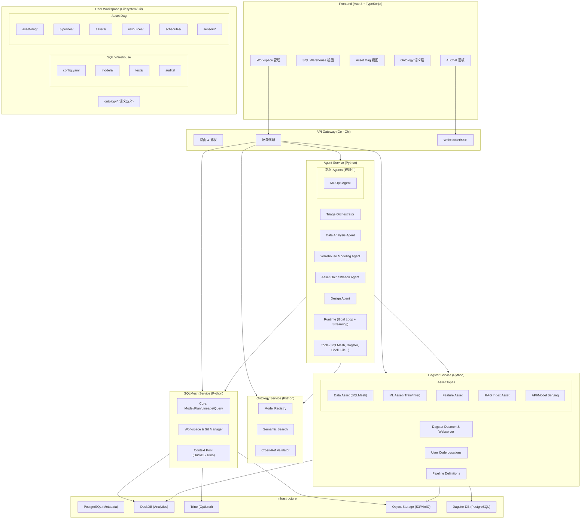
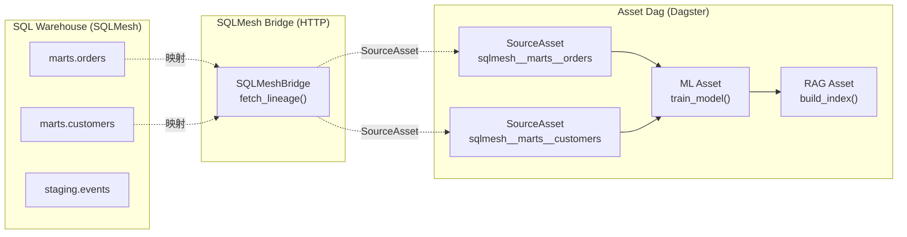
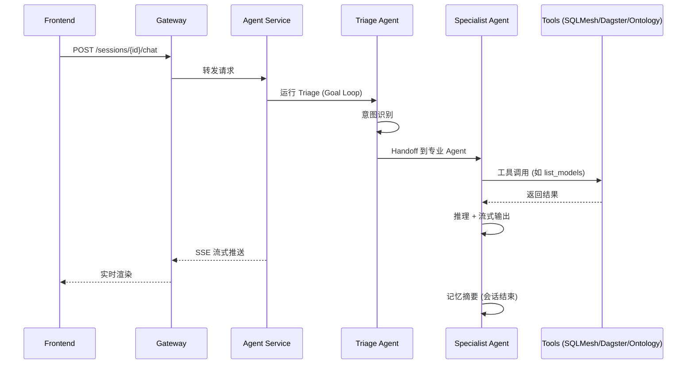
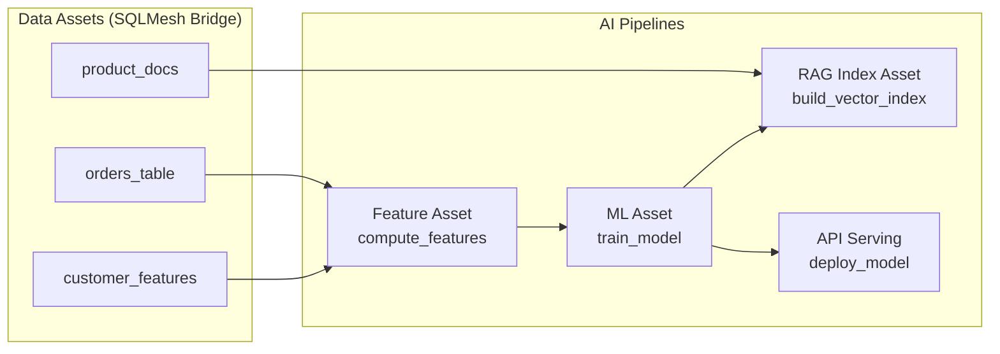

# 后台架构设计 — AgenticData Data+AI 一体化平台

> AgenticData — Data+AI 一体化 AI 原生开发平台
> 将传统数据工程（ELT、数据建模、数据质量、血缘）与现代 AI 工程（模型训练/推理、特征工程、RAG 索引构建）统一在一个 AI 原生开发平台中
> 技术底座：FastAPI 微服务 + SQLMesh ContextPool + Dagster Code Location + openai-agents SDK

## 0. 平台定位

AgenticData 是一个 **Data+AI 一体化 AI 原生开发平台**。传统数据平台与 AI 平台是割裂的（数据工程师用 dbt/Airflow，AI 工程师用 MLflow/Kubeflow），AgenticData 将两者统一在同一个用户工作区内，由 AI Agent 贯穿全流程。

### 0.1 核心理念

| 维度 | 传统数据平台 | 传统 AI 平台 | AgenticData |
|------|------------|------------|-------------|
| 数据建模 | dbt / SQLMesh | 手写 SQL | SQLMesh（SQL Warehouse） |
| 流水线编排 | Airflow | Kubeflow / Metaflow | Dagster（Asset Dag） |
| AI 交互 | 无 / 脚本 | Notebook | AI Agent（自然语言驱动） |
| 语义层 | dbt Semantic Layer | 自建 | Ontology Service（YAML 驱动） |
| 资产统一 | 数据资产 ≠ AI 资产 | AI 资产 ≠ 数据资产 | 统一资产 DAG（数据 + ML + 特征 + RAG） |

### 0.2 工作区双结构

每个用户工作区（Workspace）包含两个互补的工程子域：

```
~/.agenticdata/workspaces/{user_id}/{workspace_name}/
│
├── SQL Warehouse (SQLMesh)          # ① 数据仓库 / 数据建模
│   ├── config.yaml                   # SQLMesh 配置 (gateways, state sync)
│   ├── models/                       # SQL 模型 (ELT、数据建模)
│   ├── audits/                       # 数据质量审计
│   ├── tests/                        # 模型测试
│   ├── seeds/                        # 种子数据
│   └── macros/                       # 宏定义
│
├── Asset Dag (Dagster)               # ② Data+AI Pipeline 编排
│   ├── definitions.py                # Dagster 入口
│   └── defs/
│       ├── assets/                   # 资产定义 (Data + ML + Feature + RAG)
│       ├── resources/                # Dagster 资源 (Daft, MLflow, SQLMesh)
│       ├── jobs/                     # 资产作业
│       ├── schedules/                # 调度
│       └── sensors/                  # 传感器
│
├── ontology/                         # 语义模型 YAML
├── knowledge/                        # 知识文档
└── .ai/                              # Agent 上下文 (memory, context, rules)
```

| 子域 | 技术 | 定位 | 典型场景 |
|------|------|------|---------|
| **① SQL Warehouse** | SQLMesh | 传统数据工程 | ELT、数据建模、数据质量（审计）、血缘追踪、虚拟环境（dev/prod） |
| **② Asset Dag** | Dagster | 现代 AI 工程 | 数据处理管道、模型训练/推理、特征工程、RAG 索引构建、API/模型服务 |

两个子域通过 **SQLMesh Bridge** 连接：SQLMesh 模型自动映射为 Dagster SourceAsset，使 AI Pipeline 可以直接消费数据仓库的产出。

---

## Current Implementation (2026-Q3)

当前仓库已落地的运行时架构。本文档描述的是**实际已实现**的架构，而非未来目标。

| 组件 | 语言/框架 | 端口 | 状态 | 说明 |
|------|----------|------|------|------|
| Gateway | Go (Chi) | 8000 | 已实现 | HTTP 反向代理 + 路由 + SSE 透传 + 默认用户注入 |
| Agent Service | Python (FastAPI) | 8001 | 已实现 | AI 对话编排、ACP 协议、工具调用、SSE |
| SQLMesh Service | Python (FastAPI) | 8002 | 已实现 | SQLMesh Context 池、模型/血缘/Plan/Apply、工作区/Git/文件/知识库 |
| Ontology Service | Python (FastAPI) | 8003 | 已实现 | 语义层 YAML 加载、交叉引用验证、语义搜索 |
| Dagster Service | Python (FastAPI) | 8004 | 已实现 | Code Location 管理、Asset DAG、Run/Schedule、SQLMesh 桥接 |
| Platform Service | — | — | 未实现 | 见 `proto/platform/v1`（契约草案） |
| gRPC | — | — | 未实现 | 所有服务间通信走 HTTP/REST |
| Airflow | — | — | 未使用 | 生产调度由 Dagster Daemon 替代 |

---

## 1. 架构概述

### 1.1 核心设计决策

平台采用**单进程 FastAPI 微服务**架构，而非 Worker Pool / gRPC / 容器化 Job 模式。原因：

| 决策 | 原因 |
|------|------|
| FastAPI 而非 gRPC | 前端直接通过 Gateway 调用 REST，无需 gRPC 编译；HTTP 足够满足延迟要求 |
| ContextPool 而非 Worker Pool | SQLMesh Context 加载耗时（秒级），缓存复用比按需创建销毁更高效；Context 读取线程安全，写操作用 asyncio.Lock 串行化 |
| Dagster Code Location 始终本地 | Code Location 加载用户 `asset-dag/` 下的 Python 代码，必须在本地文件系统运行；只有 DagsterInstance（daemon+webserver+metadata DB）可远程 |
| Ontology 无数据库 | 语义模型是 YAML 文件，加载即用；元数据验证委托 sqlmesh-service，无需独立存储 |
| Gateway 透明代理 | `GenericProxy` 透传所有未特殊处理的路径，新增后端端点无需修改 Gateway |
| SQL Warehouse + Asset Dag 分离 | 数据建模（SQLMesh）与 AI Pipeline 编排（Dagster）关注点不同，分离让各自独立演进，通过 Bridge 统一 |

### 1.2 设计目标

- **Data+AI 统一**：一个工作区内同时管理数据仓库（SQLMesh）和 AI Pipeline（Dagster），AI Agent 贯穿两者
- **进程内并发**：FastAPI async + `asyncio.to_thread` 卸载阻塞的 SQLMesh 调用，单进程服务多用户
- **Context 复用**：SQLMesh Context 按 `(workspace_path, gateway)` 缓存，TTL/LRU 淘汰，dirty flag 延迟刷新
- **工作区隔离**：每个用户工作区是独立目录 `~/.agenticdata/workspaces/{user_id}/{workspace_name}/`，含独立 Git clone、SQL Warehouse 和 Asset Dag
- **Fail-soft**：数据库不可用时降级为磁盘扫描；sqlmesh-service 不可用时 ontology 跳过外部验证
- **统一错误格式**：所有服务返回 `{error_code, message, detail?}` 结构化错误

---

## 2. 整体架构

### 2.1 全局架构图



### 2.2 服务间通信

| 调用方 → 被调方 | 协议 | 用途 | 失败策略 |
|----------------|------|------|---------|
| Frontend → Gateway → 任意服务 | HTTP / SSE | 前端请求路由、实时事件流 | 502 Bad Gateway |
| Agent Service → SQLMesh Service | HTTP | 工具调用（读写文件、执行 Plan、查询模型/血缘） | 工具错误回传 Agent |
| Agent Service → Ontology Service | HTTP | 工具调用（语义搜索、实体查询） | 工具错误回传 Agent |
| Agent Service → Dagster Service | HTTP | 工具调用（触发 Run、查看 Asset DAG） | 工具错误回传 Agent |
| Dagster Service → SQLMesh Service | HTTP | 桥接 SQLMesh 模型/血缘为 Dagster SourceAsset | `SQLMeshBridgeError`，画布显示空图 |
| Ontology Service → SQLMesh Service | HTTP | 验证 Entity.model / Metric.maps_to 引用是否存在 | 跳过外部验证（`sqlmesh_checked=False`） |

所有跨服务调用都通过 Gateway 中转（前端视角），或服务间直连（`sqlmesh_service_url` 配置）。

### 2.3 SQL Warehouse 与 Asset Dag 的桥接

两个子域通过 **SQLMesh Bridge** 连接，使 AI Pipeline 能直接消费数据仓库产出：



**映射约定**：SQLMesh 模型显示名 `schema.table` → Dagster asset key `["sqlmesh", "schema", "table"]` → asset_key_str `sqlmesh__schema__table`。

---

## 3. Agent Service 架构

Agent Service 是平台的 AI 原生核心，基于 openai-agents SDK 构建，负责自然语言驱动的 Data+AI 全流程编排。

### 3.1 模块结构

```
agent-service/src/
├── main.py                    # FastAPI 入口 + ACP 协议
├── agents/
│   ├── factory.py             # Agent 工厂 (YAML → openai-agents Agent)
│   ├── registry.py            # Agent 注册表
│   ├── triage.py              # Triage Orchestrator (意图路由)
│   ├── data_analysis_agent.py # 数据分析 Agent
│   ├── warehouse_modeling_agent.py  # 数仓建模 Agent (SQLMesh 模型/指标/本体)
│   ├── asset_orchestration_agent.py # 资产编排 Agent (Dagster 资产/调度)
│   ├── design_agent.py        # 设计 Agent
│   ├── memory_agent.py        # 记忆 Agent
│   └── handoff_filters.py     # Handoff 过滤器
├── subagents/                  # Agent YAML 定义 (system prompt + tools + handoffs)
│   ├── triage.yaml
│   ├── data_analysis_agent.yaml
│   ├── warehouse_modeling_agent.yaml
│   ├── asset_orchestration_agent.yaml
│   ├── design_agent.yaml
│   └── memory_agent.yaml
├── runtime/
│   ├── goal_run.py            # Goal Loop (Agent 主循环)
│   ├── chat_executor.py       # 对话执行器
│   ├── streaming.py           # SSE 流式输出
│   ├── approval.py            # 工具调用审批
│   ├── artifacts.py           # 产物管理
│   ├── timeline.py            # 时间线追踪
│   └── todo_board.py          # TODO 看板
├── tools/                      # Agent 工具集
│   ├── registry.py            # 工具注册表 (含 level 审批)
│   ├── command_approval.py    # 命令审批 (L1-L6)
│   ├── command_policy.py      # 命令策略
│   ├── list_models.py         # 列出 SQLMesh 模型
│   ├── get_lineage.py         # 获取血缘
│   ├── query.py               # 执行 SQL 查询
│   ├── schema_discovery.py    # Schema 发现
│   ├── read_file.py / write_todo.py / create_file.py # 文件操作
│   ├── shell.py               # Shell 命令执行
│   ├── search_code.py        # 代码搜索
│   ├── sqlmesh_docs.py       # SQLMesh 文档查询
│   └── memory_*.py            # 记忆读写
├── context/                    # 运行时上下文
├── skills/                     # Agent 技能
└── protocol/                   # ACP 协议
```

### 3.2 Agent 体系

| Agent | 职责 | 典型场景 |
|-------|------|---------|
| **Triage Orchestrator** | 意图识别与路由，决定分发给哪个专业 Agent | 用户输入 → 路由到 DA/WM/AO/Design |
| **Data Analysis Agent** | 数据分析、SQL 查询、数据探索 | "分析上月销售趋势" |
| **Warehouse Modeling Agent** | 数仓建模：SQLMesh 表模型、指标、本体定义，Plan/Apply 数据落地 | "创建一个 orders 汇总模型" |
| **Asset Orchestration Agent** | 资产编排：Dagster assets/jobs/schedules/sensors 开发，deployment reload 与 run 触发 | "给订单模型加一个每天凌晨 2 点的调度" |
| **Design Agent** | 架构设计、方案规划 | "设计一个客户分层数据仓库" |
| **Memory Agent** | 对话记忆管理、摘要生成 | 会话结束时自动调用 |
| **ML Ops Agent** *(规划中)* | ML 模型训练/推理、特征工程、RAG 索引 | "训练推荐模型并部署" |

### 3.3 工具调用与审批

Agent 工具按风险等级分级审批：

| 等级 | 说明 | 示例工具 | 审批 |
|------|------|---------|------|
| L1 | 只读 | `list_models`, `get_lineage`, `read_file` | 无需审批 |
| L2 | 低风险写 | `write_todo`, `create_file` | 无需审批 |
| L3 | 中风险 | `query` (SQL 执行) | 可配置 |
| L4 | 高风险 | `shell` (命令执行) | 需用户确认 |
| L5 | 生产变更 | `plan_apply` (prod) | 需用户确认 |
| L6 | 管理 | 删除工作区/环境 | 需用户确认 |

工具列表由 YAML 配置驱动（`subagents/*.yaml` 的 `tools` 字段），`ToolRegistry` 在执行时按 `tool.level` 和确认阈值决定是否需要审批。

### 3.4 Runtime 执行模型



---

## 4. SQLMesh Service 架构

### 4.1 模块结构

```
sqlmesh-service/src/
├── main.py                    # FastAPI 入口 + lifespan + 异常处理器
├── config.py                  # Pydantic Settings (YAML + env)
├── api/
│   ├── deps.py                # 依赖注入 (WorkspacePath 校验, service 工厂)
│   ├── models/
│   │   ├── requests.py        # Pydantic 请求模型
│   │   └── responses.py       # Pydantic 响应模型
│   └── rest/
│       ├── sqlmesh.py         # /api/v1 SQLMesh 操作 (plan/apply/models/lineage/...)
│       ├── workspace.py       # /api/v1/workspaces 工作区管理
│       ├── git.py             # /api/v1/git Git 操作
│       ├── files.py           # /api/v1/files 文件 CRUD
│       ├── knowledge.py       # /api/v1/knowledge 知识文档
│       ├── events.py          # /api/v1/events SSE 事件流
│       └── meta.py            # /api/v1/meta 系统元信息
├── core/
│   ├── context_pool.py        # ContextPool — Context 缓存与并发控制
│   ├── environment_topology.py # 环境级拓扑 (从 snapshots 重建 graph)
│   ├── lineage_service.py     # 血缘分析 (支持 environment 参数)
│   ├── model_service.py       # 模型 CRUD (支持 environment 参数)
│   ├── plan_service.py        # Plan preview / apply (同步+异步)
│   ├── environment_service.py # 环境列表/删除
│   ├── external_models_service.py # 外部模型导入
│   ├── command_service.py    # evaluate / test / table-diff
│   ├── query_service.py      # ad-hoc SQL 查询
│   ├── schema_service.py     # schema 发现
│   ├── history_service.py   # apply 历史审计
│   ├── event_bus.py          # SSE 事件总线
│   ├── task_tracker.py       # 异步任务跟踪
│   └── format.py             # 序列化格式化工具
├── workspace/
│   ├── manager.py            # WorkspaceManager — 生命周期 (DB+Git+Disk)
│   ├── git_ops.py            # Git CLI 封装
│   ├── repository.py         # SQLAlchemy 数据访问层
│   ├── models.py             # ORM 模型 (Workspace, GitCredential, History, Knowledge)
│   ├── database.py           # 引擎/会话管理
│   ├── asset_dag_skeleton.py # Dagster 骨架生成 (创建工作区时)
│   ├── file_ops.py           # 文件系统操作
│   ├── config_ops.py         # state isolation 配置
│   └── layout.py             # 目录布局常量
└── utils/
    ├── errors.py             # 统一错误体系 (ServiceError + ErrorCode 枚举)
    ├── error_archive.py      # 错误归档到磁盘 ({workspace}/logs/errors/)
    ├── log_context.py        # 每请求 structlog contextvars 绑定
    └── logging.py            # structlog 配置 + 工作区落盘 sink
```

### 4.2 ContextPool — 核心并发模型

`ContextPool` 是 SQLMesh Service 的核心，替代了原 Worker Pool 设计。

**设计**：
- **Key**：`(workspace_path, gateway)` — 同一工作区的不同 gateway 各有独立 Context
- **缓存**：`ContextEntry` 持有 SQLMesh `Context` + 元数据 + `asyncio.Lock`
- **并发**：读操作并发执行（Context 读取线程安全）；写操作获取 `write_lock` 串行化
- **淘汰**：TTL（默认 30min 空闲）+ Max-Age（默认 2h）+ LRU（满容量时淘汰最久未访问）
- **刷新**：`dirty` flag 标记工作区文件变更，操作前延迟刷新；Git 操作后显式失效

**关键参数**（`config.py`）：
```python
context_pool_max_size: int = 20          # 最大缓存 Context 数
context_pool_idle_ttl: int = 1800        # 30 min 空闲淘汰
context_pool_max_age: int = 7200         # 2 h 最大存活
context_pool_cleanup_interval: int = 300  # 5 min 清理周期
```

**并发控制层级**：
```
Level 1: Context 级 — 同一 (workspace, gateway) 的写操作串行化 (asyncio.Lock)
Level 2: 工作区级 — workspace_write_lock_ttl (默认 600s)
Level 3: 环境级 — environment_lock_ttl (默认 900s)，依赖 SQLMesh 内置 ConflictingPlanError
```

### 4.3 环境级拓扑 (EnvironmentTopology)

SQLMesh 的 `context.dag` / `context.models` 反映**本地项目定义**（未 plan 的 dev 视图）。已 promote 的虚拟环境（prod/dev）在 state 中存储具体的 snapshots。

`environment_topology.py` 桥接这一差距：
- `is_local_environment(context, environment)` — 判断是否回退到本地定义视图
- `_load_environment_snapshots(context, environment)` — 从 `state_reader` 加载环境 snapshots
- `build_environment_graph_with_nodes(context, environment)` — 从 snapshots 重建 `(graph, nodes)`
- `build_environment_model_items(context, environment)` — 从 snapshots 构建模型列表

`/models` 和 `/lineage` 端点接受 `environment` 参数，非 local 环境从 snapshots 构建拓扑。

### 4.4 REST API 端点

| 路由前缀 | 端点 | 方法 | 说明 |
|---------|------|------|------|
| `/api/v1` | `/models` | GET | 列出模型（支持 `environment`, `gateway`） |
| `/api/v1` | `/models/{name}` | GET | 模型详情 |
| `/api/v1` | `/lineage` | GET | 血缘图（支持 `environment`, `model_name`） |
| `/api/v1` | `/lineage/{model}/{column}` | GET | 列级血缘 |
| `/api/v1` | `/plan` | POST | Plan 预览 |
| `/api/v1` | `/apply` | POST | Plan apply（同步） |
| `/api/v1` | `/apply/async` | POST | Plan apply（异步，SSE 进度） |
| `/api/v1` | `/apply/history` | GET | Apply 历史列表 |
| `/api/v1` | `/apply/history/{id}` | GET | Apply 历史详情 |
| `/api/v1` | `/environments` | GET | 环境列表 |
| `/api/v1` | `/environments/{name}` | DELETE | 删除环境 |
| `/api/v1` | `/render` `/validate` `/evaluate` `/query` | POST | SQL 渲染/验证/执行 |
| `/api/v1` | `/schema/discover` | POST | Schema 发现 |
| `/api/v1` | `/table-diff` | POST | 表差异对比 |
| `/api/v1` | `/test` | POST | 运行测试 |
| `/api/v1` | `/external-models/import` | POST | 导入外部模型 |
| `/api/v1` | `/meta` `/modules` | GET | 系统元信息 |
| `/api/v1` | `/events` | GET (SSE) | 实时事件流 |
| `/api/v1/workspaces` | `/` | GET/POST | 工作区列表/创建 |
| `/api/v1/workspaces` | `/{id}/ensure-local` `/sync` | POST | 确保本地/同步 |
| `/api/v1/git` | `/credentials` `/init` `/commit` `/push` ... | * | Git 操作 |
| `/api/v1/files` | `/list` `/write` `/delete` ... | * | 文件 CRUD |
| `/api/v1/knowledge` | `/documents/*` | * | 知识文档管理 |

### 4.5 数据库模型

SQLMesh Service 使用 SQLAlchemy ORM，支持 SQLite（开发）和 PostgreSQL（生产）。表：

| 表名 | 说明 | 关键字段 |
|------|------|---------|
| `workspaces` | 工作区元数据 | workspace_id, tenant_id, owner_user_id, name, dialect, git_repo_url, production_env, default_env, status |
| `workspace_members` | 工作区成员与角色绑定 | workspace_id, user_id, role_code, is_owner |
| `environments` | **环境注册表**（唯一真相源）：一个环境 = 一个分支 + 一个 SQLMesh 虚拟环境 + 一个 Dagster deployment | id(`{ws}:{name}`), workspace_id, name, branch, env_type, base_env, status, deployment_name, last_applied_commit, expires_at |
| `environment_events` | 环境生命周期审计（append-only） | id, environment_id, action, actor_user_id, trigger_type, succeeded, duration_ms |
| `user_git_credentials` | Git 凭证（OAuth/PAT） | id, user_id, provider, auth_type, token(加密), is_default |
| `plan_apply_history` | Apply 审计 | id, workspace_path, environment, user_id, trigger_type, plan_result_json |
| `knowledge_documents` | 知识文档元数据 | id, workspace_path, title, filename, content_type, tags |

`workspaces.git_branch` 已下线（迁移 `0003_environments`）：分支不再是工作区属性，而是环境属性。工作区只保留 `production_env` / `default_env` 两个环境指针。

---

## 5. Dagster Service 架构

### 5.1 模块结构

```
dagster-service/src/
├── main.py                    # FastAPI 入口 + lifespan (启动 Dagster 子进程)
├── config.py                  # local/remote 双模式配置
├── api/
│   ├── deps.py                # 依赖注入
│   ├── models/
│   │   ├── requests.py        # TriggerRun, CodeLocationReload 等
│   │   └── responses.py        # AssetInfo, AssetDagGraph, RunInfo, ScheduleInfo 等
│   └── rest/
│       ├── health.py          # GET /health, /mode
│       ├── assets.py          # GET /assets, /assets/graph (含 environment, name 计算)
│       ├── pipelines.py       # Code Location ensure/reload, run 触发
│       ├── runs.py            # 运行状态/日志/取消
│       └── schedules.py       # 调度列表
├── core/
│   ├── code_location_manager.py # gRPC Code Location 生命周期管理
│   ├── dagster_client.py       # GraphQL 客户端 (统一 local/remote)
│   ├── process_manager.py     # Dagster 子进程管理 (daemon+webserver)
│   ├── run_manager.py         # 运行编排 (启动/轮询/日志/取消)
│   └── scaffold.py            # asset-dag 骨架渲染 (fill-missing + 强制覆盖桥接文件)
├── bridge/
│   ├── sqlmesh_bridge.py      # SQLMesh → Dagster SourceAsset 映射
│   └── sqlmesh_resource.py    # Dagster ConfigurableResource (从运行中触发 SQLMesh)
├── resources/                 # 注入用户 Code Location 的 Dagster 资源
│   ├── daft_resource.py        # Daft DataFrame 资源
│   └── mlflow_resource.py     # MLflow 跟踪 (Phase 2)
├── templates/                  # asset-dag 项目模板 (.tpl)
│   ├── definitions.py.tpl
│   ├── pyproject.toml.tpl
│   └── defs/ (assets/jobs/resources/schedules/sensors)
└── utils/
    ├── errors.py              # 类型化异常 + 错误码
    └── logging.py            # structlog (复用 agenticdata_common)
```

### 5.2 双模式架构

| 模式 | DagsterInstance | Code Location | 适用场景 |
|------|----------------|---------------|---------|
| **local** (默认) | 本地子进程 (daemon + webserver :3001) | 本地 gRPC :4000 | 开发/单机部署 |
| **remote** | 远程 webserver (`dagster_remote_graphql_url`) | 本地 gRPC :4000 | 生产（共享远程 DagsterInstance） |

Code Location **始终本地**，因为它加载用户 `asset-dag/` 下的 Python 代码。

### 5.3 Deployment / Code Location 生命周期

一个环境 = 一个 Dagster deployment = 一个 Code Location（名字为 `{workspace_id}__{env}`，
由平台命名代数派生，不再从工作副本路径推断）。

```
用户打开环境（或注册表编排 apply / promote）
  │
  ▼
POST /api/v1/dagster/deployments/ensure { workspace_path[, env_type, schedules_enabled] }
  │
  ├─ 解析 workspace_path → (tenant, workspace, user, environment) → deployment 名
  ├─ 已运行? → 直接返回 (不重启，避免中断 GraphQL)
  │
  └─ 未运行:
      ├─ scaffold 自愈 (fill-missing 模板 + 强制覆盖 sql_assets.py / defs/deployment.py)
      ├─ 生成 definitions.py 检查
      ├─ 分配端口 (从 4000 递增，持久化到 DAGSTER_HOME/code_location_ports.json)
      ├─ 注入 deployment 身份 (AGENTICDATA_ENVIRONMENT / _DEPLOYMENT / _DEPLOYMENT_TYPE /
      │   _WORKSPACE_ID / _SCHEDULES_ENABLED) + SQLMesh 桥接变量
      ├─ 启动 gRPC 服务器子进程
      └─ 等待健康检查通过 → 写 workspace.yaml → 通知 DagsterInstance

代码变更后由显式动作刷新：POST /deployments/reload（不做文件监听）。
子进程被 supervisor 定期巡检，异常退出自动 respawn（窗口内次数受限，超限则上报放弃）。
```

### 5.4 SQLMesh → Dagster 桥接

**映射约定**：SQLMesh 模型显示名 `schema.table` → Dagster asset key `["sqlmesh", "schema", "table"]` → asset_key_str `sqlmesh__schema__table`。

**`SQLMeshBridge`** (`bridge/sqlmesh_bridge.py`)：
- `fetch_models(workspace_path, gateway, environment)` — 调用 `/api/v1/models`
- `fetch_lineage(workspace_path, model_name, gateway, environment)` — 调用 `/api/v1/lineage`
- `build_source_asset_specs(workspace_path, gateway, environment)` — 构建 SourceAsset 规格

**Asset DAG 端点** (`api/rest/assets.py`)：
- `GET /assets` — 列出资产（原生 Dagster + SQLMesh 桥接）
- `GET /assets/graph` — 完整依赖图（含 `environment` 参数 + `name` 显示名计算）
- `_display_name(key_path)` — SQLMesh 资产计算 `schema.table`，原生资产回退到 key 字符串

### 5.5 asset-dag 骨架

每个工作区的 `asset-dag/` 目录是一个 Dagster Code Location 项目，由 `scaffold.py` 从模板渲染：

```
{workspace}/asset-dag/
├── definitions.py          # 入口: load_defs(defs_root=defs)
├── pyproject.toml          # [tool.dagster] module_name
├── defs/                   # 自动发现根
│   ├── assets/
│   │   ├── sql_assets.py   # SQLMesh 桥接 (强制覆盖，保持权威)
│   │   └── daft_assets.py  # Daft 资产 (用户可编辑)
│   ├── resources/          # Dagster 资源
│   ├── jobs/               # 资产作业
│   ├── schedules/          # 调度
│   └── sensors/            # 传感器
└── tests/
```

渲染策略：**fill-missing**（用户可编辑文件不被覆盖）+ **managed bridge files**（`sql_assets.py` 强制覆盖以保持权威）。

### 5.6 Asset Types — Data+AI 统一资产类型

Asset Dag 支持多种资产类型，统一在 Dagster 的资产图中管理，体现 Data+AI 一体化理念：

| 资产类型 | 说明 | 典型场景 | 上游依赖 |
|---------|------|---------|---------|
| **Data Asset** | 数据资产，通常是 SQLMesh 模型的桥接 SourceAsset | 数据仓库表、视图、ELT 产出 | SQLMesh 模型（通过 Bridge） |
| **ML Asset** | ML 模型训练/推理资产 | 模型训练、批量推理、模型版本管理 | Data Asset（训练数据） |
| **Feature Asset** | 特征工程资产 | 特征计算、特征存储写入 | Data Asset（原始数据） |
| **RAG Index Asset** | RAG 索引构建资产 | 向量索引构建、文档嵌入 | Data Asset（文档数据）+ ML Asset（嵌入模型） |
| **API/Model Serving** | API/模型服务资产 | 模型部署、推理 API 暴露 | ML Asset |



**Dagster 资源**（注入用户 Code Location）：
- `DaftResource` — Daft DataFrame 处理（高性能数据处理）
- `MLflowResource` *(Phase 2)* — MLflow 实验跟踪（模型注册、指标记录）
- `SQLMeshResource` — 从 Dagster 运行中触发 SQLMesh plan/apply

---

## 6. Ontology Service 架构

### 6.1 设计原则

Ontology Service 是**最轻量**的服务：无数据库、无 Context Pool、无 SSE。语义模型是 YAML 文件，加载即用。

> 文件头声明：不需要数据库连接、SSE 流式传输、Context Pool、以及除工作区 YAML 文件之外的任何外部依赖。

### 6.2 模块结构

```
ontology-service/src/
├── main.py                    # FastAPI 入口 (:8003)
├── config.py                  # 环境变量配置 (sqlmesh_service_url, workspace_base_path)
├── models.py                  # Pydantic v2 领域模型 (Entity, Relationship, Metric, SemanticModel)
├── loader.py                  # ModelRegistry — YAML 发现+缓存
├── cross_ref_validator.py     # 交叉引用验证 (内部引用 + SQLMesh 外部引用)
├── semantic_search.py         # 语义检索服务 (6 个方法)
├── sqlmesh_metadata.py        # SQLMesh 元数据 HTTP 客户端
├── api/
│   ├── errors.py             # 异常到 HTTP 错误映射
│   └── rest/ontology.py      # 9 个 REST 端点
└── utils/logging.py          # structlog
```

### 6.3 领域模型

| 模型 | 说明 |
|------|------|
| `SemanticModel` | 顶层语义模型，一个 YAML = 一个业务域 |
| `Entity` | 核心业务概念，映射到 SQLMesh 物理模型 |
| `Attribute` | 实体属性/维度，映射到物理列 |
| `SubConcept` | 子概念/派生概念 |
| `Relationship` | 实体间语义关系 + JOIN 条件 |
| `Metric` | 业务指标（基础/过滤/派生/映射） |
| `DerivedMetric` | 派生指标公式容器 |
| `ForeignKey` | 外键引用 |
| `AIContext` | 结构化 AI 上下文（指令、同义词、示例） |

### 6.4 REST API 端点

| 端点 | 方法 | 说明 |
|------|------|------|
| `/api/v1/ontology` | GET | 列出所有本体（支持 keyword 过滤） |
| `/api/v1/ontology/{name}` | GET | 获取完整语义模型 + 验证结果 |
| `/api/v1/ontology/{name}/validate` | POST | 验证交叉引用（含 SQLMesh 存在性检查） |
| `/api/v1/ontology/{name}/entities/search` | GET | 搜索实体 |
| `/api/v1/ontology/{name}/metrics/search` | GET | 搜索指标 |
| `/api/v1/ontology/{name}/relationships/search` | GET | 搜索关系 |
| `/api/v1/ontology/{name}/entities/{entity}` | GET | 实体详情 |
| `/api/v1/ontology/{name}/metrics/{metric}` | GET | 指标详情 |
| `/api/v1/ontology/{name}/entities/{entity}/graph` | GET | 实体关系子图（BFS，depth 1-3） |

### 6.5 与 SQLMesh Service 的集成

`SqlMeshMetadataClient` (`sqlmesh_metadata.py`) 通过 HTTP 调用 sqlmesh-service：
- `fetch_models(workspace_path)` — 获取模型列表，验证 `Entity.model` 引用存在
- `fetch_metric_names(workspace_path)` — 获取指标名，验证 `Metric.maps_to` 引用存在
- `gateways_from_models(models)` — 提取 model→gateway 映射

**Fail-soft**：sqlmesh-service 不可用时跳过外部验证（`sqlmesh_checked=False`），不阻断本体加载。HTTP 调用通过 `asyncio.to_thread` 卸载到线程池，避免阻塞事件循环。

---

## 7. 工作区设计

### 7.1 目录结构

```
~/.agenticdata/workspaces/{user_id}/{workspace_name}/
│
├── ① SQL Warehouse (SQLMesh)           # 传统数据工程
│   ├── config.yaml                # SQLMesh 配置 (state isolation)
│   ├── models/                    # 模型 SQL 文件 (ELT、数据建模)
│   ├── audits/                    # 数据质量审计规则
│   ├── tests/                     # 模型测试
│   ├── seeds/                     # 种子数据
│   └── macros/                    # 宏定义
│
├── ② Asset Dag (Dagster)              # 现代 AI 工程
│   ├── definitions.py          # Dagster 入口
│   ├── pyproject.toml          # [tool.dagster] module_name
│   └── defs/                   # 自动发现根
│       ├── assets/             # Data + ML + Feature + RAG 资产
│       │   ├── sql_assets.py   # SQLMesh 桥接 (强制覆盖)
│       │   └── daft_assets.py  # Daft 资产 (用户可编辑)
│       ├── resources/          # Dagster 资源 (Daft, MLflow, SQLMesh)
│       ├── jobs/               # 资产作业
│       ├── schedules/          # 调度
│       └── sensors/            # 传感器
│
├── ontology/                  # 语义模型 YAML (语义层)
├── knowledge/                 # 知识文档 (AI 对话域)
├── .ai/                       # Agent 上下文 (memory, context, rules)
├── logs/                      # 运行时日志（everything is file）
│   ├── service/               # 各服务 NDJSON 时间线，级别为字段
│   ├── runs/                  # 任务级日志流（Dagster run 等）
│   └── errors/                # 错误归档 (error_archive)
└── .git/                      # 独立 Git clone (可选)
```

### 7.2 WorkspaceManager 生命周期

`WorkspaceManager` 编排三层操作：
- **Database** — 元数据持久化（工作区记录、Git 凭证）
- **Git** — 远程代码持久化（clone/pull/push）
- **Disk** — 本地工作副本

**Source of truth**：磁盘是权威（有 `config.yaml` 的目录即为工作区）；DB 是元数据/恢复层（Git 绑定、状态、时间戳）。DB 不可用时降级为磁盘扫描。

### 7.3 State Isolation

SQLMesh state（快照 / 环境 / external models）按 **workspace** 隔离，schema 为 `sqlmesh__{workspace_id}`，由 `config_ops.workspace_state_schema()` 纯函数派生。归属模型是"生成即真值 + 执行时校验"：`config_ops.reconcile_state_schema()` 在工作区创建时把值写入 `config.yaml`（随首次 commit 进入 Git），此后每次加载 Context 只做校验——缺值补齐，异值直接拒绝加载（409 `STATE_SCHEMA_MISMATCH`），绝不静默改写。

隔离粒度是 workspace 而非 user/environment：环境是团队共享资产，环境间的 virtual promote 要求共享同一份 state。详见 [environment-branch-deployment-design.md](environment-branch-deployment-design.md) §3.4。

---

## 8. 任务执行模型

### 8.1 同步 vs 异步执行

| 操作 | 执行方式 | 原因 |
|------|---------|------|
| validate / render / lineage / models | **同步** | 延迟要求高（< 2s），从 ContextPool 获取缓存 Context |
| query (小数据量) | **同步** | 交互式查询，row_limit 限制 |
| plan_preview | **同步** | 用户等待预览结果 |
| plan_apply (同步) | **同步** | 小规模变更，阻塞至完成 |
| plan_apply (异步) | **异步** (`/apply/async`) | 大规模 backfill，SSE 进度上报 |
| ontology validate | **同步** | YAML 解析 + HTTP 验证，快速 |

### 8.2 异步任务执行

异步操作（`/apply/async`）通过 `TaskTracker` + `EventBus` 实现：
1. `TaskTracker` 创建任务，返回 task_id
2. `asyncio.create_task` 在后台执行 SQLMesh apply
3. 进度通过 `EventBus` 发布到 SSE 流 (`/api/v1/events`)
4. 结果写入 `plan_apply_history` 表

### 8.3 阻塞操作卸载

SQLMesh Context 操作是同步阻塞的，通过 `asyncio.to_thread` 卸载到线程池：
```python
result = await asyncio.to_thread(context.plan, ...)
```
这允许 FastAPI 事件循环在等待 SQLMesh 时处理其他请求。

---

## 9. 配置管理

### 9.1 配置优先级

所有服务遵循统一优先级：**环境变量 > YAML 文件 > 默认值**

配置文件位于 `conf/{service-name}.yaml`，通过 `agenticdata_common.config.yaml_loader` 加载。

### 9.2 关键配置项

| 服务 | 配置项 | 默认值 | 说明 |
|------|--------|--------|------|
| SQLMesh | `context_pool_max_size` | 20 | 最大缓存 Context 数 |
| SQLMesh | `db_type` | sqlite | 元数据 DB 类型 (sqlite/postgres) |
| SQLMesh | `workspace_base_path` | ~/.agenticdata/workspaces | 工作区根目录 |
| Dagster | `dagster_mode` | local | local/remote 模式 |
| Dagster | `sqlmesh_service_url` | http://localhost:8002 | 桥接目标 |
| Ontology | `ONTOLOGY_SQLMESH_SERVICE_URL` | http://localhost:8002 | 验证目标 |
| 所有 | `log_level` | INFO | structlog 日志级别 |

---

## 10. 可观测性

### 10.1 结构化日志

所有服务使用 `structlog` 输出 JSON 结构化日志：
```json
{
  "timestamp": "2026-07-31T10:00:02.123Z",
  "level": "info",
  "event": "asset_graph_built",
  "workspace_path": "/Users/.../workspaces/user-001/test",
  "environment": "prod",
  "nodes": 15,
  "edges": 22
}
```

### 10.2 健康检查

每个服务暴露 `GET /health`：
- **SQLMesh Service** — 返回 ContextPool 指标（active/idle/max）
- **Dagster Service** — 返回子进程状态（daemon/webserver/code-location）
- **Ontology Service** — 返回服务存活状态
- **Gateway** — 支持 `?deep=1` 探测所有上游服务

### 10.3 工作区日志落盘

可归因到工作区的日志额外以 NDJSON 镜像到 `{workspace}/logs/service/{service}.{date}.ndjson`，一行一条记录，**级别是字段而非目录**——按级别分目录会把同一次请求的因果链拆散。没有工作区归属的日志（服务启动、鉴权、后台 reaper）只留在 stdout。

写入由 `agenticdata_common.logging.workspace_sink.WorkspaceLogSink` 作为 structlog 处理器完成：单次 `os.write` 追加 `O_APPEND` 描述符（多进程不交错）、文件句柄 LRU、按工作区令牌桶限流、单行截断、按天滚动与保留期清理，且**任何失败都不会抛出**。配置见 `conf/platform.yaml` 的 `logging.workspace_file`。

请求上下文（`trace_id` / `user_id` / `tenant_id`）由 `LogContextMiddleware` 绑定，工作区上下文（`workspace_path` / `workspace_id` / `environment`）由 `validate_workspace_path` 绑定——它是 query 与 body 两条路径的唯一入口。`trace_id` 由 Gateway 生成并经 `X-Trace-ID` 透传，用于跨服务对齐同一次操作。

### 10.4 错误归档

SQLMesh Service 将可操作的服务错误归档到 `{workspace}/logs/errors/` 目录（JSON 文件），供 Agent 消费和用户诊断。归档包含完整异常上下文（SQL、配置、操作类型）。它与服务时间线通过 `error_log_id` 关联：时间线说明何时失败，归档提供 traceback 与上下文。

### 10.5 日志读取

`GET /api/v1/logs` 提供有界尾读、按级别/来源/关键词过滤与跨文件归并，`GET /api/v1/logs/stream` 提供 SSE 实时追加。权限为 `workspace:logs:read`，独立于 `workspace:code:read`，因为日志可能含 SQL 文本与工具输出。

---

## 11. 安全设计

| 安全措施 | 实现方式 |
|---------|---------|
| **路径遍历防护** | `WorkspacePath` 依赖校验绝对路径且在工作区根目录内 |
| **SQL 注入防护** | SQLMesh 参数化查询；query 端点 row_limit 限制 |
| **Git 凭证加密** | `token_encryption_secret` 加密存储 OAuth/PAT token |
| **CORS** | Gateway 白名单配置 |
| **命令执行审批** | Agent Service `command_approval.py` 分级审批（L1-L6） |
| **SSE 隔离** | 每会话独立 SSE 流，Gateway 透传不缓冲 |
| **默认用户注入** | Gateway `DefaultUser` 中间件（开发模式） |

---

## 12. 基础设施

### 12.1 存储层

| 组件 | 用途 | 当前状态 | 说明 |
|------|------|---------|------|
| **PostgreSQL** | 元数据存储 | 可选（SQLite 默认） | sqlmesh-service 元数据（workspaces、git_credentials、plan_apply_history、knowledge_documents） |
| **DuckDB** | 分析引擎 | 默认 | SQLMesh 默认 gateway，嵌入式分析查询；Dagster 资产数据处理 |
| **Trino** | 分布式查询 | 可选 | SQLMesh 可选 gateway，跨数据源联邦查询 |
| **Object Storage (S3/MinIO)** | 大数据存储 | 可选 | 大规模数据资产存储、模型产物、RAG 文档存储 |
| **Dagster DB (PostgreSQL)** | Dagster 元数据 | local 模式用 SQLite | DagsterInstance 的运行历史、调度状态、事件日志 |
| **SQLite** | 轻量元数据 | 默认 | sqlmesh-service 元数据 + SQLMesh state sync（开发模式） |

### 12.2 Gateway 路由

Gateway (Go/Chi) 采用三层路由策略：

| 层级 | 说明 | 示例 |
|------|------|------|
| **Validated routes** | 声明式路由表，校验必填查询参数后代理 | `SQLMeshValidatedRoutes`, `OntologyValidatedRoutes` |
| **Special handlers** | 需要 body 注入或 SSE 流式的路由 | `CreateWorkspace` (注入 user_id), `AgentSSEEvents` |
| **Catch-all proxy** | `GenericProxy` 透明转发所有其他路径 | 新增后端端点自动可用 |

**代理目标**：

| 目标 | BaseURL 配置 | 路径重写 |
|------|-------------|---------|
| SQLMesh (strip) | `sqlmesh_service_url` | 去掉 `/sqlmesh` 前缀 |
| SQLMesh (identity) | `sqlmesh_service_url` | 不重写 |
| Agent | `agent_service_url` | 不重写 |
| Ontology | `ontology_service_url` | 不重写 |
| Dagster | `dagster_service_url` | 不重写 |

### 12.3 中间件

- `RequestID` — 生成请求追踪 ID
- `RealIP` — 提取真实客户端 IP
- `RequestLogger` — 结构化访问日志 (zap)
- `Recoverer` — panic 恢复
- `DefaultUser` — 注入默认用户 ID（开发模式）
- `cors.Handler` — 跨域配置

---

## 13. 演进路线

### Phase 1: 单机部署（当前）

```
所有服务单进程部署
├── Gateway (Go) :8000
├── Agent Service (Python) :8001
├── SQLMesh Service (Python) :8002 + SQLite + DuckDB
├── Ontology Service (Python) :8003
└── Dagster Service (Python) :8004 + 本地 DagsterInstance (SQLite)
```

- ContextPool 缓存复用，asyncio 并发
- SQLite 元数据存储 + DuckDB 分析引擎
- 本地文件系统工作区
- AI Agent 基础编排（Triage → DA/WM/AO/Design）

### Phase 2: 多实例 + 共享存储

```
SQLMesh Service (2~3 实例)
├── 共享 PostgreSQL (元数据 + state sync + Dagster DB)
├── 共享文件系统 (NFS/EFS 工作区)
├── Object Storage (S3/MinIO 大数据资产)
├── Dagster remote 模式 (共享 DagsterInstance)
└── 可选 Trino (跨数据源联邦查询)
```

- 多实例部署，ContextPool 状态无状态化
- PostgreSQL 替代 SQLite
- Object Storage 存储大规模 AI 资产（模型、RAG 索引）
- Redis 可选（分布式锁，替代 asyncio.Lock）

### Phase 3: 大规模（未来）

- ContextPool 按工作区分片
- 工作区存储迁移到 CephFS
- Dagster Code Location 池化管理

---

## 14. 关键设计决策总结

| # | 决策 | 原因 | 替代方案 |
|---|------|------|---------|
| 1 | FastAPI 微服务而非 gRPC | 前端直接 REST 调用，无需 proto 编译；HTTP 足够 | gRPC（过重，前端不友好） |
| 2 | ContextPool 缓存而非 Worker Pool | Context 加载耗时，缓存复用比按需创建高效 | Worker Pool（创建开销大） |
| 3 | asyncio.Lock 串行化写操作 | 单进程内足够；读操作并发不受限 | Redis 分布式锁（过重，单机不需要） |
| 4 | Dagster Code Location 始终本地 | 加载用户 Python 代码，必须本地文件系统 | 远程 Code Location（无法加载本地代码） |
| 5 | Ontology 无数据库 | YAML 文件即模型，加载即用 | 独立 DB（冗余） |
| 6 | Gateway 透明代理 | 新增端点自动可用，无需改 Gateway | 显式路由（维护成本高） |
| 7 | SQLMesh 桥接通过 HTTP 而非共享 Context | 服务隔离；Dagster 不依赖 SQLMesh SDK | 共享 Context（耦合） |
| 8 | environment 参数驱动环境级拓扑 | 虚拟环境 snapshots 与本地定义不同 | 仅本地定义（无法按环境展示） |
| 9 | asset-dag 骨架 fill-missing + 强制桥接 | 用户编辑保留 + 桥接权威 | 全覆盖（丢失用户编辑）/ 全保留（桥接过时） |
| 10 | 错误归档到磁盘 | Agent 可消费完整错误上下文 | 仅日志（Agent 无法访问） |
| 11 | SQL Warehouse + Asset Dag 双结构 | 数据建模与 AI Pipeline 关注点分离，各自独立演进 | 单一工具（无法覆盖 Data+AI 全场景） |
| 12 | AI Agent 贯穿全流程 | 自然语言驱动 Data+AI 开发，降低使用门槛 | 纯 CLI/GUI（效率低，学习成本高） |
| 13 | 统一资产 DAG（Data+ML+Feature+RAG） | 数据资产与 AI 资产统一管理，血缘贯通 | 割裂的资产视图（无法追踪端到端依赖） |
