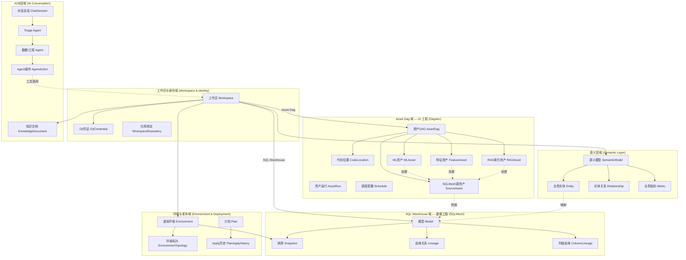
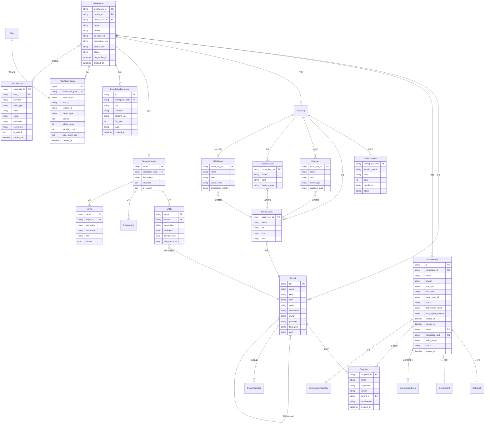
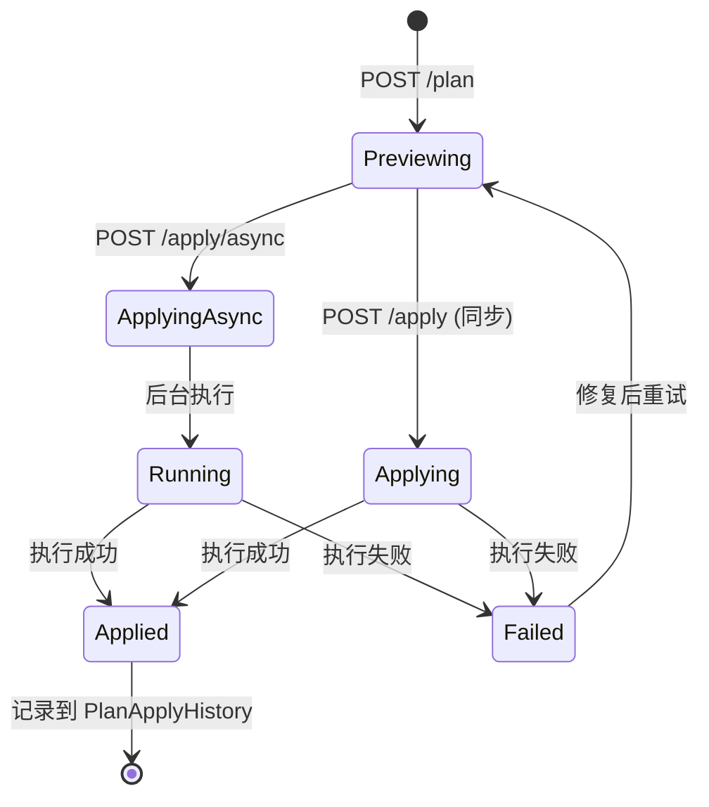
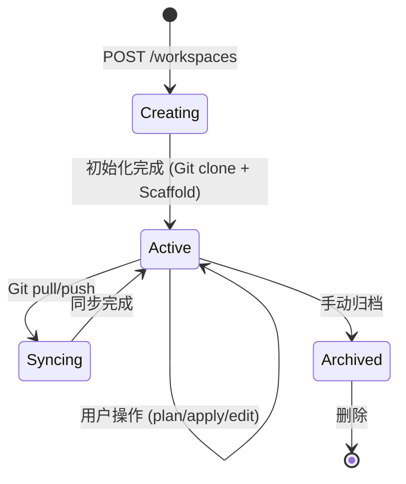
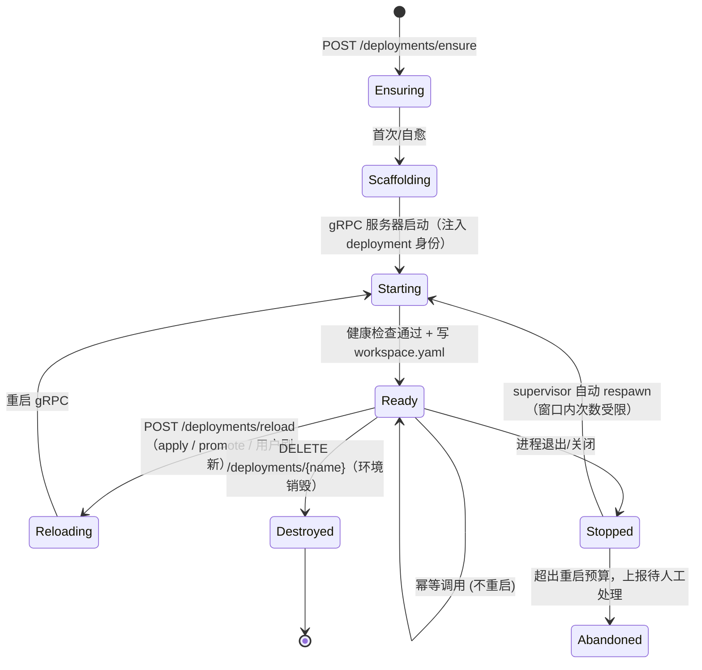
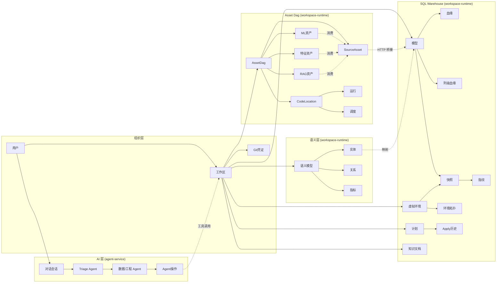

# 领域模型与业务术语设计

> DataCode — Data+AI 一体化 AI 原生开发平台
> 将传统数据工程（ELT、数据建模、数据质量、血缘）与现代 AI 工程（模型训练/推理、特征工程、RAG 索引构建）统一在一个 AI 原生开发平台中
> 基于 2.0 服务架构（gateway / identity-service / control-service / workspace-runtime / agent-service）实际实现；服务切分依据见 [00-README.md](00-README.md)

---

## 0. 平台定位与工作区双结构

### 0.1 平台定位

DataCode 是 **Data+AI 一体化 AI 原生开发平台**。传统数据平台与 AI 平台是割裂的，DataCode 将两者统一在同一个用户工作区内，由 AI Agent 贯穿全流程。

| 维度 | 传统数据平台 | 传统 AI 平台 | DataCode |
|------|------------|------------|-------------|
| 数据建模 | dbt / SQLMesh | 手写 SQL | SQLMesh（SQL Warehouse） |
| 流水线编排 | Airflow | Kubeflow / Metaflow | Dagster（Asset Dag） |
| AI 交互 | 无 / 脚本 | Notebook | AI Agent（自然语言驱动） |
| 资产统一 | 数据资产 ≠ AI 资产 | AI 资产 ≠ 数据资产 | 统一资产 DAG |

### 0.2 工作区双结构

每个用户工作区包含两个互补的工程子域：

| 子域 | 技术 | 定位 | 典型场景 |
|------|------|------|---------|
| **① SQL Warehouse** | SQLMesh | 传统数据工程 | ELT、数据建模、数据质量（审计）、血缘追踪、虚拟环境（dev/prod） |
| **② Asset Dag** | Dagster | 现代 AI 工程 | 数据处理管道、模型训练/推理、特征工程、RAG 索引构建、API/模型服务 |

两者通过 **SQLMesh Bridge** 连接：SQLMesh 模型自动映射为 Dagster SourceAsset，使 AI Pipeline 直接消费数据仓库产出。

---

## 1. 领域划分

系统按照 DDD（领域驱动设计）思想划分为以下限界上下文（Bounded Context）：



### 限界上下文职责

| 限界上下文 | 核心实体 | 所在服务 | 职责 |
|-----------|---------|---------|------|
| **身份与租户域** | User, Tenant, Role, TenantMember | identity-service | 认证、RBAC、租户放置（2.0 拆出：身份是全平台唯一真源） |
| **工作区与身份域** | Workspace, GitCredential, WorkspaceRepository | control-service（元数据） + workspace-runtime（物化） | 工作区生命周期管理（元数据/注册 vs 文件系统/引擎副作用分治）、Git 凭证管理、用户级开发环境隔离 |
| **SQL Warehouse 域** | Model, Snapshot, Lineage, ColumnLineage | workspace-runtime | SQLMesh 模型定义、版本管理（快照/指纹）、血缘分析 |
| **环境与发布域** | Environment, EnvironmentTopology, Plan, PlanApplyHistory | control-service（注册中心） + workspace-runtime（执行） | 虚拟环境管理、环境级拓扑构建、Plan/Apply 变更发布、审计追踪 |
| **Asset Dag 域** | AssetDag, CodeLocation, AssetRun, Schedule, SourceAsset, MLAsset, FeatureAsset, RAGAsset | workspace-runtime | Dagster Code Location 管理、统一资产 DAG（Data+ML+Feature+RAG）、运行编排、调度 |
| **语义层域** | SemanticModel, Entity, Relationship, Metric | workspace-runtime | 语义模型定义、业务实体/关系/指标、交叉引用验证、语义搜索 |
| **AI 对话域** | ChatSession, TriageAgent, DataAgent, AgentAction, KnowledgeDocument | agent-service | AI 交互、Agent 编排（Triage→专业 Agent）、工具调用（经 workspace-runtime） |

---

## 2. 核心实体关系（ER 模型）



---

## 3. 聚合根与实体层级

| 聚合根 (Aggregate Root) | 包含的实体/值对象 | 所在服务 | 说明 |
|------------------------|------------------|---------|------|
| **Workspace** | SQL Warehouse (Model, Environment, Plan), Asset Dag (AssetDag, SourceAsset), SemanticModel, KnowledgeDocument, GitCredential | control-service（元数据） + workspace-runtime（工作副本） | 工作区是 Data+AI 开发的核心组织单元，包含 SQL Warehouse 和 Asset Dag 两个子域 |
| **EnvironmentTopology** | Snapshot, SnapshotId, graph, nodes | workspace-runtime | 环境级拓扑从 snapshots 重建 |
| **Plan** | PlanApplyHistory, ChangeSet, Backfill | workspace-runtime | Plan 是变更管理的核心流程对象 |
| **AssetDag** | CodeLocation, SourceAsset, MLAsset, FeatureAsset, RAGAsset, AssetInfo, AssetDagEdge | workspace-runtime | 统一资产 DAG，桥接原生 Dagster + SQLMesh + AI Pipeline 资产 |
| **SemanticModel** | Entity, Relationship, Metric, Attribute, SubConcept | workspace-runtime | 语义模型是业务术语的容器 |
| **ChatSession** | TriageAgent, DataAgent, AgentAction, Artifact, ToolCall | agent-service | AI 对话会话，Agent 编排的上下文容器 |

> 1.x 的 ContextPool 聚合已随 2.0 沙箱化移除：用户代码不再于平台进程内构建 SQLMesh Context，读侧元数据由 workspace-runtime 的 MetadataContextStore 缓存，写侧进入 task-runner 沙箱（见 [04-workspace-sandbox-isolation.md](04-workspace-sandbox-isolation.md)）。

---

## 4. 领域事件

| 事件 | 触发条件 | 消费者 | 传输方式 |
|------|---------|--------|---------|
| `WorkspaceCreated` | 创建新工作区 | Scaffold（生成 asset-dag 骨架） | 同步调用 |
| `WorkspaceActivated` | 用户打开工作区 | workspace-runtime（ensure Code Location） | HTTP |
| `ModelFileChanged` | AI 生成/修改模型文件 | workspace-runtime（验证语法）、元数据缓存失效 | 同步 |
| `PlanCreated` | 创建 Plan 预览 | EventBus（SSE 推送进度） | SSE |
| `PlanApplied` | Plan apply 成功 | PlanApplyHistory（审计记录）、元数据缓存失效、AssetDag（重建） | 同步 + SSE |
| `EnvironmentChanged` | 切换虚拟环境 | 前端（重载模型/血缘）、workspace-runtime（重载 asset graph） | HTTP |
| `CodeLocationReady` | gRPC Code Location 启动完成 | workspace-runtime（GraphQL 查询资产图） | 同步 |
| `AssetRunCompleted` | Dagster 运行完成（Data/ML/Feature/RAG 资产） | 前端（状态更新）、EventBus | SSE |
| `OntologyValidated` | 本体验证完成 | 前端（展示错误）、workspace-runtime（外部引用检查） | HTTP |
| `GitOperationCompleted` | Git push/pull 完成 | 元数据缓存失效、前端（状态更新） | HTTP |
| `ErrorArchived` | 服务错误发生 | 错误归档到 `{workspace}/logs/errors/` | 同步 |
| `KnowledgeDocumentUploaded` | 上传知识文档 | KnowledgeDocumentModel（元数据记录） | HTTP |
| `AgentHandoff` | Triage Agent 路由到专业 Agent | 目标 Agent（加载上下文） | 内部 |
| `ToolCallRequested` | Agent 请求执行工具 | Approval（审批检查）、Tool Registry（执行） | 内部 |
| `ToolCallApproved` | 用户批准高危工具调用 | Tool Registry（执行工具） | SSE |
| `ArtifactGenerated` | Agent 生成代码产物 | 前端（展示 diff）、Workspace（写入文件） | SSE |

---

## 5. 状态机

### 5.1 Plan 状态机



### 5.2 Workspace 状态机



### 5.3 Context 状态机（1.x，已移除）

> ContextPool 及其状态机已随 2.0 沙箱化移除（P6 close-out）：平台进程不再构建
> SQLMesh Context —— 读侧元数据由 workspace-runtime 的 MetadataContextStore 缓存，
> 写侧（plan/apply）整体进入 task-runner 沙箱按任务执行。保留本节仅为阅读
> 历史设计时的对照，现行机制见 [04-workspace-sandbox-isolation.md](04-workspace-sandbox-isolation.md)。

### 5.4 Deployment（Code Location）状态机

一个 Deployment 对应一个环境（`{workspace_id}__{env}`），其载体是一个 Code Location gRPC 进程。



---

## 6. 业务术语表（Ubiquitous Language）

### 6.1 核心概念

| 术语 | 英文 | 定义 | 所属域 | 所在服务 |
|------|------|------|--------|---------|
| **工作区** | Workspace | 一个 SQLMesh 数据工程工作区，对应目录 `{base}/{tenant_id}/{workspace_id}/{user_id}/envs/{environment}/`（按环境隔离的工作副本），包含模型、Git、asset-dag 等 | 工作区与身份域 | control-service（元数据） + workspace-runtime（工作副本） |
| **工作副本** | Working Copy | 一个成员某环境的 Git worktree 检出，工作区租约的持有单位 | 工作区与身份域 | workspace-runtime |
| **模型** | Model | SQLMesh 中的数据转换单元，用 SQL 定义。显示名 `schema.table`，FQN 为完全限定名 | 模型开发域 | workspace-runtime |
| **虚拟环境** | Environment | SQLMesh 的虚拟环境（prod/dev 等），通过视图层实现隔离 | 环境与发布域 | control-service（注册） + workspace-runtime（执行） |
| **环境拓扑** | EnvironmentTopology | 从环境 snapshots 重建的模型依赖图，区别于本地定义视图 | 环境与发布域 | workspace-runtime |
| **计划** | Plan | SQLMesh 的变更计划，描述模型变更的影响范围和执行策略 | 环境与发布域 | workspace-runtime |
| **代码位置** | CodeLocation | Dagster 的 gRPC 服务器进程，加载用户 `asset-dag/` Python 代码 | 资产调度域 | workspace-runtime |
| **资产 DAG** | AssetDag | 统一的资产依赖图，合并原生 Dagster 资产 + SQLMesh 桥接资产 | 资产调度域 | workspace-runtime |
| **源资产** | SourceAsset | SQLMesh 模型在 Dagster 中的映射，key 为 `sqlmesh__schema__table` | 资产调度域 | workspace-runtime |
| **SQLMesh 桥接** | SQLMeshBridge | 生成的 asset-dag 代码通过 HTTP 调用 workspace-runtime 获取模型/血缘元数据 | 资产调度域 | workspace-runtime |
| **语义模型** | SemanticModel | 一个 YAML 文件定义的业务域，包含实体、关系、指标 | 语义层域 | workspace-runtime |
| **业务实体** | Entity | 语义层中的核心业务概念，映射到 SQLMesh 物理模型 | 语义层域 | workspace-runtime |
| **业务指标** | Metric | 业务度量定义（基础/过滤/派生/映射），映射到 SQLMesh 指标 | 语义层域 | workspace-runtime |
| **知识文档** | KnowledgeDocument | 存储在 `{workspace}/knowledge/` 下的业务知识文件 | AI 对话域 | workspace-runtime |

### 6.2 SQLMesh 专有概念

| 术语 | 英文 | 定义 |
|------|------|------|
| **快照** | Snapshot | 模型在某个时间点的完整状态，包含 SQL、配置、指纹等。存储在 state 中 |
| **快照 ID** | SnapshotId | 快照的唯一标识，`parents` 字段记录上游依赖 |
| **指纹** | Fingerprint | 模型内容的哈希值，用于检测变更。相同指纹 = 无变更 |
| **虚拟更新** | Virtual Update | 仅更新视图引用（不重新计算数据）的部署方式，实现零停机发布 |
| **回填** | Backfill | 对历史数据区间重新计算，通常在模型变更后触发 |
| **增量模型** | Incremental Model | 只处理新到达数据的模型（如 INCREMENTAL_BY_TIME_RANGE） |
| **全量模型** | Full Model | 每次运行都重新计算全部数据的模型 |
| **粒度** | Grain | 模型的主键定义，标识数据的唯一性 |
| **审计** | Audit | 数据质量检查规则，验证模型输出是否符合预期 |
| **血缘** | Lineage | 模型之间的依赖关系图（DAG），描述数据流向 |
| **列级血缘** | Column Lineage | 单个列的上游依赖追踪 |
| **方言** | Dialect | SQL 方言（如 duckdb、postgres、bigquery），决定 SQL 语法 |
| **网关** | Gateway | SQLMesh 的数据库连接配置，定义模型执行的目标引擎 |
| **前向计划** | Forward-only Plan | 不回填历史数据的变更计划，适用于大表 |
| **重跑计划** | Restatement Plan | 指定历史区间重新计算的计划，用于数据修复 |
| **State Reader** | State Reader | SQLMesh 读取 state（snapshots/environments）的接口 |
| **State Sync** | State Sync | SQLMesh 的状态同步层，支持 SQLite/PostgreSQL |

### 6.3 Dagster 专有概念

| 术语 | 英文 | 定义 |
|------|------|------|
| **DagsterInstance** | DagsterInstance | Dagster 的运行实例，包含 daemon + webserver + metadata DB |
| **Code Location** | Code Location | Dagster 的 gRPC 服务器，加载用户 Python 代码，始终本地运行 |
| **资产** | Asset | Dagster 中的数据资产单元，有唯一 asset key |
| **Asset Key** | Asset Key | 资产的唯一标识，路径形式如 `["sqlmesh", "schema", "table"]` |
| **SourceAsset** | SourceAsset | 外部数据源资产，SQLMesh 模型映射为 SourceAsset |
| **Definitions** | Definitions | Dagster 代码位置的入口，加载所有资产/作业/调度 |
| **Scaffold** | Scaffold | 渲染 `asset-dag/` 项目骨架的模板系统 |
| **Run** | Run | Dagster 中一次作业的执行实例 |
| **Schedule** | Schedule | Dagster 的定时调度配置 |

### 6.4 AI Pipeline 资产类型（Data+AI 一体化）

| 术语 | 英文 | 定义 | 所属子域 |
|------|------|------|---------|
| **数据资产** | Data Asset | SQLMesh 模型桥接的 SourceAsset，代表数据仓库产出 | SQL Warehouse → Asset Dag |
| **ML 资产** | ML Asset | ML 模型训练/推理资产，消费 Data Asset 作为训练数据 | Asset Dag |
| **特征资产** | Feature Asset | 特征工程资产，从原始数据计算特征并写入特征存储 | Asset Dag |
| **RAG 索引资产** | RAG Index Asset | RAG 索引构建资产，将文档嵌入向量并构建索引 | Asset Dag |
| **API/模型服务** | API/Model Serving | 模型部署和推理 API 暴露资产 | Asset Dag |
| **Daft 资源** | Daft Resource | 注入 Dagster 的 Daft DataFrame 处理资源 | Asset Dag |
| **MLflow 资源** | MLflow Resource | 注入 Dagster 的 MLflow 实验跟踪资源（Phase 2） | Asset Dag |
| **SQLMesh 资源** | SQLMesh Resource | 注入 Dagster 的 SQLMesh plan/apply 触发资源 | Asset Dag |

### 6.5 平台专有概念

| 术语 | 英文 | 定义 |
|------|------|------|
| **Data+AI 一体化** | Data+AI Unified | 平台核心理念：数据工程与 AI 工程统一在一个工作区内，由 AI Agent 贯穿全流程 |
| **SQL Warehouse** | SQL Warehouse | 工作区的数据仓库子域，基于 SQLMesh，负责传统数据工程（ELT、建模、质量、血缘） |
| **Asset Dag** | Asset Dag | 工作区的 AI Pipeline 子域，基于 Dagster，负责现代 AI 工程（训练/推理、特征、RAG） |
| **AI 原生** | AI Native | AI Agent 是平台的一等公民，自然语言驱动开发，而非附加工具 |
| **Agent 记忆** | Agent Memory | 存储在 `.ai/memory/` 目录下的 Markdown 文件，记录对话摘要和关键决策 |
| **记忆索引** | Memory Index | `.ai/memory/index.md` 文件，Agent 每次启动时加载的核心记忆 |
| **上下文快照** | Context Snapshot | `.ai/context/` 目录下的文件，描述工作区概要、编码规范、术语表 |
| **Agent 操作** | Agent Action | AI Agent 建议的可执行操作（如部署、提交），需用户确认 |
| **操作分级** | Action Level | AI 操作的风险等级（L1只读 ~ L6管理），决定是否需要人工确认 |
| **Agent Client Protocol** | ACP | 前端与 Agent Service 之间的标准化通信协议 |
| **Handoff** | Handoff | openai-agents SDK 中 Agent 间的对话转交机制 |
| **Triage Agent** | Triage Agent | 负责意图识别和路由的入口 Agent |
| **错误归档** | Error Archive | 将服务错误持久化到 `{workspace}/logs/errors/` 目录，供 Agent 消费 |
| **工作区日志** | Workspace Log | 可归因到工作区的服务日志，以 NDJSON 落到 `{workspace}/logs/service/`，级别为字段 |
| **变更类别** | Change Category | Plan 中模型变更的分类：破坏性(Breaking) / 非破坏性(Non-breaking) |
| **显示名** | Display Name | SQLMesh 模型的用户可读名称 `schema.table`，对应 Dagster asset key `sqlmesh__schema__table` |
| **环境切换** | Environment Switching | 前端切换 SQLMesh 虚拟环境，驱动模型列表/血缘/资产图按环境刷新 |

### 6.6 概念关系图



---

## 7. 跨上下文映射

### 7.1 模型 → 资产（SQLMesh → Dagster）

SQLMesh 模型通过 `SQLMeshBridge` 映射为 Dagster SourceAsset，这是 SQL Warehouse 与 Asset Dag 之间的桥梁：

| SQLMesh 概念 | Dagster 概念 | 映射规则 |
|-------------|-------------|---------|
| 模型显示名 `schema.table` | Asset Key `["sqlmesh", "schema", "table"]` | 加 `sqlmesh` 前缀，`.` → 路径段 |
| 模型显示名 | Asset Key Str `sqlmesh__schema__table` | `.` → `__` |
| 模型显示名 | Asset `name` 字段 | 直接使用 |
| 模型 FQN | 血缘图节点 key | 内部使用 FQN |
| 模型上游依赖 | Asset `deps` | 上游 FQN → 显示名 → asset key str |
| 模型 kind | Asset `kind` | 标记为 `sqlmesh` |

### 7.2 Data → AI 资产依赖链（Data+AI 一体化）

SourceAsset（数据资产）是 AI Pipeline 资产的上游，体现 Data+AI 统一资产 DAG：

```
SQLMesh 模型 (Data Asset)
    ↓ SourceAsset 桥接
Dagster SourceAsset (sqlmesh__schema__table)
    ↓ 消费
├── ML Asset (train_model) → API/Model Serving (deploy)
├── Feature Asset (compute_features)
└── RAG Index Asset (build_vector_index)
```

| 资产类型 | 上游 | 产出 | 典型 Dagster 资源 |
|---------|------|------|------------------|
| SourceAsset (Data) | SQLMesh 模型 | 数据表/视图 | SQLMeshBridge (HTTP) |
| ML Asset | SourceAsset | 训练好的模型 | MLflowResource |
| Feature Asset | SourceAsset | 特征向量 | DaftResource |
| RAG Index Asset | SourceAsset + ML Asset | 向量索引 | DaftResource |
| API/Model Serving | ML Asset | 推理 API | — |

### 7.3 语义实体 → SQLMesh 模型

Ontology Entity 通过 `Entity.model` 字段引用 SQLMesh 模型，`CrossRefValidator` 验证引用存在性：

| Ontology 概念 | SQLMesh 概念 | 验证方式 |
|-------------|-------------|---------|
| `Entity.model` | Model name/fqn | HTTP 调用 `/api/v1/models` 检查存在 |
| `Metric.maps_to` | SQLMesh metric name | HTTP 调用获取指标名集合 |
| `Entity.gateway` | Model gateway | 从模型列表提取 model→gateway 映射 |

### 7.4 环境切换的影响范围

切换 SQLMesh 虚拟环境时，以下数据源按环境刷新：

| 数据源 | 服务 | 环境参数 | 数据来源 |
|--------|------|---------|---------|
| 模型列表 | workspace-runtime `/models` | `environment` | local: `context.models`；promoted: snapshots |
| 模型血缘 | workspace-runtime `/lineage` | `environment` | local: `context.dag`；promoted: snapshot parents |
| 资产图 | workspace-runtime `/assets/graph` | `environment` | 原生资产不受影响；SQLMesh 子图按环境 |
| SQLMesh 子图 | workspace-runtime `buildSqlmeshSubgraph` | `environment` | 调用 `/sqlmesh/lineage?environment=...` |
