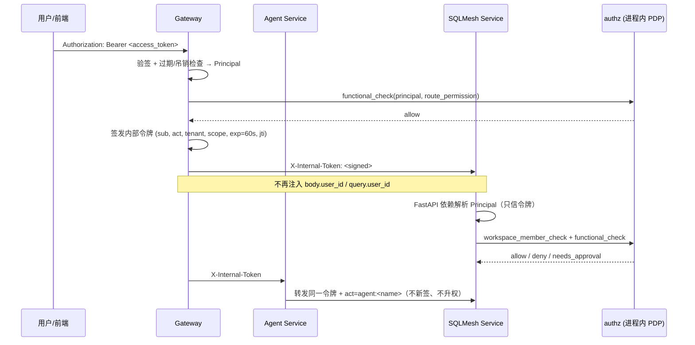
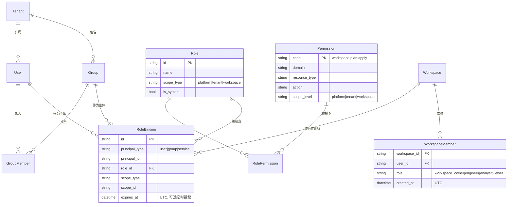
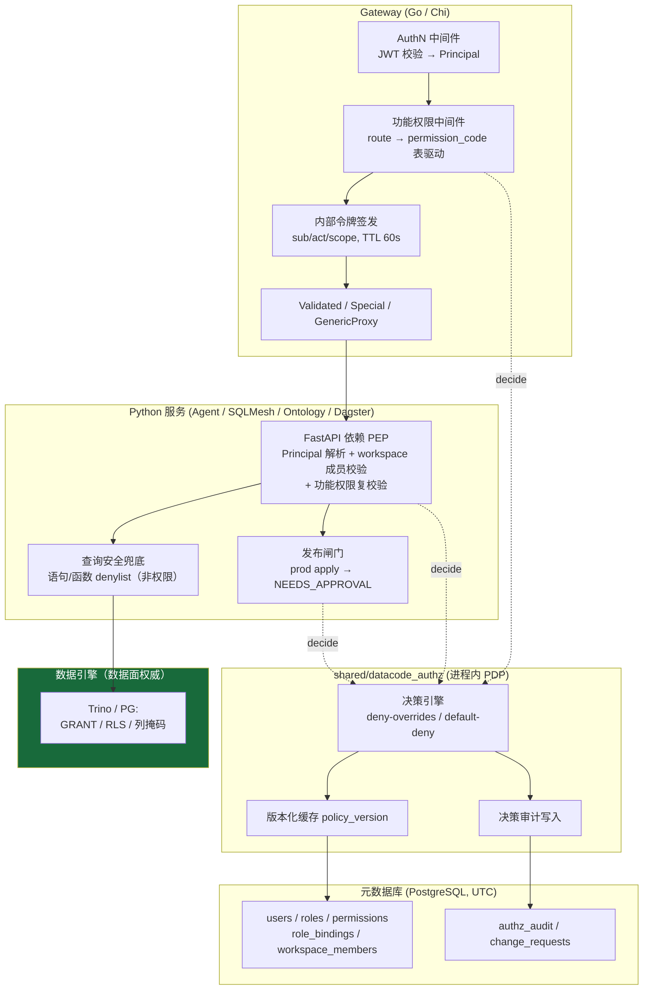
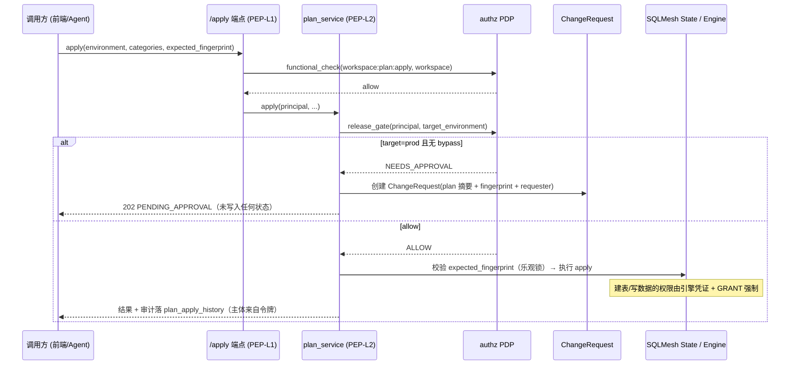

# 平台权限体系设计 — 控制面 RBAC（数据面下沉引擎）

> DataCode — Data+AI 一体化 AI 原生开发平台
> 本文档定义平台的**身份认证、功能权限（RBAC）、工作区归属、发布审批、审计**五件事。
> **明确不做**：不在平台层重建一套数据访问控制去替代数据引擎的权限。

---

## 0. 定位：平台管什么，引擎管什么

这是本方案最重要的一节。所有后续设计都是这条定位的推论。

### 0.1 核心判断

DataCode 是**开发工具（developer tool）**，不是数据网关，也不是数据安全产品。因此：

| 层面 | 谁是权威（authority） | 理由 |
|------|---------------------|------|
| **数据面**：谁能读哪张表 / 哪些行 / 哪些列 | **数据引擎**（Trino / PostgreSQL 的 `GRANT` / RLS / 列掩码） | 引擎是执行时强制点（runtime enforcement），不可绕过；应用层解析 SQL 只是"猜"，永远堵不完（动态 SQL、方言差异、表函数、外部读） |
| **控制面**：谁能用平台的哪个能力 | **DataCode 平台** | 这些操作**引擎看不见**，引擎无从鉴权 |

### 0.2 为什么控制面必须平台自己管

SQLMesh 在引擎之上造了一层抽象（environment / snapshot / virtual update / plan-apply 工作流）。这层抽象里的动作，引擎**天然无法鉴权**——引擎只看得到最终的 `CREATE TABLE` / `SELECT`，看不到"这是一次 dev plan 还是 prod 发布"。

| 操作 | 引擎能鉴权吗 | 原因 |
|------|------------|------|
| `POST /files/write` 改 `models/*.sql` | ❌ | 改的是 Git 工作区文件，根本没碰引擎 |
| "能不能发起一次 prod apply" | ❌ | 引擎只看到 DDL/DML，不知道这是发布动作 |
| `DELETE /environments/{name}` | ❌ | SQLMesh 逻辑环境是工具概念 |
| 进入某个 workspace | ❌ | 多租户归属是平台概念 |
| Agent 调用工具 / shell | ❌ | 完全在应用层 |
| Dagster 调度触发 | ❌ | 调度是平台概念 |
| 建表 / 写数据 / 读数据时有无权限 | ✅ | **交给引擎** |

### 0.3 边界声明（必须显式承认，不可默认成立）

> **DataCode 的数据面权限强度 = 底层数据引擎的权限强度。**

- ✅ **Trino / PostgreSQL / Snowflake / BigQuery**（本项目生产形态）：有 `GRANT` / RLS，定位成立。
- ⚠️ **DuckDB / 本地嵌入式**：无身份鉴权。本平台**仅将其定位为本地开发引擎，不承载生产敏感数据**。不再试图用应用层沙箱模拟鉴权（那是必败的军备竞赛）。

### 0.4 本期的数据隔离边界

本期**不做**"用户身份下推到引擎连接"（列为后续阶段，见 §9）。因此本期的实际数据隔离边界是：

```
workspace 成员资格  →  该 workspace 的 config.yaml gateways 凭证  →  引擎侧该凭证的 GRANT 范围
```

即：**workspace 是数据隔离单元**，同一 workspace 内的成员共享同一引擎身份、拥有同等数据可见性。工作区之间的数据隔离靠"不同 workspace 配不同引擎凭证 + 引擎侧 GRANT"实现。

这是一个诚实且常见的开发工具定位（dbt Cloud、Hex 同类做法）。**必须写进产品文档**，避免让人误以为"用了 DataCode 就有细粒度数据权限"。

### 0.5 被明确否决的设计（相比早期草案）

| 被否方案 | 否决原因 |
|---------|---------|
| `query` 端点做 **AST 表引用集 → 反查 model FQN → 资源鉴权** | 在应用层重建数据库权限引擎；`read_parquet` / `ATTACH` / 动态 SQL / 方言差异永远堵不完；Trino/PG 有 `GRANT` 时纯属重复劳动 |
| DuckDB **引擎沙箱模拟鉴权**（函数 denylist 当权限用） | 沙箱是"防逃逸的安全措施"，不是"权限"。把它当权限用会给出虚假安全感 |
| `model_access_policies` 模型级资源策略 + 受管标签审批 | 属于数据面权威争夺；运维成本极高（策略需与引擎 GRANT 双写，必然漂移） |
| `apply_indirect` 下游弱动作、变更集逐模型资源判定 | 随资源级鉴权一并移除；下游影响改用"审批 + 通知 + 审计"闭环治理 |
| 血缘 / 模型列表的**未授权节点脱敏** | 元数据脱敏收益低、实现复杂、易破坏 DAG 语义。workspace 已是隔离边界，进不了 workspace 就看不到元数据 |

---

## 1. 现状与问题

| 层面 | 现状（2026-Q3） | 风险 |
|------|----------------|------|
| 认证 | 无。Gateway `DefaultUser` 中间件硬编码注入 `user-admin-001` / `tenant-default`；`GET /api/v1/me` 返回硬编码 `role: admin` | 无身份，无法审计到人 |
| 身份传播 | Gateway 反代时**新建请求、不透传身份**；`user_id` 靠 body 注入 / query 拼接（`injectUserIDIntoBody`） | 后端信任客户端传入的 `user_id`，可任意伪造 |
| 功能权限 | 无。路由表 `ValidatedRoutes` 只校验必填 query 参数 | 任何人可调用任何端点 |
| 工作区归属 | 无。`validate_workspace_path` 只做路径遍历防护，**不校验归属** | 任意用户可操作任意工作区 |
| 发布管控 | 无。prod apply 与 dev apply 等价 | 无发布闸门 |
| 审计 | 仅 `plan_apply_history` 记录 apply 归属（且归属字段来自不可信输入） | 审计不可信 |

**核心问题一句话**：平台**连身份都没有**。在没有可信身份之前，讨论任何权限都是空谈——这也是为什么 §3 的身份链是整个方案的地基与第一优先级。

---

## 2. 目标与非目标

### 2.1 目标

| 目标 | 说明 |
|------|------|
| **可信身份** | 所有请求都有可验证主体（User / Agent 委托 / ServiceAccount / ScheduledJob）；后端不再信任客户端传入的 `user_id` |
| **真实用户名注入** | 引擎侧、Git commit、审计、日志中出现的都是**真人身份**，而非 `user-admin-001` |
| **功能权限 RBAC** | "能不能用这个能力"——按角色控制端点/菜单/操作，声明式、集中维护 |
| **工作区归属** | 非成员不可访问该 workspace 的任何端点（多租户隔离边界） |
| **prod 发布审批** | 生产发布默认走审批（`NEEDS_APPROVAL`），不是简单 allow/deny |
| **可审计** | 每次授权决策与关键操作落审计表，UTC 时间戳，归属到真人 |
| **低侵入** | 复用现有架构：Gateway 表驱动路由、FastAPI 依赖注入、`shared/` 共享库、无新增 gRPC |

### 2.2 非目标（本期明确不做）

| 非目标 | 归属 |
|--------|------|
| 模型级 / 表级 / 行级 / 列级数据权限 | 数据引擎 `GRANT` / RLS / 列掩码 |
| SQL 语义鉴权（引用了哪些表能不能读） | 数据引擎 |
| 用户身份下推到引擎连接 | 后续阶段（§9 P4） |
| Ontology / Dagster 资源级权限 | 后续（同一 RBAC 扩展 permission code 即可） |

### 2.3 原则

1. **控制面 Default Deny**：无显式 allow 即拒绝；`deny` 优先于 `allow`。
2. **控制面 Fail-Closed**：授权组件不可用时拒绝（**显式违背平台其他模块的 fail-soft 惯例**）；保留带全量审计与告警的 break-glass 环境开关（默认关闭）。
3. **不放大权限**：Agent / 调度 / 服务账号只能以**委托（on-behalf-of）**行事，权限恒为委托人权限的子集。
4. **UI 不是安全边界**：前端按 capability 隐藏/禁用只为体验，服务端必须重复校验。
5. **数据面不自建**：平台层只保留"防注入/防逃逸"的**安全兜底**（§7），不承担数据授权判定。
6. **无历史兼容负担**：直接移除 `DefaultUser`、body/query 的 `user_id` 信任等既有机制。

---

## 3. 身份与认证（AuthN）— 地基

### 3.1 主体（Principal）模型

| 主体类型 | 说明 | 凭证 | 权限来源 |
|---------|------|------|---------|
| **User** | 真人用户 | 登录后 Access Token（JWT，短 TTL）+ Refresh Token | 角色绑定 |
| **Agent（委托）** | agent-service 代表用户执行 | 内部令牌，`sub=用户`，`act=agent:{name}` | **用户权限 ∩ Agent 工具白名单 ∩ 审批等级** |
| **ServiceAccount** | 服务间调用（如 dagster→sqlmesh 读元数据） | 内部令牌，`sub=svc:{name}` | 显式最小角色，禁止持有 `apply` / prod 权限 |
| **ScheduledJob（冻结委托）** | Dagster 调度触发 | 内部令牌，`sub=创建者`，`act=schedule:{id}` | 创建时记录委托人，**运行时重新判定**（权限被回收则任务失败） |

### 3.2 身份传播链（消除伪造面）



**关键约束**：

- 后端**只接受**来自内部令牌的身份；请求体/查询参数中的 `user_id` 一律**忽略并告警**（无需兼容历史）。
- 内部令牌 TTL ≈ 60s + `jti` 防重放；签名密钥**仅来自环境变量**（secrets env-only）。
- 服务端口不对外暴露；服务间调用必须携带令牌，缺失即 401（**不再有"无令牌默认用户"**）。
- `GET /api/v1/me` 返回真实主体 + **capability 清单**（供前端渲染）。

### 3.3 真实用户名的落点（"注入真实身份"的具体含义）

这是本期最有实际价值的一块。真实身份必须一路带到以下位置：

| 落点 | 现状 | 目标 |
|------|------|------|
| 结构化日志 | `user_id=user-admin-001` | 真实 user id（英文日志） |
| `plan_apply_history.user_id` | 来自可伪造输入 | 来自内部令牌 |
| Git commit author | 工作区级配置 | `author = {username} <{email}>`，来自登录身份 |
| 审计表 `authz_audit` / 操作审计 | 无 | `principal` + `actor` + `on_behalf_of` |
| SQLMesh 个人开发环境命名 | 手工传入 | `dev_{username}` 由服务端按身份生成 |
| 引擎连接身份 | workspace 共享凭证 | **本期保持共享凭证**；下推列入 P4（§9） |

> 注意区分：本期"真实用户名注入"覆盖的是**平台侧可观测性与归属**（日志/审计/Git/环境命名），**不含引擎连接身份**。后者是 P4。

---

## 4. 功能权限（RBAC）

### 4.1 模型



要点：

- **Permission** 是平台**预置封闭集合**（种子数据，不允许运行时随意新增），命名 `domain:resource:action`，全英文。
- **Role** 分系统内置与自定义；`scope_type` 决定可绑定层级。
- **RoleBinding** 带 scope（platform ⊇ tenant ⊇ workspace）与可选 `expires_at`，支持**临时提权**（到期自动失效，全程审计）。
- **没有 `model_access_policies`**——资源级数据策略不在本期范围（§0.5）。

### 4.2 权限点目录（按能力，而非按数据资源）

> **单一真相源**：`shared/rbac-catalog.json`。Go 侧（`shared/go/rbac`）与 Python 侧
> （`datacode_common.rbac`）的常量表由 `scripts/gen-rbac-catalog.py` 生成，两侧各自
> 读同一份 JSON 做漂移断言。identity-service 启动时把目录同步进 `permissions` 表；
> 该表是**投影**（供角色编辑器下发选项、让已下线权限码的历史角色组合仍可读），
> 永不作为真相源、永不经 API 写入——因此权限码无法靠写库"发明"出来。
>
> 下表为当前实现的完整目录（7 个租户级 + 21 个工作区级）。新增权限点 = 改 JSON +
> 重新生成；漏改任一侧则两个语言的测试之一必红。

**租户作用域**（判据：与具体工作区无关的租户级能力）

| 权限点 | 语义 |
|--------|------|
| `tenant:member:read` / `tenant:member:write` | 查看 / 增删改租户成员 |
| `tenant:role:read` / `tenant:role:write` | 查看 / 管理角色与其权限组合 |
| `tenant:workspace:create` | 在租户内创建工作区 |
| `tenant:workspace:join` | 可被授予工作区访问权（无此权限者不出现在成员选择器中） |
| `tenant:agent:use` | 使用 Agent 会话与语言模型 |

**工作区作用域**（判据："**能不能用这个能力**"，与"操作哪些数据"无关，后者归引擎）

| 权限点 | 语义 | 覆盖端点（示例） |
|--------|------|-----------------|
| `workspace:read` | 打开工作区、读元数据 | `POST /workspaces/{id}/open` |
| `workspace:delete` | 删除工作区 | `DELETE /workspaces/{id}` |
| `workspace:member:read` / `:write` | 查看 / 授予撤销工作区成员 | `/workspaces/{id}/members` |
| `workspace:git:bind` | 绑定或重绑 Git 仓库 | `POST /workspaces/bind-git` |
| `workspace:git:push` | 推送到远端，**亦即"使用某个 Git 凭证"** | `/git/push`, `/git/publish`, `/git/merge` |
| `workspace:env:read` / `:create` / `:delete` | 环境（分支 + 虚拟环境 + 部署三合一）的读 / 建 / 毁 | `/workspaces/{id}/environments`, `/environments/*` |
| `workspace:env:promote` | 合并进 production 分支、启用非生产部署的调度 | `POST /git/merge`（目标为 prod 时的附加门） |
| `workspace:code:read` / `:write` | 读 / 写模型、文件、血缘 | `/files/*`, `/sqlmesh/render`, `/wip/*` |
| `workspace:plan:preview` / `:apply` | plan 预览 / 应用 | `/sqlmesh/plan`, `/sqlmesh/apply` |
| `workspace:query:run` | 执行 ad-hoc 查询（**读哪张表由引擎判**） | `/sqlmesh/query`, `/sqlmesh/evaluate` |
| `workspace:knowledge:read` / `:write` | 业务知识文档读 / 写 | `/knowledge/*` |
| `workspace:ontology:read` | 读语义本体 | `/ontology/*` |
| `workspace:pipeline:read` / `:run` | 查看 / 触发取消流水线 | `/dagster/*` |
| `workspace:logs:read` | 读工作区服务日志与错误归档（与 `code:read` 分离：日志行可能引用 SQL、数据值、远端主机） | `/logs/*` |

**刻意不设权限点的资源：Git 凭证（用户个人 PAT）**

`/git/credentials*` 只要求**已认证身份**，边界是**归属**而非角色：网关重写身份头并覆盖
请求里任何 `user_id`，控制面按 `caller.user_id` 过滤读、按 `(credential_id, user_id)`
解析写。权限门开在"**用**凭证做什么"（`workspace:git:push`、prod 另加
`workspace:env:promote`），而不是"管我自己的令牌"。

> 反面教材（已修复）：控制面曾断言一个不在目录里的 `git:credential:write`。它不在
> `permissions` 表 → 角色编辑器无该复选框 → identity 拒绝手动授予，于是**任何角色
> （含 admin）都不可能持有它**，凭证写入对所有人恒 403。守护措施：`require_permission`
> 在导入期校验目录成员（非法码则服务启动即失败），网关路由表测试断言"每个路由要求的
> 权限必须至少能被一个内置角色持有"，AST 扫描禁止手写权限码字面量。

### 4.3 内置角色

角色**定义**在代码（`shared/rbac-catalog.json` 的 `roles`），角色**组合**在数据库且
**租户可编辑**（含内置角色）。seeder 写 `tenant_id=''` 的模板行，租户首次被解析时克隆
一份实例，此后 seeder 不再触碰实例——这正是租户的编辑能跨重启存活的原因。

| 角色 | 作用域 | 权限集 |
|------|--------|--------|
| `admin` | tenant | 成员读写 + 角色读写 + `workspace:create` + `workspace:join` + `agent:use` |
| `developer` | tenant | 成员读 + 角色读 + `workspace:create` + `workspace:join` + `agent:use` |
| `viewer` | tenant | `tenant:member:read` |
| `workspace_owner` | workspace | 全部工作区权限（由目录推导，新增权限点自动纳入） |
| `engineer` | workspace | 读写代码、push、环境增删、plan 预览与应用、查询、知识读写、本体读、流水线读跑、日志读 |
| `analyst` | workspace | 读代码、plan 预览、查询、环境读、知识/本体/流水线读、日志读（**无** `code:write`、**无** `plan:apply`） |
| `viewer` | workspace | 读工作区/成员/代码/环境/知识/本体/流水线 |

**滚动升级语义**：向模板新增权限时，`EnsureTenantRoles` 只回填**未被定制**的内置角色
（当前权限集是模板子集者）。已被租户定制的角色**不覆盖**（否则会静默撤销租户的授权），
改为记 `builtin_role_permission_drift` 结构化告警，并可经内部只读端点
`GET /internal/tenants/{tid}/rbac/role-drift` 查询积压，由管理员决定是否补授。

### 4.4 判定位置与算法



判定算法（简单且可缓存，无资源集求值）：

```
decide(principal, permission_code, scope) -> Verdict
  1. 解析有效角色集：RoleBinding(user + 所属 group)，按 scope 匹配（platform ⊇ tenant ⊇ workspace）
     过滤 expires_at < now(UTC)
  2. scope 为 workspace 时：先校验 workspace 成员资格；非成员 → DENY_NOT_MEMBER（对外 404）
  3. permission_code ∈ (角色 → 权限点) 并集 ? ALLOW : DENY_FUNCTIONAL
  4. 发布闸门（仅 apply 类）：目标环境为 prod 且主体无 bypass → NEEDS_APPROVAL
  5. 写审计（principal / actor / permission / verdict / policy_version / latency_ms, UTC）
```

| Verdict | 处理 |
|---------|------|
| `ALLOW` | 继续执行 |
| `DENY` | 403 `{error_code: AUTHZ_DENIED, message, detail:{required_permission}}` |
| `NEEDS_APPROVAL` | 202 `PENDING_APPROVAL`，落 `ChangeRequest`，走审批（§6） |

**为什么 PDP 是进程内库而非独立服务**：与既有"不引入新 gRPC"决策一致；策略数据量小（角色/绑定量级 10²–10³）可全量缓存；避免热路径网络往返与可用性耦合。

---

## 5. 工作区归属与多租户隔离

本期最实用的隔离机制。**workspace 成员资格既是控制面边界，也是（本期）事实上的数据可见性边界**（§0.4）。

| 规则 | 设计 |
|------|------|
| 成员校验位置 | 所有携带 `workspace_path` / `workspace_id` 的端点，统一由 FastAPI 依赖前置校验（与现有 `validate_workspace_path` 路径遍历防护叠加，两者职责不同） |
| 非成员响应 | **404**（而非 403），避免通过错误码枚举工作区存在性 |
| 工作区角色 | 成员表带 `role`（`workspace_owner` / `engineer` / `analyst` / `viewer`），与全局 RoleBinding 取**并集**后再判功能权限 |
| 引擎凭证归属 | `config.yaml` 的 `gateways` 段是 workspace 级配置，**由 Owner 维护**；普通成员不可读取明文凭证（API 返回时脱敏） |
| 跨工作区读 | 禁止。`state_schema` 已按 workspace 隔离（`workspace_state_schema()`），引擎侧建议不同 workspace 使用不同引擎账号 |
| Agent / Dagster 访问 | 委托令牌里带 workspace scope，同样过成员校验，无旁路 |

> 由此得出一条重要的运维约定：**敏感数据域应放在独立 workspace，并为该 workspace 配置权限受限的引擎账号**。这是本期表达"数据分级"的正确方式（而不是在平台里写模型级策略）。

### 5.1 落地实现（已生效）

Workspace 已按"租户级共享 + Git 为唯一代码载体 + 每人独立本地工作副本"落地。

**标识与路径约定**（唯一来源：`workspace-runtime/src/api/deps.py`，校验函数 `validate_workspace_path`）

| 项 | 约定 |
|----|------|
| `workspace_id` | `ws-{tenant_id}-{slug}`，`slug` 由 workspace 名称规范化而来 |
| 共享根目录 | `{workspace_base_path}/{tenant_id}/{workspace_id}` |
| 用户工作副本 | `{workspace_base_path}/{tenant_id}/{workspace_id}/{user_id}` |

本地路径**不入库**，一律在运行时按上表推导。`validate_workspace_path` 在原有"必须位于 base 之下"的遍历防护之外，追加**严格四段布局校验**：多一层或少一层（例如共享根、`sql-warehouse/` 子目录）均拒绝。

**实际表结构**

```
workspaces
  id             VARCHAR(128) PK      -- ws-{tenant_id}-{slug}
  tenant_id      VARCHAR(64)  NOT NULL
  owner_user_id  VARCHAR(64)  NOT NULL
  name           VARCHAR(128) NOT NULL
  dialect        VARCHAR(32)  NOT NULL DEFAULT 'duckdb'
  git_repo_url   VARCHAR(512) NULL    -- 为空 => 非 Owner 不可打开
  git_branch     VARCHAR(64)  NOT NULL DEFAULT 'main'
  status         VARCHAR(32)  NOT NULL DEFAULT 'active'
  created_at / updated_at / last_active_at  TIMESTAMP (UTC)
  INDEX idx_workspaces_tenant_status (tenant_id, status)
  -- 无 local_path 列

workspace_members
  workspace_id   VARCHAR(128) PK
  user_id        VARCHAR(64)  PK
  role           VARCHAR(32)  NOT NULL   -- workspace_owner|engineer|analyst|viewer
  created_at     TIMESTAMP (UTC)
  INDEX idx_workspace_members_user (user_id)
```

**权威与鉴权**

- DB 是 workspace 存在性与成员关系的**唯一权威**；磁盘只是可丢弃的 Git 工作副本（丢失后重新 clone）。已移除"磁盘扫描 + 回填 DB"机制。
- 列表接口按 `tenant_id` + `workspace_members` 单次 JOIN 过滤，**非成员看不到该 workspace**；直接访问返回 **404**（防枚举）。
- 创建者自动写入 `workspace_owner` 成员行（与 workspace 插入同事务）；其余租户成员需 Owner **手动授权**。
- Owner-only 操作：成员增删、绑定 Git、删除 workspace（返回 403）。
- 租户成员目录由 identity-service 提供（`GET /api/v1/auth/tenant-members`，经网关代理，仅返回 `userId`/`username`）；添加成员时 identity-service 先校验目标用户 ∈ 调用方租户，workspace 成员授权走 identity 的内部 bindings API（P5.5 起 identity 是身份数据集的唯一写入方）。

**打开与 openable 语义**

- `POST /api/v1/workspaces/{id}/open`：body 携带 `environment`（不再是 `branch`）。首次为该用户建立共享的裸仓库 `.repo`，之后为目标环境按需追加一个 Git worktree，落到调用者自己的目录 `{tenant}/{ws}/{user}/envs/{env}`。省略 `environment` 时采用 workspace 的 `default_env`。切换环境不做 `checkout`，因此不会被未提交改动阻塞，多个环境可并行持有。
- `openable = bool(git_repo_url) or (role == owner and 本地副本已存在)`。后半段仅覆盖 Owner "已 scaffold、尚未绑定 Git"的引导期，其他成员一律置灰并提示联系 Owner 推送代码。该值由**后端计算**，前端不得自行从 `git_repo_url` 推导。
- `git_repo_url` 在创建/绑定时统一做 SSRF 校验：仅允许 `https` / `ssh`（含 `git@host:org/repo.git`），拒绝 loopback、link-local、私有网段及 `9./10./11./21./30.` 段。

### 5.2 遗留缺口

`POST` body 中的 `workspace_path` 目前只做**容器 + 布局**校验，未与调用者身份做密码学绑定。Gateway 已对以 query 参数携带 `workspace_path` 的 ValidatedRoutes 追加"路径中的用户目录必须等于已认证 user_id"的纵深校验（`rbac.OwnsWorkingCopy`，按 `{tenant}/{ws}/{user}/envs/{env}` 布局取第三段，不符返回 403），但 body 路径的完整身份绑定依赖 §3 内部令牌阶段落地，本期显式记为遗留缺口。

---

## 6. 发布管控：prod apply 审批

引擎能拦"这个账号不能在 `marts` 建表"，但拦不住"这次 apply 是一次未评审的生产发布"。所以**发布语义必须平台管**。

### 6.1 闸门位置



要点：

- 闸门判定发生在**任何状态写入之前**，且与现有 `write_lock` / `expected_fingerprint` 乐观锁同一临界区（防 TOCTOU）。
- **不做**变更集逐模型资源判定；`ChangeRequest` 只**携带 plan 摘要供人类审批人评估**（added / directly_modified / indirectly_modified / removed / restatements 计数与列表），这是**信息展示**，不是鉴权输入。
- 审批通过后由**原发起人身份**重放（审批人只授予放行，不转移归属），审批人记入审计。
- 审批流复用 agent-service 现有审批通道与 SSE 通知，不新建机制。

### 6.2 环境策略

| 环境 | 默认策略 |
|------|---------|
| `dev_{username}` 个人环境 | 直接 allow（服务端按登录身份生成环境名，不接受任意命名） |
| 共享 dev / staging | 有 `workspace:plan:apply` 即 allow |
| `prod` | `NEEDS_APPROVAL`（可按 workspace 配置允许 `WorkspaceOwner` bypass） |
| `restate` on prod | 恒 `NEEDS_APPROVAL`（覆盖历史数据，风险等同写生产） |
| `DELETE /environments/*` | 需 `sqlmesh:environment:delete`；prod 环境恒需审批 |

---

## 7. 查询安全兜底（这是"安全"，不是"权限"）

`/query` 保留一层极薄的校验，目的是**防注入与防引擎逃逸**，不做数据授权判定。

| 兜底项 | 规则 | 目的 |
|--------|------|------|
| 语句类型 allowlist | 仅 `SELECT` / `WITH` / `DESCRIBE` / `EXPLAIN` | 防 ad-hoc 查询端点被当作 DDL/DML 通道（会绕过 plan/apply 的发布审批） |
| 多语句拒绝 | `;` 分隔的多语句一律拒绝 | 防"第一条合法、第二条搞事" |
| 本地文件/网络函数拒绝 | `read_csv` / `read_parquet` / `read_json` / `glob` / `httpfs` 等 | 防经服务进程读取服务器本地文件（这是**SSRF/LFI 类安全问题**，与数据权限无关） |
| `ATTACH` / `INSTALL` / `LOAD` / `COPY TO` 拒绝 | 语句 denylist | 防引擎逃逸与写文件 |
| 资源配额 | `row_limit` / 超时 / 并发上限 | 防资源滥用 |
| 审计 | SQL 指纹 + 主体 + 行数 + 耗时（英文日志） | 事后追溯 |

**明确不做**：不解析表引用集、不反查 model FQN、不做 `read_data` 判定。查询能读到什么，**由该 workspace 的引擎凭证在引擎侧的 GRANT 决定**。

同理，`evaluate` / `render` / `table-diff` / `test` 只校验 `sqlmesh:query:execute` 功能权限 + 上述安全兜底。

---

## 8. 数据模型与审计

统一存 **UTC** 时间戳；表放在现有元数据库（SQLite 开发 / PostgreSQL 生产）。

| 表 | 用途 | 关键字段 |
|----|------|---------|
| `tenants` / `users` | 租户与用户 | id, tenant_id, username, email, timezone, status, password_hash（本地认证时） |
| `groups` / `group_members` | 用户组（按团队授权） | group_id, principal_id |
| `permissions` | 权限点目录（种子数据、封闭集） | code, domain, resource_type, action, scope_level |
| `roles` / `role_permissions` | 角色与功能权限 | role_id, scope_type, is_system, permission_code |
| `role_bindings` | 主体—角色—作用域绑定 | principal_type/id, role_id, scope_type/id, expires_at(UTC) |
| `workspace_members` | 工作区成员与工作区内角色 | workspace_id, user_id, role_id, created_at(UTC) |
| `change_requests` / `change_approvals` | 发布审批 | plan_summary_json, fingerprint, target_environment, requester, approver, status |
| `authz_audit` | 决策审计 | principal, actor, on_behalf_of, permission_code, scope, verdict, reason, policy_version, latency_ms, created_at(UTC) |
| `policy_versions` | 缓存失效 epoch | scope, version, updated_at(UTC) |

> 相比早期草案，**删除** `model_access_policies`、`managed_model_labels`、`role_gateway_credentials`（后者随 P4 引擎下推再引入）。

**审计要求**：

- 记录 `actor`（实际执行者，可能是 agent/schedule）与 `on_behalf_of`（委托人）双字段。
- 用户时区仅用于**前端展示**；存储与后端逻辑全 UTC。
- 结构化日志输出 `authz_decision` 事件（英文），暴露 deny 率、审批积压等指标。

---

## 9. 落地阶段

| 阶段 | 范围 | 完成标志（可验收） |
|------|------|------------------|
| **P0 身份地基**（最高优先） | 登录 / JWT、内部令牌签发与校验、**移除 `DefaultUser` 与 body/query 的 `user_id` 信任**、`/me` 真实化、`authz_audit` 表、日志与 `plan_apply_history` 归属真实化、Git commit author 真实化 | 无令牌请求全部 401；日志与 apply 历史可追溯到真人 |
| **P1 功能权限 + 工作区归属** | 权限点种子、内置角色、Gateway `route → permission_code` 表、服务侧 workspace 成员校验、`/me` capability 清单、前端按 capability 渲染 | 非成员访问工作区返回 404；Analyst 调 `/apply` 返回 403 |
| **P2 发布审批 + 查询安全兜底** | prod apply / restate 的 `NEEDS_APPROVAL`、`ChangeRequest` + 审批中心、`/query` 语句与函数 denylist、配额与审计 | prod apply 必须经审批；`/query` 无法执行 DDL 与文件读 |
| **P3 委托与调度治理** | Agent 委托令牌（`act` 字段）、工具白名单、`agent:tool:shell` 独立权限点、Dagster 调度冻结委托 + 运行时复检 | Agent 权限 ≤ 用户权限；权限回收后调度任务失败 |
| **P4 引擎身份下推**（后续，本期不做） | `role/user → gateway credential` 映射（凭证加密，密钥 env-only）、或统一服务账号 + `SET ROLE` / session user 传递、Trino/PG 库内角色与 `GRANT` 规范 | 直连引擎也无法越权；数据面权限从 workspace 级细化到用户级 |

---

## 10. 关键设计决策总结

| # | 决策 | 原因 | 被否方案 |
|---|------|------|---------|
| 1 | **数据面权威下沉引擎**，平台不做 SQL 语义鉴权 | 引擎是执行时强制点；应用层 AST 鉴权是必败的军备竞赛，且与引擎 `GRANT` 重复 | 平台层做表/模型级数据鉴权 |
| 2 | **控制面权限平台自管** | plan/apply 语义、环境、文件写、workspace 归属、Agent 工具在引擎里**不可见** | 全部交给引擎（漏掉一大批操作） |
| 3 | 显式声明"数据面强度 = 引擎强度"，DuckDB 仅限本地开发 | 避免虚假安全感；不用沙箱冒充权限 | 用 DuckDB 沙箱模拟鉴权 |
| 4 | **workspace 为本期数据隔离单元** | 引擎凭证是 workspace 级配置，天然边界；实现简单、语义清晰 | 平台内做细粒度数据策略（与引擎双写必漂移） |
| 5 | 功能权限用**纯 RBAC**，无资源选择器 | 判据只关心"能不能用这个能力"，无需 ABAC 复杂度 | RBAC + 模型选择器 + 受管标签（运维成本过高） |
| 6 | `select_models` / SQL `tags` **完全不参与授权** | 客户端可控、用户可编辑，本就不是安全边界；随资源鉴权移除，标签自提权漏洞自然消失 | 以选择器/标签为闸门（伪权限） |
| 7 | 保留 `NEEDS_APPROVAL` 三态 | 生产发布需"有条件放行"；纯 deny 会让权限系统被绕过或关掉 | 二态判定 |
| 8 | `ChangeRequest` 携带 plan 摘要仅供**人类审批**，非鉴权输入 | 保留发布评审价值，同时不引入资源级判定复杂度 | 变更集逐模型资源判定 |
| 9 | 身份只来自**签名内部令牌** | 现状后端信任 body `user_id` 等于无鉴权；服务可能被直连 | 明文 `X-User-ID`（可伪造） |
| 10 | 控制面 **fail-closed**（违背平台 fail-soft 惯例） | 权限降级即静默提权 | 沿用 fail-soft |
| 11 | PDP 为**进程内共享库** | 与"不引入 gRPC"一致；策略量小可全量缓存；避免热路径往返 | 独立 authz-service |
| 12 | 非成员返回 **404** | 避免通过错误码枚举工作区/资源存在性 | 统一 403 |
| 13 | Agent / 调度采用**委托 + 运行时复检** | 常驻高权服务账号是最大隐患；调度会让已回收权限长期存活 | Agent 用固定服务账号 |
| 14 | 引擎身份下推**列为 P4** | P0–P3 已消除"无身份、无功能权限、无发布闸门"三大空洞；下推涉及引擎侧账号治理，独立推进 | 一次性做完（阻塞地基交付） |

---

## 11. 已知局限

| 局限 | 说明 | 缓解 / 后续 |
|------|------|------------|
| 本期数据可见性只到 **workspace 级** | 同一 workspace 成员数据可见性相同 | 敏感域独立 workspace + 受限引擎账号；P4 做用户级下推 |
| DuckDB 无引擎鉴权 | 嵌入式引擎无 `GRANT` | 定位为本地开发引擎，不承载生产敏感数据（产品文档需明示） |
| 引擎侧 `GRANT` 需人工治理 | 平台不自动同步引擎权限 | P4 提供 Trino/PG 角色与 GRANT 规范；平台只读展示 |
| 缓存最终一致 | 角色/绑定回收存在收敛窗口 | 版本号轮询 ≤5s；高敏操作（prod apply / environment delete）强制回源判定 |
| Git 批量落盘无法逐文件前置拦截 | pull / checkout 会批量改文件 | `workspace:code:write` 为 workspace 级能力权限，配合审批与审计；不做逐文件资源鉴权 |
| Ontology / Dagster 资源级权限未纳入 | 本期只做能力权限 | 后续按需扩展 permission code，无需改 PDP 结构 |
