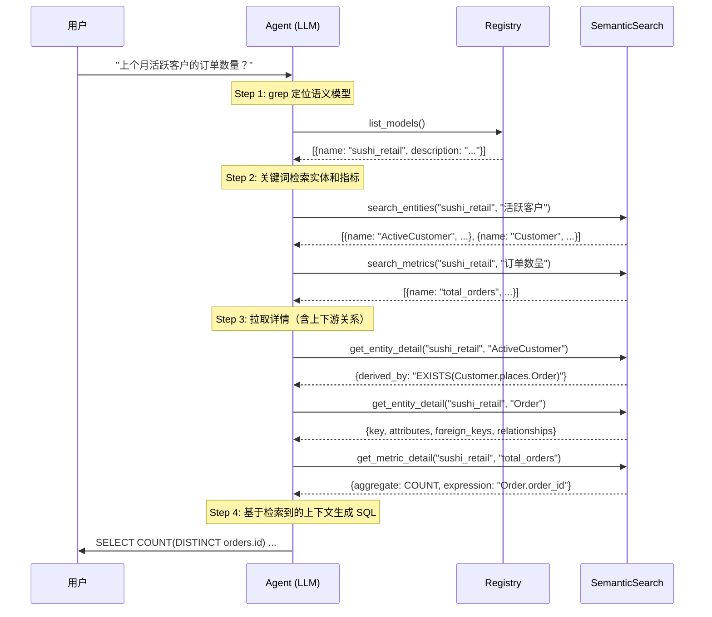

# 语义层方案设计

**版本**: 0.1.0  
**状态**: Draft  
**作者**: AgenticData Team

---

## 目录

1. [概述与设计目标](#1-概述与设计目标)
2. [架构总览](#2-架构总览)
3. [核心概念模型](#3-核心概念模型)
4. [Schema 完整规范](#4-schema-完整规范)
5. [与 OSI 标准的关系](#5-与-osi-标准的关系)
6. [运行时架构](#6-运行时架构)
7. [Agent 按需检索工作流](#7-agent-按需检索工作流)
8. [与 dbt 语义层对比](#8-与-dbt-语义层对比)
9. [扩展与演进路线](#9-扩展与演进路线)

---

## 1. 概述与设计目标

### 1.1 问题背景

在数据仓库项目中，存在三层鸿沟：

```
物理层 (SQLMesh Models)       逻辑层 (dbt/SQLMesh)        语义层 (需填补)
┌──────────────────┐      ┌──────────────────┐      ┌──────────────────┐
│ sushi.customers   │      │ MODEL(name ...)   │      │ "客户"是什么概念？   │
│ sushi.orders      │ ───▶ │ METRIC(name ...)   │ ──?─▶│ 客户与订单什么关系？  │
│ sushi.order_items │      │                  │      │ "活跃客户"怎么定义？  │
│ sushi.waiter_names│      │                  │      │ AI 如何理解这些？    │
└──────────────────┘      └──────────────────┘      └──────────────────┘
```

SQLMesh 已经解决了物理层到逻辑层的映射（通过 MODEL/METRIC），但缺少一个**业务语义层**来回答：

- 这些表和指标在业务上代表什么**概念**？
- 概念之间有什么**关系**？自然语言如何表达？
- 如何在不修改 SQLMesh DDL 的前提下增强**本体语义**？
- AI Agent 如何理解并正确使用这些数据？

### 1.2 设计目标

| 目标 | 说明 |
|------|------|
| **与 SQLMesh 解耦** | 不修改任何 MODEL/METRIC 定义，语义层独立配置 |
| **单文件一体化** | 一个 `semantic_model.yaml` = 一个业务域，概念+映射+关系+指标全收拢 |
| **OSI 标准兼容** | 概念模型对齐 OSI ontology 规范（EntityType/ValueType/ManyToOne 等） |
| **dbt 用户友好** | 设计风格接近 dbt semantic model，降低迁移成本 |
| **AI-Native** | 内建 `ai_context` 结构化标注（synonyms、instructions、examples） |
| **可扩展** | 支持概念继承（sub_concepts）、派生指标（derived）、映射已有指标（maps_to） |

### 1.3 核心设计原则

```
一个业务域 = 一个文件 = 一次读完即理解全貌

semantic_model.yaml
├── 实体(Entity)      ← 概念声明 + 物理模型映射，一体定义
├── 关系(Relationship) ← 语义关系 + JOIN 条件，一体定义
├── 指标(Metric)      ← 业务指标 + AI 语义标注，一体定义
└── AI上下文          ← 结构化 AI 提示，各级可挂载
```

---

## 2. 架构总览

### 2.1 系统分层

```
┌──────────────────────────────────────────────────────────────┐
│                      消费层 (Consumers)                       │
│  ┌──────────┐  ┌──────────────┐  ┌──────────┐  ┌──────────┐ │
│  │ AI Agent │  │ BI 工具(拖拽)│  │ REST API │  │ Notebook │ │
│  └────┬─────┘  └──────┬───────┘  └────┬─────┘  └────┬─────┘ │
└───────┼────────────────┼──────────────┼──────────────┼───────┘
        │                │              │              │
        ▼                ▼              ▼              ▼
┌──────────────────────────────────────────────────────────────┐
│                   语义层 (Semantic Layer)                      │
│                                                              │
│  ┌──────────────────────────────────────────────────────┐   │
│  │              semantic_model.yaml                      │   │
│  │  ┌──────────┐  ┌──────────────┐  ┌───────────────┐  │   │
│  │  │ Entities │  │ Relationships│  │    Metrics    │  │   │
│  │  │(概念+映射)│  │ (语义关系+JOIN)│  │ (指标+AI标注) │  │   │
│  │  └──────────┘  └──────────────┘  └───────────────┘  │   │
│  └──────────────────────────────────────────────────────┘   │
│                                                              │
│  ┌──────────────────────────────────────────────────────┐   │
│  │                  语义层引擎                             │   │
│  │  ┌────────┐  ┌──────────┐  ┌────────┐  ┌─────────┐  │   │
│  │  │ Loader │  │ Resolver │  │ Planner│  │SQL Gen  │  │   │
│  │  │(解析器) │  │ (概念解析)│  │ (计划) │  │(SQL生成)│  │   │
│  │  └────────┘  └──────────┘  └────────┘  └─────────┘  │   │
│  └──────────────────────────────────────────────────────┘   │
└──────────────────────────┬───────────────────────────────────┘
                           │ 查询 SQLMesh State
                           ▼
┌──────────────────────────────────────────────────────────────┐
│               逻辑层 (SQLMesh Logical Layer)                   │
│  ┌──────────────┐  ┌──────────────┐  ┌──────────────────┐   │
│  │ MODEL(name)  │  │ METRIC(name) │  │ AUDIT(name,...)  │   │
│  │ (不改动)      │  │ (不改动)      │  │ (不改动)          │   │
│  └──────────────┘  └──────────────┘  └──────────────────┘   │
└──────────────────────────┬───────────────────────────────────┘
                           │
                           ▼
┌──────────────────────────────────────────────────────────────┐
│                物理层 (Physical Layer)                         │
│  ┌────────────────┐  ┌────────────────┐  ┌──────────────┐   │
│  │ sushi.customers │  │ sushi.orders   │  │ ...           │   │
│  └────────────────┘  └────────────────┘  └──────────────┘   │
└──────────────────────────────────────────────────────────────┘
```

### 2.2 数据流

```
用户/AI 问题: "上个月有多少活跃客户的订单？"
        │
        ▼
┌─────────────────────────────────────┐
│ 1. 语义解析 (Resolver)              │
│    "活跃客户" → ActiveCustomer      │
│    "订单" → Order                   │
│    "上个月" → 时间范围过滤          │
│    "多少" → COUNT 聚合              │
└──────────────┬──────────────────────┘
               │
               ▼
┌─────────────────────────────────────┐
│ 2. 概念展开 (Concept Expander)      │
│    ActiveCustomer                    │
│      → derived_by: EXISTS(Customer  │
│           .places.Order)             │
│      → 需要 JOIN Customer + Order   │
└──────────────┬──────────────────────┘
               │
               ▼
┌─────────────────────────────────────┐
│ 3. JOIN 规划 (Join Planner)         │
│    Customer.customer_id =            │
│      Order.customer_id               │
│    → sushi.customers                 │
│      JOIN sushi.orders               │
│      ON customers.customer_id        │
│         = orders.customer_id          │
└──────────────┬──────────────────────┘
               │
               ▼
┌─────────────────────────────────────┐
│ 4. SQL 生成 (SQL Generator)         │
│    SELECT COUNT(DISTINCT             │
│      customers.customer_id)          │
│    FROM sushi.customers              │
│    JOIN sushi.orders                 │
│      ON customers.customer_id        │
│         = orders.customer_id          │
│    WHERE customers.status = 'ACTIVE' │
│      AND orders.event_date           │
│        BETWEEN '2026-06-01'          │
│        AND '2026-06-30'              │
└─────────────────────────────────────┘
```

---

## 3. 核心概念模型

### 3.1 实体 (Entity)

实体是语义层的核心抽象，代表业务世界中可被引用的"事物"。

```yaml
entities:
  - name: Customer                              # 概念名（业务语言）
    description: A person who places orders     # 业务描述
    type: EntityType                            # OSI 概念类型

    model: sushi.customers                      # 物理模型映射（SQLMesh 全限定名）
    key:
      customer_id: customer_id                  # 概念属性 → 物理列

    attributes:
      - name: status                            # 属性（维度）
        column: status                          # 物理列
        type: categorical
        ai_context:
          synonyms: [customer state, account status]

    foreign_keys:                               # 外键（对另一端的概念引用）
      - name: customer_id
        column: customer_id
        references: Customer.customer_id

    sub_concepts:                               # 子概念/概念继承（OSI 特性）
      - name: ActiveCustomer
        derived_by: "EXISTS(Customer.places.Order)"
```

**实体类型层级**：

```
EntityType (可被引用的独立事物)
├── Customer          # 客户
├── Order             # 订单
├── OrderItem         # 订单行项
└── Waiter            # 服务员

ValueType (带语义的数据类型，扩展 BuiltIn)
├── String            # 内置
├── Integer           # 内置
├── Date              # 内置
└── Amount            # 自定义值类型（extends: [Decimal]）
```

### 3.2 关系 (Relationship)

关系定义实体之间如何关联，同时声明：
- **物理 JOIN 条件**：如何生成 SQL
- **语义描述**：自然语言如何表达（verbalizes）
- **多重性约束**：ManyToOne / OneToOne

```yaml
relationships:
  - name: Customer.places                    # 关系全限定名
    from: Customer                           # 源概念
    to: Order                                # 目标概念
    join:
      - [customer_id, customer_id]           # 物理 JOIN: from.列 = to.列
    multiplicity: ManyToOne                  # 一个客户可以有多个订单
    verbalizes:                              # 自然语言双向表述
      - "{Customer} places {Order}"          # 正向
      - "{Order} is placed by {Customer}"    # 反向
```

**关系类型**：

| 关系类型 | 示例 | 说明 |
|---------|------|------|
| **实体间关系** | `Customer.places → Order` | 不同实体间的外键关联 |
| **实体属性关系** | `Order.ordered_on → event_date` | 通过 `via_attribute` 将实体属性提升为关系 |
| **自引用关系** | `OrderItem.has_quantity → quantity` | 同一实体的属性关系 |

**verbally 模板变量**：
- `{ConceptName}` — 插入概念名称
- `{ConceptName:roleName}` — 当同一概念出现多次时区分角色
- `{attributeName}` — via_attribute 关系中的属性值

### 3.3 指标 (Metric)

指标定义业务度量，支持三种模式：

```yaml
metrics:
  # 模式 1: 基础指标（直接在语义层定义）
  - name: total_orders
    description: Total number of orders
    aggregate: COUNT
    expression: Order.order_id         # 概念.属性 引用
    entity: Order

  # 模式 2: 带过滤的指标
  - name: total_orders_from_active_customers
    aggregate: COUNT
    expression: Order.order_id
    filter: "Customer.status = 'ACTIVE'"  # 语义层过滤条件
    entities: [Order, Customer]           # 涉及多个实体时声明

  # 模式 3: 派生指标（基于其它指标计算）
  - name: items_per_order
    derived:
      formula: total_ordered_items / total_orders
    entities: [OrderItem, Order]

  # 模式 4: 映射已有 SQLMesh METRIC（不重定义）
  - name: sushi_total_orders
    maps_to: total_orders              # 指向已有 METRIC(name total_orders)
    ai_context:                        # 仅增加 AI 语义标注
      examples:
        - "How many orders were placed last week?"
```

### 3.4 AI 上下文 (AI Context)

`ai_context` 是各级定义中可挂载的结构化 AI 提示，支持两种形式：

```yaml
# 简单字符串形式
ai_context: "Use this for sales analysis"
```

```yaml
# 结构化对象形式（推荐）
ai_context:
  instructions: "Use this model for sushi restaurant sales and customer analytics"
  synonyms:
    - sushi analytics
    - restaurant data
  examples:
    - "Show total sales last month"
    - "What is the revenue by customer region?"
```

**挂载级别**：

| 级别 | 作用域 |
|------|--------|
| `semantic_model.ai_context` | 整个语义模型的全局 AI 提示 |
| `entity.ai_context` | 单个实体的同义词、使用说明 |
| `attribute.ai_context` | 单个属性的同义词（如 "purchase date" 同义于 "order date"） |
| `metric.ai_context` | 指标的同义词和使用示例 |

---

## 4. Schema 完整规范

### 4.1 顶层结构

```yaml
version: "0.1.0"                    # 必需，Schema 版本
name: <string>                      # 必需，业务域唯一标识
description: <string>               # 可选，业务域描述
ai_context: <string|object>         # 可选，AI 上下文
entities: <Entity[]>                # 必需，实体定义列表
relationships: <Relationship[]>    # 可选，关系定义列表
metrics: <Metric[]>                 # 可选，指标定义列表
```

### 4.2 Entity Schema

| 字段 | 类型 | 必需 | 说明 |
|------|------|------|------|
| `name` | string | 是 | 业务概念名称，如 `Customer`、`Order` |
| `description` | string | 否 | 概念的业务描述 |
| `type` | `EntityType` \| `ValueType` | 是 | 概念类型 |
| `model` | string | EntityType 必需 | SQLMesh 物理模型全限定名 |
| `key` | `map<string,string>` | EntityType 必需 | 概念属性→物理列映射 |
| `attributes` | `Attribute[]` | 否 | 属性/维度列表 |
| `foreign_keys` | `ForeignKey[]` | 否 | 外键列表 |
| `sub_concepts` | `SubConcept[]` | 否 | 子概念（继承此概念的定义） |
| `extends` | `string[]` | 否 | 继承自哪些概念 |
| `derived_by` | `string[]` | 否 | 概念派生表达式 |
| `identify_by` | `string[]` | 否 | 标识关系的名称 |
| `requires` | `string[]` | 否 | 概念约束条件 |
| `ai_context` | `string\|object` | 否 | AI 上下文 |

**Attribute**：

| 字段 | 类型 | 必需 | 说明 |
|------|------|------|------|
| `name` | string | 是 | 属性名（业务语言） |
| `column` | string | 是 | 物理列名 |
| `type` | `categorical` \| `time` \| `numeric` \| `text` | 否 | 属性类型，默认 `categorical` |
| `granularity` | string | time 类型时可用 | 时间粒度：`second`/`minute`/`hour`/`day`/`week`/`month`/`year` |
| `description` | string | 否 | 属性描述 |
| `ai_context` | `string\|object` | 否 | AI 上下文 |

**ForeignKey**：

| 字段 | 类型 | 必需 | 说明 |
|------|------|------|------|
| `name` | string | 是 | 外键属性名 |
| `column` | string | 是 | 物理列名 |
| `references` | string | 是 | 目标概念.属性的点分隔引用，如 `Customer.customer_id` |

**SubConcept**：

| 字段 | 类型 | 必需 | 说明 |
|------|------|------|------|
| `name` | string | 是 | 子概念名 |
| `derived_by` | string `|` string[] | 是 | 派生表达式（ANSI SQL） |
| `description` | string | 否 | 子概念描述 |
| `ai_context` | `string\|object` | 否 | AI 上下文 |

### 4.3 Relationship Schema

| 字段 | 类型 | 必需 | 说明 |
|------|------|------|------|
| `name` | string | 是 | 关系全限定名，格式 `Concept.relationshipName` |
| `from` | string | 是 | 关系的源概念 |
| `to` | string | 是 | 关系的目标概念（可与 from 相同） |
| `join` | `string[][]` | 常规关系必需 | 物理 JOIN 条件：`[[from属性, to属性], ...]` |
| `via_attribute` | string | 属性关系时使用 | 关系的"值"来自此属性 |
| `multiplicity` | `ManyToOne` \| `OneToOne` | 否 | 多重性约束 |
| `description` | string | 否 | 关系描述 |
| `verbalizes` | `string[]` | 是 | 自然语言模板，至少一个 |
| `derived_by` | `string[]` | 否 | 关系派生规则 |
| `requires` | `string[]` | 否 | 关系约束条件 |
| `ai_context` | `string\|object` | 否 | AI 上下文 |

### 4.4 Metric Schema

| 字段 | 类型 | 必需 | 说明 |
|------|------|------|------|
| `name` | string | 是 | 指标唯一名称 |
| `description` | string | 否 | 指标描述 |
| `aggregate` | `COUNT` \| `SUM` \| `AVG` \| `MIN` \| `MAX` \| `COUNT_DISTINCT` | 基础指标必需 | 聚合函数 |
| `expression` | string | 基础指标必需 | 度量表达式，格式 `Concept.attribute` |
| `entity` | string | 基础指标且单实体时 | 主要实体 |
| `entities` | `string[]` | 基础指标且多实体时 | 涉及的实体列表 |
| `filter` | string | 否 | 语义层过滤条件 |
| `derived.formula` | string | 派生指标必需 | 派生公式，引用其他指标名 |
| `maps_to` | string | 映射指标时使用 | 映射到已有 SQLMesh METRIC 名称 |
| `ai_context` | `string\|object` | 否 | AI 上下文 |

---

## 5. 与 OSI 标准的关系

### 5.1 双层 OSI 模型

本方案兼容 OSI 的双层架构：

```
┌──────────────────────────────────────────┐
│ OSI Semantic Model (Core Spec)           │  ← 物理/逻辑层描述
│  - datasets (物理表)                      │     models.py:
│  - relationships (FK关系)                │     OSISemanticModel
│  - fields (列表达式)                      │
│  - metrics (聚合指标)                     │
└──────────────────┬───────────────────────┘
                   │
                   │ mapped by ontology_mappings
                   ▼
┌──────────────────────────────────────────┐
│ OSI Ontology (Ontology Spec)             │  ← 概念/本体层描述
│  - concepts (EntityType, ValueType)      │     ontology.json:
│  - relationships (带 verbose 语义)        │     Concept + Relationship
│  - derived_by (推导规则)                  │
│  - requires (约束规则)                     │
│  - identify_by (标识方式)                 │
└──────────────────────────────────────────┘
```

### 5.2 semantic_model.yaml 涵盖的 OSI 概念

| semantic_model.yaml 元素 | 对应的 OSI Core | 对应的 OSI Ontology |
|--------------------------|-----------------|---------------------|
| `entities[].name` | `OSIDataset.name` | `Concept.name` |
| `entities[].type` | — | `ConceptType` |
| `entities[].model` | `OSIDataset.source` | — (在 ontology_mappings 中) |
| `entities[].key` | `OSIDataset.primary_key` | `Concept.identify_by` |
| `entities[].attributes[]` | `OSIField` | — |
| `entities[].sub_concepts[]` | — | `Concept.derived_by` |
| `entities[].extends` | — | `Concept.extends` |
| `entities[].derived_by` | — | `Concept.derived_by` |
| `relationships[].name` | `OSIRelationship.name` | `Relationship.name` (含 concept 前缀) |
| `relationships[].join` | `OSIRelationship.from_columns/to_columns` | — (在 ontology_mappings 中) |
| `relationships[].multiplicity` | — | `Relationship.multiplicity` |
| `relationships[].verbalizes` | — | `Relationship.verbalizes` |
| `metrics[].name` | `OSIMetric.name` | — |
| `metrics[].aggregate` | `OSIMetric.expression` (SQL 中的聚合) | — |
| `metrics[].derived.formula` | — (需合成) | — |
| `ai_context` | `OSIAIContext` | `ai_context` |

### 5.3 设计取舍：一体化 vs 双层分离

| 维度 | OSI 双层分离 | semantic_model.yaml 一体化 |
|------|-------------|--------------------------|
| **文件数量** | 2+ (core + ontology + mappings) | 1 |
| **概念复用** | ontology 可跨项目共享 | 同文件内 sub_concepts 继承 |
| **映射显式度** | 独立的 ontology_mappings | 内联在 entity/relationship 中 |
| **入门门槛** | 高（需理解抽象层次） | 低（dbt 用户一眼看懂） |
| **适合场景** | 大型企业多项目复用 | 中小团队快速落地 |

**推荐策略**：先用一体化方案快速落地，当项目规模增长需要跨域复用时，可通过自动工具将 `semantic_model.yaml` 拆分为 OSI Core + Ontology + Mappings 三件套。

---

## 6. 运行时架构

### 6.1 核心组件（第一期）

```
ontology-service/
├── doc/
│   └── semantic-layer-design.md
├── examples/
│   └── sushi_retail.yaml              # 示例语义模型
├── registry/
│   └── models.yaml                    # 语义模型注册表（← Agent grep 入口）
├── src/
│   ├── __init__.py
│   ├── loader.py                      # YAML → 内存模型 解析器
│   ├── models.py                      # Pydantic 数据模型
│   ├── cross_ref_validator.py         # 交叉引用校验
│   └── semantic_search.py             # 语义检索服务（← 第一期核心）
└── tests/
    ├── test_loader.py
    ├── test_models.py
    ├── test_cross_ref_validator.py
    ├── test_semantic_search.py        # 语义检索测试
    └── test_sushi_retail.py
```

**第一期不包含**：
- `planner.py` / `sql_generator.py` / `metric_engine.py` / `relationship_graph.py`
- 这些组件留到需要自动 SQL 生成引擎的后续阶段再实现

### 6.2 Agent 检索工作流总览

Agent 不是一次性获取全部上下文，而是**按需逐步检索**：



### 6.3 核心类设计（第一期）

#### Registry — 语义模型注册表

Agent 需要先知道有哪些语义模型可用，这通过一个轻量注册表实现：

```yaml
# registry/models.yaml
models:
  - name: sushi_retail
    path: examples/sushi_retail.yaml
    description: Sushi restaurant retail analytics
    keywords: [sushi, restaurant, retail, order, customer]
    ai_context:
      synonyms: [sushi analytics, restaurant data]
```

对应 Python 模型：

```python
class ModelRegistry:
    """语义模型注册表——Agent grep 的入口。
    
    在项目启动时加载 registry/models.yaml，
    提供 list_models() 让 Agent 知道有哪些语义模型可用。
    """
    
    def __init__(self, registry_path: Path, models_dir: Path):
        self._models: Dict[str, ModelMeta] = {}
        # 加载注册表
        data = yaml.safe_load(registry_path.read_text())
        for m in data["models"]:
            self._models[m["name"]] = ModelMeta(
                name=m["name"],
                path=models_dir / m["path"],
                description=m.get("description"),
                keywords=m.get("keywords", []),
                ai_context=m.get("ai_context"),
            )
    
    def list_models(self) -> List[ModelSummary]:
        """列出所有可用的语义模型（Agent 第一步调用）。"""
        return [
            ModelSummary(
                name=m.name,
                description=m.description,
                keywords=m.keywords,
            )
            for m in self._models.values()
        ]
    
    def get_model(self, name: str) -> SemanticModel:
        """按名加载完整语义模型（懒加载，按需解析）。"""
        meta = self._models[name]
        return SemanticModel.from_yaml(meta.path)
```

#### SemanticSearchService — 语义检索服务（核心新增）

替代原来的 `ContextBuilder`，提供 Agent 按需检索的工具集：

```python
class SemanticSearchService:
    """Agent 语义检索工具集。
    
    核心设计理念：
    - Agent 不一次性加载全部上下文，而是按需逐步检索
    - 每个方法对应 Agent 的一个 tool
    - 先搜摘要（search_*），再拉详情（get_*_detail），最后可按需展开关系图
    """
    
    def __init__(self, registry: ModelRegistry):
        self._registry = registry
        self._loaded: Dict[str, SemanticModel] = {}   # 懒加载缓存
    
    def _load(self, model_name: str) -> SemanticModel:
        """懒加载语义模型。"""
        if model_name not in self._loaded:
            self._loaded[model_name] = self._registry.get_model(model_name)
        return self._loaded[model_name]
    
    # ─── Tool 1: 按关键词搜索实体 ───
    def search_entities(
        self, model_name: str, keyword: str, limit: int = 5
    ) -> List[EntitySummary]:
        """搜索实体：匹配 name、description、ai_context.synonyms。
        
        Agent 使用示例：
        - search_entities("sushi_retail", "客户") → [Customer, ActiveCustomer]
        - search_entities("sushi_retail", "purchase") → [Order]（匹配到 Order 的 synonym）
        """
        model = self._load(model_name)
        results = []
        kw = keyword.lower()
        
        for entity in model.entities.values():
            score = self._entity_match_score(entity, kw)
            if score > 0:
                results.append(EntitySummary(
                    name=entity.name,
                    type=entity.type,
                    description=entity.description,
                    model_ref=entity.model,
                    match_score=score,
                    match_reason=self._match_reason(entity, kw),
                ))
        
        results.sort(key=lambda r: r.match_score, reverse=True)
        return results[:limit]
    
    # ─── Tool 2: 按关键词搜索指标 ───
    def search_metrics(
        self, model_name: str, keyword: str, limit: int = 5
    ) -> List[MetricSummary]:
        """搜索指标：匹配 name、description、ai_context.synonyms。
        
        Agent 使用示例：
        - search_metrics("sushi_retail", "订单数量") → [total_orders]
        - search_metrics("sushi_retail", "active") → [total_orders_from_active_customers]
        """
        model = self._load(model_name)
        results = []
        kw = keyword.lower()
        
        for metric in model.metrics.values():
            score = self._metric_match_score(metric, kw)
            if score > 0:
                summary = MetricSummary(
                    name=metric.name,
                    description=metric.description,
                    aggregate=metric.aggregate,
                    expression=metric.expression,
                    entity=metric.entity,
                    entities=metric.entities,
                    filter=metric.filter,
                    is_derived=metric.is_derived(),
                    is_mapped=metric.is_mapped(),
                    match_score=score,
                )
                results.append(summary)
        
        results.sort(key=lambda r: r.match_score, reverse=True)
        return results[:limit]
    
    # ─── Tool 3: 按关键词搜索关系 ───
    def search_relationships(
        self, model_name: str, keyword: str, limit: int = 5
    ) -> List[RelationshipSummary]:
        """搜索关系：匹配 name、verbalizes、涉及的实体名。
        
        Agent 使用示例：
        - search_relationships("sushi_retail", "places") → [Customer.places]
        - search_relationships("sushi_retail", "Customer Order") → [Customer.places]
        """
        model = self._load(model_name)
        results = []
        kw = keyword.lower()
        
        for rel in model.relationships.values():
            score = self._rel_match_score(rel, kw, model)
            if score > 0:
                results.append(RelationshipSummary(
                    name=rel.name,
                    from_entity=rel.from_entity,
                    to_entity=rel.to_entity,
                    multiplicity=rel.multiplicity,
                    verbalizes=list(rel.verbalizes),
                    match_score=score,
                ))
        
        results.sort(key=lambda r: r.match_score, reverse=True)
        return results[:limit]
    
    # ─── Tool 4: 获取实体详情（含上下游关系）───
    def get_entity_detail(
        self, model_name: str, entity_name: str
    ) -> EntityDetail:
        """获取实体的完整详情，包括：
        - 基本定义（key、attributes、foreign_keys）
        - 子概念（sub_concepts）
        - 该实体作为 from 的关系（下游）
        - 该实体作为 to 的关系（上游）
        - 派生规则和约束
        
        这是 Agent 最核心的检索接口：
        拿到实体名后，调用此接口查看"这个实体是什么、跟谁有关、怎么 JOIN"。
        """
        model = self._load(model_name)
        entity = model.entities[entity_name]
        
        # 下游关系（该实体作为 from）
        downstream = []
        for rel in model.relationships.values():
            if rel.from_entity == entity_name:
                downstream.append(RelLink(
                    relationship_name=rel.name,
                    direction="out",
                    target_entity=rel.to_entity,
                    join_conditions=list(rel.join),
                    multiplicity=rel.multiplicity,
                    verbalizes=list(rel.verbalizes),
                    via_attribute=rel.via_attribute,
                ))
        
        # 上游关系（该实体作为 to）
        upstream = []
        for rel in model.relationships.values():
            if rel.to_entity == entity_name and rel.from_entity != entity_name:
                upstream.append(RelLink(
                    relationship_name=rel.name,
                    direction="in",
                    target_entity=rel.from_entity,
                    join_conditions=list(rel.join),
                    multiplicity=rel.multiplicity,
                    verbalizes=list(rel.verbalizes),
                    via_attribute=rel.via_attribute,
                ))
        
        return EntityDetail(
            name=entity.name,
            type=entity.type,
            description=entity.description,
            model_ref=entity.model,
            key_mapping=entity.key,
            attributes=[
                AttrSummary(name=a.name, column=a.column, type=a.type)
                for a in entity.attributes
            ],
            foreign_keys=[
                FKSummary(name=fk.name, column=fk.column, ref=fk.references)
                for fk in entity.foreign_keys
            ],
            sub_concepts=[
                SubConceptSummary(name=sc.name, derived_by=sc.derived_by,
                                  description=sc.description)
                for sc in entity.sub_concepts.values()
            ],
            extends=list(entity.extends),
            derived_by=list(entity.derived_by),
            identify_by=list(entity.identify_by),
            requires=list(entity.requires),
            downstream_relationships=downstream,
            upstream_relationships=upstream,
            ai_context=entity.ai_context,
        )
    
    # ─── Tool 5: 获取指标详情 ───
    def get_metric_detail(
        self, model_name: str, metric_name: str
    ) -> MetricDetail:
        """获取指标的完整定义。
        
        Agent 使用示例：
        - get_metric_detail("sushi_retail", "total_orders")
          → {aggregate: COUNT, expression: "Order.order_id", entity: "Order"}
        """
        model = self._load(model_name)
        metric = model.metrics[metric_name]
        
        return MetricDetail(
            name=metric.name,
            description=metric.description,
            aggregate=metric.aggregate,
            expression=metric.expression,
            entity=metric.entity,
            entities=list(metric.entities),
            filter=metric.filter,
            is_derived=metric.is_derived(),
            derived_formula=metric.derived.formula if metric.is_derived() else None,
            is_mapped=metric.is_mapped(),
            maps_to=metric.maps_to,
            ai_context=metric.ai_context,
        )
    
    # ─── Tool 6: 获取实体关系子图 ───
    def get_entity_graph(
        self, model_name: str, entity_name: str, depth: int = 1
    ) -> EntityGraph:
        """获取以指定实体为中心的关系子图。
        
        当 Agent 需要理解"这个实体和哪些实体有关、通过什么关系关联"时调用。
        depth=1 返回直接邻居，depth=2 返回邻居的邻居。
        """
        model = self._load(model_name)
        entity = model.entities[entity_name]
        
        nodes = {entity_name: entity}
        edges: List[GraphEdge] = []
        
        # BFS 展开
        queue = [(entity_name, 0)]
        visited = {entity_name}
        
        while queue:
            current, d = queue.pop(0)
            if d >= depth:
                continue
            
            for rel in model.relationships.values():
                if rel.from_entity == current and rel.to_entity not in visited:
                    visited.add(rel.to_entity)
                    nodes[rel.to_entity] = model.entities[rel.to_entity]
                    edges.append(GraphEdge(
                        from_entity=rel.from_entity,
                        to_entity=rel.to_entity,
                        relationship=rel.name,
                        join_conditions=list(rel.join),
                        verbalizes=list(rel.verbalizes),
                    ))
                    queue.append((rel.to_entity, d + 1))
                
                elif rel.to_entity == current and rel.from_entity not in visited:
                    visited.add(rel.from_entity)
                    nodes[rel.from_entity] = model.entities[rel.from_entity]
                    edges.append(GraphEdge(
                        from_entity=rel.from_entity,
                        to_entity=rel.to_entity,
                        relationship=rel.name,
                        join_conditions=list(rel.join),
                        verbalizes=list(rel.verbalizes),
                    ))
                    queue.append((rel.from_entity, d + 1))
        
        return EntityGraph(
            center=entity_name,
            depth=depth,
            nodes={
                name: EntityNode(name=n.name, model=n.model, key=n.key)
                for name, n in nodes.items()
            },
            edges=edges,
        )
    
    # ─── 匹配评分私有方法 ───
    
    def _entity_match_score(self, entity: Entity, kw: str) -> int:
        score = 0
        # 精确名称匹配：最高权重
        if entity.name.lower() == kw:
            score += 100
        elif kw in entity.name.lower():
            score += 50
        # 描述匹配
        if entity.description and kw in entity.description.lower():
            score += 20
        # 同义词匹配
        if entity.ai_context and entity.ai_context.synonyms:
            for syn in entity.ai_context.synonyms:
                if kw == syn.lower():
                    score += 80
                elif kw in syn.lower() or syn.lower() in kw:
                    score += 30
        # 子概念匹配
        for sc in entity.sub_concepts.values():
            if sc.name.lower() == kw:
                score += 90
            elif kw in sc.name.lower():
                score += 40
            if sc.description and kw in sc.description.lower():
                score += 20
        return score
    
    def _match_reason(self, entity: Entity, kw: str) -> str:
        """生成匹配原因说明（帮助 Agent 理解为何匹配）。"""
        reasons = []
        if entity.name.lower() == kw:
            reasons.append("名称精确匹配")
        elif kw in entity.name.lower():
            reasons.append("名称部分匹配")
        if entity.ai_context and entity.ai_context.synonyms:
            for syn in entity.ai_context.synonyms:
                if kw in syn.lower() or syn.lower() in kw:
                    reasons.append(f"同义词匹配: {syn}")
        for sc in entity.sub_concepts.values():
            if kw in sc.name.lower() or sc.name.lower() in kw:
                reasons.append(f"子概念匹配: {sc.name}")
        return "; ".join(reasons) if reasons else "关键词匹配"
    
    def _metric_match_score(self, metric: Metric, kw: str) -> int:
        score = 0
        if metric.name.lower() == kw:
            score += 100
        elif kw in metric.name.lower():
            score += 50
        if metric.description and kw in metric.description.lower():
            score += 20
        if metric.ai_context and metric.ai_context.synonyms:
            for syn in metric.ai_context.synonyms:
                if kw == syn.lower():
                    score += 80
                elif kw in syn.lower() or syn.lower() in kw:
                    score += 30
        return score
    
    def _rel_match_score(
        self, rel: Relationship, kw: str, model: SemanticModel
    ) -> int:
        score = 0
        # 关系名匹配
        if rel.name.lower() == kw:
            score += 100
        elif kw in rel.name.lower():
            score += 50
        # 实体名匹配
        if rel.from_entity.lower() in kw or rel.to_entity.lower() in kw:
            score += 30
        # verbalizes 匹配
        for v in rel.verbalizes:
            if kw in v.lower():
                score += 40
        return score


# ================================================================
# 返回值类型定义
# ================================================================

@dataclass
class ModelSummary:
    name: str
    description: Optional[str]
    keywords: List[str]

@dataclass
class EntitySummary:
    name: str
    type: str
    description: Optional[str]
    model_ref: Optional[str]
    match_score: int
    match_reason: str

@dataclass
class MetricSummary:
    name: str
    description: Optional[str]
    aggregate: Optional[str]
    expression: Optional[str]
    entity: Optional[str]
    entities: List[str]
    filter: Optional[str]
    is_derived: bool
    is_mapped: bool
    match_score: int

@dataclass
class RelationshipSummary:
    name: str
    from_entity: str
    to_entity: str
    multiplicity: Optional[str]
    verbalizes: List[str]
    match_score: int

@dataclass
class AttrSummary:
    name: str
    column: str
    type: Optional[str]

@dataclass
class FKSummary:
    name: str
    column: str
    ref: str

@dataclass
class SubConceptSummary:
    name: str
    derived_by: Union[str, List[str]]
    description: Optional[str]

@dataclass
class RelLink:
    relationship_name: str
    direction: str              # "in" | "out"
    target_entity: str
    join_conditions: List[Tuple[str, str]]
    multiplicity: Optional[str]
    verbalizes: List[str]
    via_attribute: Optional[str] = None

@dataclass
class EntityDetail:
    name: str
    type: str
    description: Optional[str]
    model_ref: Optional[str]
    key_mapping: Dict[str, str]
    attributes: List[AttrSummary]
    foreign_keys: List[FKSummary]
    sub_concepts: List[SubConceptSummary]
    extends: List[str]
    derived_by: List[str]
    identify_by: List[str]
    requires: List[str]
    downstream_relationships: List[RelLink]   # 我→别人的关系
    upstream_relationships: List[RelLink]     # 别人→我的关系
    ai_context: Optional[Any] = None

@dataclass
class MetricDetail:
    name: str
    description: Optional[str]
    aggregate: Optional[str]
    expression: Optional[str]
    entity: Optional[str]
    entities: List[str]
    filter: Optional[str]
    is_derived: bool
    derived_formula: Optional[str]
    is_mapped: bool
    maps_to: Optional[str]
    ai_context: Optional[Any] = None

@dataclass
class EntityNode:
    name: str
    model: Optional[str]
    key: Dict[str, str]

@dataclass
class GraphEdge:
    from_entity: str
    to_entity: str
    relationship: str
    join_conditions: List[Tuple[str, str]]
    verbalizes: List[str]

@dataclass
class EntityGraph:
    center: str
    depth: int
    nodes: Dict[str, EntityNode]
    edges: List[GraphEdge]
```

### 6.4 加载与启动流程

```
项目启动
    │
    ▼
┌──────────────────────┐
│ Registry.load()      │  读取 registry/models.yaml
│ → 知道有哪些模型      │
└────────┬─────────────┘
         │ Agent 调用 list_models()
         ▼
┌──────────────────────┐
│ Agent 决定目标模型    │  如: "sushi_retail"
└────────┬─────────────┘
         │ Agent 调用 search_*(keyword)
         ▼
┌──────────────────────┐
│ SemanticSearchService│  懒加载解析 semanic_model.yaml
│ ._load(model_name)   │  构建索引
└────────┬─────────────┘
         │ Agent 调用 get_*_detail(name)
         ▼
┌──────────────────────┐
│ 返回结构化详情        │  dataclass → JSON → Agent Tool Response
└──────────────────────┘
         │
         ▼
┌──────────────────────┐
│ Agent 生成 SQL       │  LLM 利用检索结果推理
└──────────────────────┘
```

### 6.5 与原来 ContextBuilder 方案的关键区别

| 维度 | ContextBuilder（废弃） | SemanticSearchService（新） |
|------|----------------------|---------------------------|
| **交互模式** | 一次性 dump 全部上下文 | Agent 按需逐步检索 |
| **Token 消耗** | 固定 ~2000 tokens（即使只需要 1 个实体） | 按需 ~300-800 tokens per call |
| **Agent 控制力** | 被动接收所有信息 | 主动决策"我需要查什么" |
| **可扩展性** | 模型变大后 prompt 爆掉 | 模型再大也只检索相关部分 |
| **工具数量** | 3 个输出格式 | 7 个独立 tool |
| **检索精度** | 关键词正则匹配 | 评分排序 + 匹配原因说明 |
| **关系理解** | Markdown 文本描述 | 结构化上游/下游 + 关系子图 |

---

## 7. Agent 按需检索工作流（第一期核心能力）

> **设计决策**：第一期不实现自动 SQL 生成引擎。  
> 而是提供 `SemanticSearchService` 作为 Agent 的 tool set。  
> Agent 自主决定检索路径：先搜、再查详情、最后生成 SQL。

### 7.1 完整四步工作流

```
┌─────────────────────────────────────────────────────────────┐
│ Step 1: grep 定位语义模型                                    │
│                                                             │
│ Agent 使用关键字搜索可用语义模型列表                           │
│                                                             │
│ 调用: list_models()                                         │
│ 返回: [{name: "sushi_retail", description: "...",           │
│          keywords: ["sushi", "order", "customer"]}]         │
│                                                             │
│ Agent 决策: 用户问题中有 "订单"、"客户" → 选择 sushi_retail  │
└─────────────────────────────────────────────────────────────┘
        │
        ▼
┌─────────────────────────────────────────────────────────────┐
│ Step 2: 语义检索——按关键词查找实体和指标                       │
│                                                             │
│ Agent 从用户问题中提取关键词，逐个搜索                         │
│                                                             │
│ 调用: search_entities("sushi_retail", "活跃客户")            │
│ 返回: [{name: "ActiveCustomer", match_score: 90,             │
│          match_reason: "子概念匹配: ActiveCustomer"},         │
│        {name: "Customer", match_score: 50,                   │
│          match_reason: "名称部分匹配"}]                       │
│                                                             │
│ 调用: search_metrics("sushi_retail", "订单数量")             │
│ 返回: [{name: "total_orders", aggregate: "COUNT",            │
│          expression: "Order.order_id", match_score: 100}]    │
│                                                             │
│ Agent 决策: 需要 ActiveCustomer、Order 的详情                 │
└─────────────────────────────────────────────────────────────┘
        │
        ▼
┌─────────────────────────────────────────────────────────────┐
│ Step 3: 拉取详情——理解实体如何关联、指标如何计算               │
│                                                             │
│ 调用: get_entity_detail("sushi_retail", "ActiveCustomer")   │
│ 返回: {                                                     │
│   name: "ActiveCustomer",                                   │
│   sub_concepts: [{derived_by: "EXISTS(Customer.places.      │
│                                Order)"}],                    │
│   downstream_relationships: [                               │
│     {relationship_name: "Customer.places",                   │
│      target_entity: "Order",                                │
│      join_conditions: [["customer_id","customer_id"]],       │
│      verbalizes: ["{Customer} places {Order}"]}             │
│   ]                                                         │
│ }                                                           │
│                                                             │
│ 调用: get_entity_detail("sushi_retail", "Order")            │
│ 返回: {                                                     │
│   key_mapping: {order_id: "id"},                            │
│   attributes: [{name: "event_date", column: "event_date",   │
│                  type: "time", granularity: "day"}],         │
│   foreign_keys: [{name: "customer_id", column: "customer_id",│
│                    ref: "Customer.customer_id"}]             │
│ }                                                           │
│                                                             │
│ Agent 决策: 已理解 JOIN 条件和列映射，可以生成 SQL             │
└─────────────────────────────────────────────────────────────┘
        │
        ▼
┌─────────────────────────────────────────────────────────────┐
│ Step 4: Agent 基于检索到的上下文生成 SQL                       │
│                                                             │
│ 推理过程:                                                    │
│ 1. ActiveCustomer.derived_by: EXISTS(Customer.places.Order) │
│    → 需要 JOIN Customer + Order                             │
│ 2. Customer.places JOIN: customer_id = customer_id           │
│    → FROM sushi.customers JOIN sushi.orders                  │
│       ON sushi.customers.customer_id = sushi.orders.customer_id│
│ 3. total_orders = COUNT(Order.order_id)                     │
│    → SELECT COUNT(DISTINCT sushi.orders.id)                  │
│ 4. "上个月" → Order.event_date 是 time 维度                  │
│    → WHERE event_date BETWEEN '2026-06-01' AND '2026-06-30' │
│ 5. "活跃" → 从 derived_by 推理出需要 status='ACTIVE'          │
│    → AND sushi.customers.status = 'ACTIVE'                   │
└─────────────────────────────────────────────────────────────┘
```

### 7.2 完整 Agent 调用序列

以 "上个月活跃客户的订单数量" 为例：

```
# Step 1: grep 定位
Tool: list_models()
→ [{name: "sushi_retail", keywords: ["sushi", "order", "customer"]}]

# Step 2: 语义检索
Tool: search_entities("sushi_retail", "活跃客户")
→ [
    {name: "ActiveCustomer", match_score: 90, match_reason: "子概念匹配"},
    {name: "Customer", match_score: 50, match_reason: "名称部分匹配"},
    {name: "Order", match_score: 10, match_reason: "关键词匹配"}
  ]

Tool: search_metrics("sushi_retail", "订单数量")
→ [
    {name: "total_orders", aggregate: "COUNT", expression: "Order.order_id",
     entity: "Order", match_score: 100},
    {name: "total_orders_from_active_customers", ...}
  ]

# Step 3: 拉取详情
Tool: get_entity_detail("sushi_retail", "ActiveCustomer")
→ {
    sub_concepts: [{name: "ActiveCustomer",
      derived_by: "EXISTS(Customer.places.Order)"}],
    downstream_relationships: [{
      relationship_name: "Customer.places",
      target_entity: "Order",
      join_conditions: [["customer_id", "customer_id"]],
      verbalizes: ["{Customer} places {Order}"]
    }]
  }

Tool: get_entity_detail("sushi_retail", "Order")
→ {
    model_ref: "sushi.orders",
    key_mapping: {order_id: "id"},
    attributes: [{name: "event_date", column: "event_date", type: "time"}],
    foreign_keys: [{name: "customer_id", column: "customer_id",
                     ref: "Customer.customer_id"}]
  }

Tool: get_metric_detail("sushi_retail", "total_orders")
→ {aggregate: "COUNT", expression: "Order.order_id"}

# Step 4: Agent 生成 SQL
→ SELECT COUNT(DISTINCT sushi.orders.id) AS total_orders
  FROM sushi.customers
  JOIN sushi.orders
    ON sushi.customers.customer_id = sushi.orders.customer_id
  WHERE sushi.customers.status = 'ACTIVE'
    AND sushi.orders.event_date BETWEEN '2026-06-01' AND '2026-06-30'
```

### 7.3 工具定义（MCP Tool 格式）

以下是将 `SemanticSearchService` 暴露为 Agent tool 时的定义：

```json
[
  {
    "name": "list_semantic_models",
    "description": "列出所有可用的语义模型。Agent 第一步调用，根据返回的 keywords 选择目标模型。",
    "inputSchema": {
      "type": "object",
      "properties": {},
      "required": []
    }
  },
  {
    "name": "search_entities",
    "description": "按关键词搜索指定语义模型中的实体。匹配 name、description、ai_context.synonyms。返回按匹配度排序的实体摘要列表。",
    "inputSchema": {
      "type": "object",
      "properties": {
        "model_name": {"type": "string", "description": "语义模型名称"},
        "keyword": {"type": "string", "description": "搜索关键词（支持中英文）"},
        "limit": {"type": "integer", "description": "返回结果上限，默认5"}
      },
      "required": ["model_name", "keyword"]
    }
  },
  {
    "name": "search_metrics",
    "description": "按关键词搜索指定语义模型中的指标。匹配 name、description、ai_context.synonyms。",
    "inputSchema": {
      "type": "object",
      "properties": {
        "model_name": {"type": "string", "description": "语义模型名称"},
        "keyword": {"type": "string", "description": "搜索关键词"},
        "limit": {"type": "integer", "description": "返回结果上限，默认5"}
      },
      "required": ["model_name", "keyword"]
    }
  },
  {
    "name": "search_relationships",
    "description": "按关键词搜索指定语义模型中的关系。匹配 name、verbalizes、涉及的实体名。",
    "inputSchema": {
      "type": "object",
      "properties": {
        "model_name": {"type": "string", "description": "语义模型名称"},
        "keyword": {"type": "string", "description": "搜索关键词（如'places'、'Customer Order'）"},
        "limit": {"type": "integer", "description": "返回结果上限，默认5"}
      },
      "required": ["model_name", "keyword"]
    }
  },
  {
    "name": "get_entity_detail",
    "description": "获取指定实体的完整详情：包括标识键映射、属性列表、外键、子概念、派生规则、约束条件、以及上下游关系（含 JOIN 条件和 verbalizes）。这是 Agent 理解实体如何关联的核心接口。",
    "inputSchema": {
      "type": "object",
      "properties": {
        "model_name": {"type": "string", "description": "语义模型名称"},
        "entity_name": {"type": "string", "description": "实体名称"}
      },
      "required": ["model_name", "entity_name"]
    }
  },
  {
    "name": "get_metric_detail",
    "description": "获取指定指标的完整定义：包括聚合函数、表达式、涉及的实体、过滤条件、派生公式等。",
    "inputSchema": {
      "type": "object",
      "properties": {
        "model_name": {"type": "string", "description": "语义模型名称"},
        "metric_name": {"type": "string", "description": "指标名称"}
      },
      "required": ["model_name", "metric_name"]
    }
  },
  {
    "name": "get_entity_graph",
    "description": "获取以指定实体为中心的关系子图。当 Agent 需要理解实体间的整体关联拓扑时使用。depth=1返回直接邻居，depth=2返回邻居的邻居。",
    "inputSchema": {
      "type": "object",
      "properties": {
        "model_name": {"type": "string", "description": "语义模型名称"},
        "entity_name": {"type": "string", "description": "中心实体名称"},
        "depth": {"type": "integer", "description": "展开深度，默认1"}
      },
      "required": ["model_name", "entity_name"]
    }
  }
]
```

### 7.4 Agent System Prompt 示例

```markdown
你是数据分析助手。你可以通过以下工具查询业务语义模型：

1. **list_semantic_models()** — 列出所有可用的语义模型
2. **search_entities(model, keyword)** — 按关键词搜索实体
3. **search_metrics(model, keyword)** — 按关键词搜索指标
4. **search_relationships(model, keyword)** — 按关键词搜索关系
5. **get_entity_detail(model, entity)** — 获取实体完整详情（含上下游关系、JOIN条件）
6. **get_metric_detail(model, metric)** — 获取指标完整定义
7. **get_entity_graph(model, entity, depth)** — 获取实体关系子图

工作流程：
1. 收到用户问题后，先调用 list_semantic_models() 找到目标语义模型
2. 从用户问题中提取关键词，调用 search_entities() 和 search_metrics()
3. 对匹配到的实体和指标，调用 get_entity_detail() 和 get_metric_detail() 查看详情
4. 基于详情中的 key_mapping、join_conditions、verbalizes 生成 SQL

重要提示：
- key_mapping 中的键是概念层属性名，值是物理列名（可能不同，如 order_id→id）
- downstream_relationships 中的 join_conditions 给出了精确的 JOIN 条件
- 子概念（sub_concepts）的 derived_by 给出了概念的派生规则
- 不要编造不在语义模型中的表名或列名
```

### 7.5 为什么按需检索优于全文 dump

| 维度 | 全文 dump（旧方案） | 按需检索（新方案） |
|------|-------------------|-------------------|
| **Agent 行为** | 被动消费，过滤噪音 | 主动决策，精准获取 |
| **Token 效率** | 一次性消耗 ~2000 tokens | 每步 ~300-800 tokens，按需累积 |
| **模型扩展** | 50 个实体后 prompt 溢出 | 不受实体总数影响 |
| **检索精度** | 简单的关键词匹配 | 评分排序 + match_reason 解释 |
| **关系理解** | Markdown 文本（Agent 需自行解析） | 结构化 upstream/downstream + JOIN 条件 |
| **错误定位** | 不知道哪步出错 | 每步独立，错误可精确定位到某个检索调用 |
| **多模型支持** | 混在一起无法区分 | 显式 model_name 参数隔离 |

---

## 8. 与 dbt 语义层对比

| 维度 | dbt Semantic Layer | 本方案 semantic_model.yaml |
|------|-------------------|---------------------------|
| **文件组织** | 单文件 per 语义模型 | 单文件 per 语义模型 ✅ |
| **实体定义** | `entities:` + `type: primary/foreign/unique` | `entities:` + `type: EntityType/ValueType` |
| **物理映射** | `model: ref('orders')` 内联 | `model: sushi.orders` 内联 ✅ |
| **维度** | `dimensions:` 块 | `attributes:` 块（含 type: time/categorical） ✅ |
| **度量** | `measures: { agg: sum, expr: ... }` | `metrics:` 块（含 aggregate/expression） ✅ |
| **关系/Join** | 通过 foreign entity + primary_entity 隐式推导 | `relationships:` 块显式声明 JOIN 条件 ✅ |
| **自然语言关系** | ❌ 不支持 | `verbalizes:` 双向自然语言表述 ✅ |
| **概念继承** | ❌ 不支持 | `sub_concepts:` + `derived_by` ✅ |
| **派生指标** | `type: derived` + `type_params. expr` | `derived: { formula: ... }` ✅ |
| **AI 上下文** | 无结构化支持 | 各级 `ai_context:` 含 synonyms/examples/instructions ✅ |
| **多重性** | ❌ 不支持 | `multiplicity: ManyToOne/OneToOne` ✅ |
| **已有指标映射** | ❌ 必须重定义 | `maps_to: <sqlmesh_metric_name>` ✅ |
| **概念约束** | ❌ 不支持 | `requires:` 表达式列表 ✅ |

### 相比 dbt 的额外能力

1. **概念继承** (`sub_concepts`): 如 `ActiveCustomer extends Customer`，自动推导
2. **自然语言 verbalizes**: AI Agent 可直接理解实体间关系，不需要额外训练
3. **AI-Native**: 结构化的 `ai_context` 在各级别提供同义词、示例、指令
4. **已有指标零侵入映射**: `maps_to` 直接引用 SQLMesh METRIC，不改动任何 DDL
5. **概念约束规则** (`requires`): 声明数据完整性规则，用于自动审计

---

## 9. 扩展与演进路线

### 9.1 Phase 1: Agent 语义检索（当前阶段） 🎯

**目标**：提供语义检索 API，让 AI Agent 按需检索实体、指标、关系，生成更准确的 SQL。

- [x] `semantic_model.yaml` Schema 定义
- [x] Pydantic 数据模型 + 基础校验
- [ ] YAML 加载器 + 交叉引用校验
- [ ] `ModelRegistry` — 语义模型注册表（Agent grep 入口）
  - [ ] `list_models()` — 列出所有可用语义模型
- [ ] `SemanticSearchService` — 语义检索服务（代替原 ContextBuilder）
  - [ ] `search_entities(model, keyword)` — 按关键词搜索实体（含匹配评分）
  - [ ] `search_metrics(model, keyword)` — 按关键词搜索指标
  - [ ] `search_relationships(model, keyword)` — 按关键词搜索关系
  - [ ] `get_entity_detail(model, entity)` — 获取实体完整详情（含上下游关系）
  - [ ] `get_metric_detail(model, metric)` — 获取指标完整定义
  - [ ] `get_entity_graph(model, entity, depth)` — 获取关系子图
- [ ] Agent 集成示例（将 SemanticSearch 暴露为 MCP tool set）

**交付物**：
- `src/models.py` — 数据模型
- `src/loader.py` — YAML 加载
- `src/cross_ref_validator.py` — 校验器
- `registry/models.yaml` — 语义模型注册表
- `src/semantic_search.py` — 语义检索服务（← 核心）
- `examples/sushi_retail.yaml` — 示例语义模型
- 使用文档：Agent 如何逐步检索语义上下文

**明确不做**：
- ❌ QueryPlanner（查询计划器）
- ❌ SQLGenerator（SQL 生成器）
- ❌ SemanticQuery 请求模型
- ❌ RelationshipGraph（BFS 路径查找）
- ❌ MetricEngine（指标运行时引擎）

### 9.2 Phase 2: 智能查询辅助

**目标**：提升 Agent 上下文质量 + 提供查询建议。

- [ ] 多方言 SQL 模板（Snowflake、Databricks、BigQuery）
- [ ] 指标血缘可视化（哪些指标依赖哪些实体和关系）
- [ ] 查询示例自动生成（从 `ai_context.examples` 生成 SQL 模板）
- [ ] `ContextBuilder` 增强：自动检测歧义（如两个实体都有 `id` 列）
- [ ] REST API 服务（FastAPI）：暴露语义模型查询接口

### 9.3 Phase 3: 查询引擎（可选）

**目标**：当需要确定性 SQL 生成时，添加查询引擎。

> 仅在以下场景需要时才实现此阶段：
> - 生产 BI 需要 100% 确定性的 SQL 生成
> - 需要对接不支持 LLM 的传统 BI 工具
> - 需要查询缓存/物化视图等高级优化

- [ ] `RelationshipGraph` — 实体间 BFS 路径查找
- [ ] `QueryPlanner` — 语义查询 → 执行计划
- [ ] `SQLGenerator` — 执行计划 → 多方言 SQL
- [ ] `MetricEngine` — 基础/派生/映射指标运行时
- [ ] `SemanticQuery` DSL — 结构化查询语言

### 9.4 Phase 4: 企业级

- [ ] 多语义模型联邦（跨业务域 JOIN）
- [ ] OSI 全标准兼容导出（`semantic_model.yaml` → OSI Core + Ontology）
- [ ] 语义模型版本管理与 diff
- [ ] 语义层血缘（概念级别的列血缘追踪）
- [ ] 权限控制（基于语义层的行级/列级安全过滤）

---

## 附录 A: 完整项目结构（第一期）

```
ontology-service/
├── doc/
│   └── semantic-layer-design.md          # 本文件
├── examples/
│   └── sushi_retail.yaml                 # 示例语义模型
├── registry/
│   └── models.yaml                       # 语义模型注册表（← Agent grep 入口）
├── src/
│   ├── __init__.py
│   ├── loader.py                         # YAML 加载 + 验证
│   ├── models.py                         # Pydantic 数据模型
│   ├── cross_ref_validator.py            # 交叉引用校验
│   └── semantic_search.py                # 语义检索服务（← 第一期核心）
├── tests/
│   ├── test_loader.py
│   ├── test_models.py
│   ├── test_cross_ref_validator.py
│   ├── test_semantic_search.py           # 语义检索测试
│   └── test_sushi_retail.py              # 端到端测试
├── requirements.txt
└── README.md
```

**后期可能新增**（Phase 2+）：
```
src/
├── relationship_graph.py     # 关系图 + BFS 路径查找（Phase 3）
├── planner.py                # 查询计划器（Phase 3）
├── sql_generator.py          # SQL 生成器（Phase 3）
└── metric_engine.py          # 指标引擎（Phase 3）
```

## 附录 B: 关键设计决策记录

| 决策 | 选项 | 选择 | 理由 |
|------|------|------|------|
| 文件组织 | 分散(concepts+mappings) vs 一体化 | **一体化** | 降低入门门槛，dbt 用户友好 |
| 概念层 | 纯概念 vs 概念+映射混合 | **概念+映射混合** | 避免跨文件对齐，每实体自包含 |
| 关系声明 | dbt 隐式推导 vs 显式声明 | **显式声明** | 支持 verbalizes 和 multiplicity |
| 指标模式 | 仅基础 vs 基础+派生+映射 | **基础+派生+映射** | 覆盖全部场景，maps_to 零侵入 |
| 概念类型 | 仅 EntityType vs EntityType+ValueType | **EntityType+ValueType** | 对齐 OSI ontology 标准 |
| **第一期能力** | **查询引擎 vs 语义检索接口** | **语义检索接口** | 低耦合，Agent 自主决策检索路径 |
| SQL 生成 | 自己写引擎 vs 交给 LLM | **交给 LLM（第一期）** | 避免过早优化，聚焦语义定义质量 |
| Agent 交互 | 一次性 dump 上下文 vs 按需 tool 检索 | **按需 tool 检索** | Token 高效，Agent 可控，可扩展 |

## 附录 C: 为什么"按需检索"优于"全文 dump"

### C.1 两种范式对比

```
全文 dump（旧）:                        按需检索（新）:
┌──────────────────┐                   ┌──────────────────┐
│ 一次性加载全部     │                   │ Step 1: grep      │
│ 上下文到 Prompt   │                   │ → 找到目标模型     │
│                  │                   │                  │
│ Agent 被动消费   │                   │ Step 2: search   │
│ 过滤噪音         │                   │ → 精确匹配实体/指标│
│                  │                   │                  │
│ Token 固定消耗   │                   │ Step 3: detail   │
│ ~2000 tokens     │                   │ → 获取上下游关系   │
│                  │                   │                  │
│ 模型变大后       │                   │ Step 4: 生成SQL  │
│ Prompt 溢出      │                   │ → 精确JOIN+列映射 │
└──────────────────┘                   └──────────────────┘
  Agent 被动                              Agent 主动
  一次性                                 逐步深入
  Token 浪费                              Token 高效
```

### C.2 按需检索的独特优势

1. **Agent 主动性**：Agent 根据用户问题自主决定"我需要查什么"，而不是被动接收一个巨大的 prompt
2. **Token 效率**：每个 tool 调用只需 300-800 tokens，而不是固定 2000+ tokens。50 个实体的模型也无压力
3. **结构化输出**：`get_entity_detail()` 返回的 JSON 中 `downstream_relationships` 直接包含 `join_conditions`——Agent 不需要从 Markdown 文本中解析 JOIN 条件
4. **匹配可解释**：`search_entities()` 返回 `match_score` 和 `match_reason`，帮助 Agent 判断匹配质量
5. **错误可定位**：如果 Agent 生成的 SQL 错了，可以精确定位到是哪个检索步骤的结果有问题
6. **多模型支持**：`list_models()` + 显式 `model_name` 参数天然支持多业务域

### C.3 何时升级到查询引擎

当满足以下任一条件时，再考虑实现查询引擎：
- 需要 100% 确定性的 SQL 输出（如生产 BI 报表）
- Agent 生成的 SQL 在某些场景下持续出错且无法通过改进 YAML 修复
- 需要对接不支持 LLM 的传统 BI 工具
- YAML 定义的指标已经非常稳定，需要自动缓存和物化视图优化

---

**文档版本**: 0.1.0  
**最后更新**: 2026-07-09